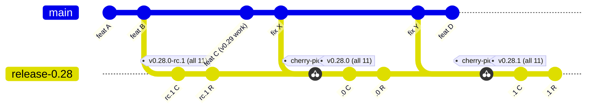
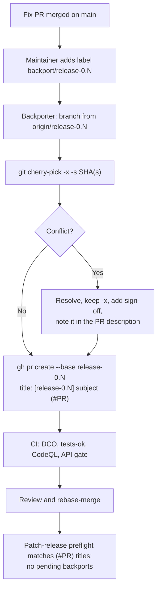
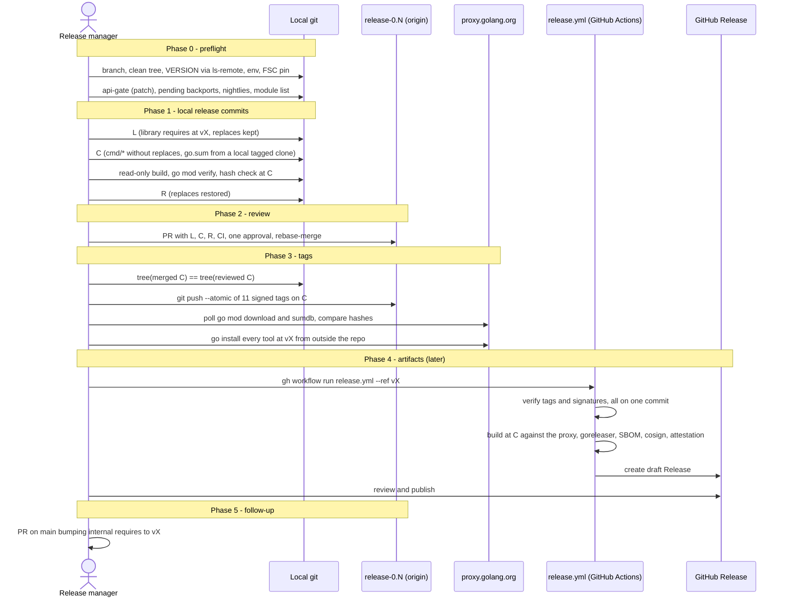
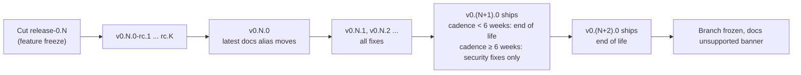
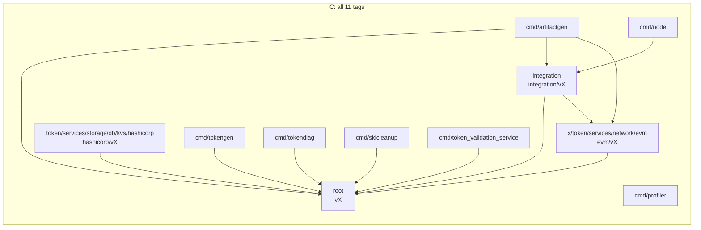
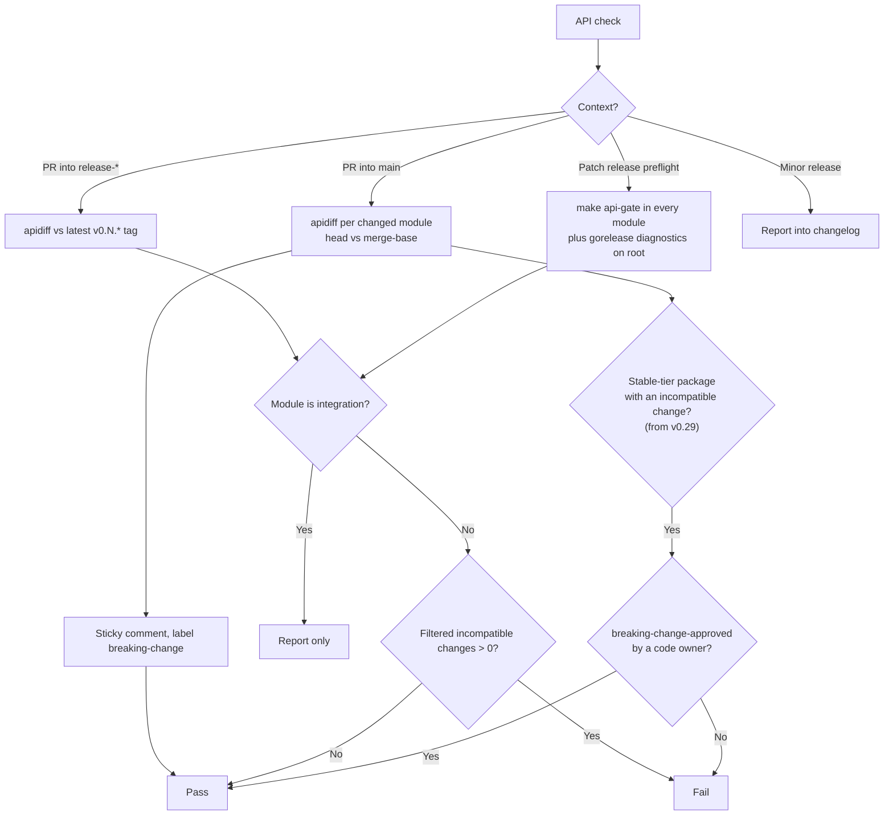
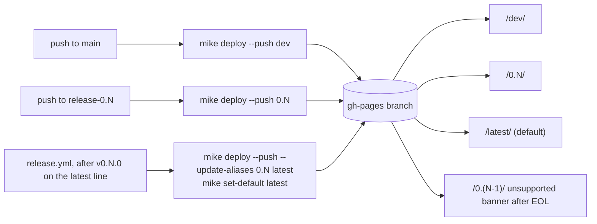

# Release Process Proposal

| | |
|---|---|
| **Status** | Draft — open for maintainer discussion |
| **Author** | Angelo De Caro |
| **Date** | 2026-11-09 |
| **Base commit** | `4e2fa180a`. Earlier checks ran on `8a27c3260` and `d8f7a82ff` (FSC v0.28.0). File:line references are against `4e2fa180a`, except in §9, which uses `69a1a48bf`. |
| **Revision** | 2026-11-09: absorbs an independent four-track review (modules, supply chain, governance, consistency). 2026-11-10: adds [§9 Path to v1.0](#9-path-to-v10), measured against `69a1a48bf` and reviewed by two independent reviewers. 2026-11-11: flow review of the whole document; evaluation period added. |

This document proposes a release process for Panurus. It uses long-lived release branches, the model of Go, Kubernetes, etcd and Moby. It also covers:

- making the `cmd/*` tools installable with `go install`;
- changelog generation and API compatibility checks with `gorelease` and `apidiff`.

The goal is agreement among maintainers. Nothing here is decided until we agree on it.

> **Evaluation period.** Once accepted, the process runs as a trial for a few months. After this evaluation period, maintainers are free to agree on updates to the process.

---

## 1. Summary

### 1.1 The problem

- Every release is a set of lightweight tags (no message, no signature) on `main`, all applied at once.
- GitHub Releases are written by hand.
- There are no release branches. None of the past "patch" releases came from a branch.
- Nothing protects tags or any branch other than `main`.
- None of the published **submodule** tags can be used by consumers without workarounds. This includes `integration`, `evm`, `hashicorp` and every `cmd/*` module. A fresh `go get` or `go install` fails for them. A consumer that also requires the root module directly can build (fabric-x-samples does).

Details and evidence: [Appendix A](#appendix-a-why-change-what-we-found-today).

### 1.2 The proposal at a glance

| Area | Proposal |
|---|---|
| Branches | `main` always holds the next minor version. Cut `release-0.N` at feature freeze. Patches are tagged only on the release branch. |
| Tags | Every module tagged in lockstep (until a core module gets its own line, [§9.5](#95-stages-1-to-3-towards-a-v1-core-module)): `v0.N.P` plus `<dir>/v0.N.P`. Tags are annotated and **SSH-signed**. RCs are tagged `v0.N.0-rc.K` on the branch. Two tag rulesets: one restricts creation to release managers, one forbids update and deletion with no bypass. |
| Tagging order | **One release commit C carries all 11 tags.** At C, the libraries require their siblings at `vX`, and the `cmd/*` modules drop their replaces and carry precomputed `go.sum` lines for `vX`. A restore commit R follows and puts the replaces back. C and R land through one PR. A module zip excludes nested modules, so the library hashes don't depend on `cmd/*` files ([§3.4](#34-tagging-order-one-release-commit-replaces-kept-for-development)). |
| Local development | **Local `replace` directives stay on `main` and on release branches.** They are dropped only at the tagged commit C. No `go.work` is needed, because a root `go.work` breaks FSC's node builder ([§3.4](#34-tagging-order-one-release-commit-replaces-kept-for-development)). |
| Versioning | Panurus versions are **decoupled** from FSC versions. Each release records its FSC pin in its notes and in a compatibility table. |
| Support | **The latest minor only**, while minors ship less than 6 weeks apart. At a 6-week or slower cadence, the previous minor also gets security fixes. |
| Backports | Every fix merges to `main` first. It is then copied to the release branch with `git cherry-pick -x -s` and merged through a PR titled `[release-0.N] <subject> (#PR)`. `release-*` PRs, including the release PR, merge by **rebase only**. **Backports are manual at first**; automation is deferred. |
| Docs | **Versioned** with `mike`: `/0.N/` per release line, `/latest/` alias, `/dev/` from `main`. **Deferred to v0.29 or later**, because the switch changes every public docs URL. |
| API gate | On patch releases and on PRs into `release-*`, the number of incompatible changes `apidiff` reports must be **zero**, except in `integration`. `gorelease` is only advisory while the version is `v0.x`. |
| Path to v1.0 | **The root module stays v0 while FSC is v0.** From v0.29, `token`, `token/token` and `token/driver` form a **stable tier** with a written promise and a code-owner gate. A separate core module may reach v1.0.0 in stages ([§9](#9-path-to-v10)). |
| Changelog | One file per release, `docs/releases/vX.Y.Z.md`. It contains the commits grouped by Conventional Commit type plus the per-module API changes from apidiff. It becomes the GitHub Release body. A short `CHANGELOG.md` index links to these files. |
| Artifacts | **Deferred to v0.29 or later** ([§7](#7-rollout-plan)). The design: `release.sh` dispatches `release.yml` **on the root tag**. A tag push can't trigger it: GitHub sends no event when more than 3 tags are pushed at once. The workflow builds from C with goreleaser (free edition). It produces binaries, checksums, an SBOM, a cosign signature and build provenance, verified against the exact signer identity `release.yml@refs/tags/vX`. It creates a draft Release. Releases are immutable once published. For v0.28.0 the GitHub Release is created by hand. |

### 1.3 What we ask maintainers to agree on

1. The seven **proposed decisions** in [§5](#5-proposed-decisions): decoupled FSC versions, support window, tools as separate modules, versioned docs, manual backports, profiler tagged and installable, and the stable tier on the path to v1.
2. The overall model: release branches, lockstep signed tags, one tagged release commit, rebase-only `release-*` PRs, `workflow_dispatch` releases.
3. The [rollout plan](#7-rollout-plan): a minimum set of PRs for `v0.28.0`, and the rest after it.
4. Answers to the [open questions](#6-open-questions).
5. Awareness of the [open risks](#10-open-risks) and the [future work](#11-future-work).

The proposal is decided by the rule in `MAINTAINERS.md`: a PR open for two weeks and a majority of active maintainers.

### 1.4 How this proposal was verified

We tested the proposal instead of only reasoning about it. All tests ran in local worktrees and local module proxies, with no commit, push or remote tag.

| How | What |
|---|---|
| **Run** | A full two-phase release, simulated through a local module proxy. **A full single-commit release through a local bare clone, run twice: by an independent reviewer (`v0.98.9`) and again by the author (`v0.97.0`), with a negative control** ([§3.4](#34-tagging-order-one-release-commit-replaces-kept-for-development)). Hash independence of the library modules against sum.golang.org records for v0.27.0. The tidy and build of the release and restore commits with `GOWORK=off`. The profiler split, including a full `profile.sh` run. The tokengen refactor. gorelease and apidiff on every module. The `go.work` failure in FSC's nwo. mike with the current pins. goreleaser across 4 modules. `cherry-pick -x -s` with DCO. buf against a tag. Retractions of old-path versions. A consumer build of fabric-x-samples. For [§9](#9-path-to-v10): apidiff history of the root module from v0.16.0, a go/types scan of FSC and other v0 types in exported signatures, and a type-check prototype of `driver.Identity` as a defined type. |
| **Checked against docs or source** | GitHub's 3-tag event limit. The `pull_request_target` change on 2026-12-02. Immutable releases. Ruleset capabilities and bypass scope. Environment tag patterns. Fulcio certificate fields. `gh attestation verify` flags. Temporary private forks. Scorecard's branch discovery. The DCO app rules. goreleaser's validate pipe. cmd/go's zip rules. etcd's `release_mod.sh`. |
| **Not verified yet** | Listed in [§6](#6-open-questions), item 10, and in [§10](#10-open-risks). |

---

## 2. The process

### 2.1 Branches and tags

- **`main`** is always the next minor version. All work, including fixes, lands on `main` first.
- **`release-0.N`** is cut from `main` at feature freeze.
    - Changes arrive through PRs only: backport PRs and the release PR ([§2.6](#26-releasing-a-version)). Nobody pushes to it directly, and the `release-*` ruleset has no bypass actor ([§3.11](#311-ci-and-github-settings)).
    - It is never deleted. When a line reaches end of life it is simply frozen.
- **RCs and the final `.0` release are tagged on the branch**, as Go and etcd do. The RCs and the final release are then the same line of commits.
- Optional: right after the cut, tag `v0.(N+1).0-alpha.0` on `main`, as Kubernetes does. Pseudo-versions on `main` then sort above the release branch. The tag must be applied to **every** module prefix, because pseudo-version bases are computed per prefix.



All 11 tags of a version sit on its release commit C: the root `v0.N.P`, the three library tags, and the seven `cmd/<tool>/…` tags. R restores the local replaces.

> **Why?** Fixes reach every line from one place, and a release line only gets reviewed, low-risk changes. RCs and the final release share history, so what was tested is what ships.
>
> **Alternatives considered:**
>
> - *Keep tagging `main`* (today): past "patches" carried new features, because `main` had moved on.
> - *Go's `release-branch.` prefix*: unusual outside Go. `release-0.N` follows Kubernetes, etcd and Prometheus.
> - *Hugo's one branch per patch*: creates branch churn.
> - *Prometheus's "fix on the release branch, then merge it into `main`"*: fits a single line, but it needs merge commits, which conflicts with linear history on `main`.

### 2.2 Contributors: day-to-day development

Little changes for contributors.

- Open PRs against `main`, as today. Fixes too.
- Keep the local `replace` directives. Do not commit a `go.work` ([§3.4](#34-tagging-order-one-release-commit-replaces-kept-for-development)).
- Never put `v0.0.0` or an unpublished version in a `require`. Internal requires point at the last published release.
- A root change that breaks another module is fixed in the same PR. The local `replace` makes every module build against the root in your working tree, so no tag is needed ([FAQ](#8-faq)).
- If your PR fixes a bug in a supported line, ask for the `backport/release-0.N` label.
- Use a Conventional Commit PR title. There is no `!` rule: apidiff, not the title, is the breaking-change signal ([§3.7](#37-api-compatibility-gorelease-and-apidiff)).
- PRs into `main` are squash-merged. PRs into `release-*` are rebase-merged ([§2.3](#23-backports)).
- Never run `/update-fsc` against a release branch.

### 2.3 Backports

**Rule:** every fix merges to `main` first, then is backported. The only exception is code that no longer exists on `main`. Such a PR goes straight to the release branch, and its description says why.

**What can be backported:** security fixes, regressions, crash or data-loss bugs, and required dependency or security bumps. CI, test and docs fixes only when a release on that line needs them. **New features and API changes cannot.** Who approves a backport is [future work](#11-future-work).

**Labels:**

| Label | Meaning |
|---|---|
| `backport/release-0.N` | A backport is requested. |

The preflight finds pending backports without a second label: a backport is done when a merged PR into `release-0.N` has a title ending in `(#orig)`.

**PR title:** `[release-0.N] fix(scope): subject (#orig)`. Keeping the Conventional Commit type inside the title lets the changelog script still parse it. The changelog parser strips the `[release-0.N] ` prefix. If the original subject already ends in `(#orig)`, don't add it twice.

**Mechanics:**

- `git cherry-pick -x -s <sha>` keeps the original author, the original sign-off and the provenance line. It adds the backporter's sign-off.
- If the original PR was rebase-merged, it may have several commits. Pick all of them, in order: `git cherry-pick -x -s <first>^..<last>`.
- **`-s` is mandatory.** The DCO app needs a sign-off that matches the author **or the committer** by name and email (`lib/dco.js`). In a simulated pick, the original sign-off didn't match the author's name. The check passed only because of the backporter's `-s`.
- **Merge method: rebase only** for `release-*` PRs, set by the `release-*` ruleset (`pull_request.allowed_merge_methods: ["rebase"]`).
- Rebase-merge rewrites the committer, and GitHub can't sign the new commits. A "require signed commits" rule is therefore incompatible with rebase-only merges. The signed tags cover the released content.

**Manual procedure (proposed decision 5):**

1. A maintainer adds `backport/release-0.N` to the merged PR on `main`.
2. The backporter runs:

    ```
    git fetch origin
    git checkout -b backport-<PR>-release-0.N origin/release-0.N
    git cherry-pick -x -s <sha>            # or <first>^..<last>
    gh pr create --base release-0.N --title "[release-0.N] <original subject> (#<PR>)" --body "Backport of #<PR>. Fixes #<issue>"
    ```

3. Before each patch release, the release manager's preflight lists merged `main` PRs labelled `backport/release-0.N` that have no matching merged `[release-0.N] … (#PR)` PR.

On conflict, the backporter resolves it, keeps `-x`, adds their sign-off, and says so in the PR description so reviewers check the resolution. It still merges by rebase.



> **Why rebase only?** The repo sets `squash_merge_commit_message: BLANK`. A squash merge would drop the `-x` line and the original sign-off. No other ruleset targets `release-*`, so nothing blocks the setting (checked).
>
> **Why manual?** It needs no `pull_request_target` workflow, so the 2026-12-02 Actions-policy change does not affect Panurus for now.
>
> **Alternatives considered:**
>
> - *Squash merge*: loses provenance and sign-off (above).
> - *`korthout/backport-action`*: the path if manual load grows. It needs SHA pinning and `label_pattern: ^backport/([^ ]+)$`. It needs a GitHub App token: PRs opened with `GITHUB_TOKEN` run CI only after a writer approves the run. It needs least-privilege permissions and must never check out PR code. It needs an Actions policy that allows `pull_request_target` for that workflow: GitHub blocks such workflows on public repositories from 2026-12-02 without one.
> - *`tibdex/backport`*: unmaintained.
> - *Mergify*: needs third-party write access.

### 2.4 Release manager: cutting a release branch

1. Decide whether `feature/zkat-snark-driver` stays out of the line (for 0.28, see [open questions](#6-open-questions)).
2. Create `release-0.N` from `main`. Only release managers can create `release-*` branches ([§3.11](#311-ci-and-github-settings)).
3. Optionally tag `v0.(N+1).0-alpha.0` on `main`, for every module prefix.
4. Create the label `backport/release-0.N`.
5. Add the line to the `dependabot.yml` `target-branch` entries (github-actions only).
6. Add the line to the scheduled ref matrices (fuzz, CodeQL, govulncheck). The new line replaces the previous one in the fuzz and CodeQL matrices at `v0.N.0`, not at the cut.

The runbook `docs/development/release.md` will hold the exact steps ([§3.11](#311-ci-and-github-settings)).

### 2.5 Release candidates

- Tag `v0.N.0-rc.K` on `release-0.N`. Use a dot before `K`, so it sorts numerically.
- **Each RC is a full release run:** one release PR (C and R) and 11 tags.
- RC exit criteria (how long an RC soaks, who signs off) are [future work](#11-future-work).
- The changelog's `PREV` for `v0.N.0` skips RCs.
- mike's `latest` alias moves only at `v0.N.0`.
- goreleaser uses `prerelease: auto`.
- **`@latest` never picks a pre-release** once a real release exists. Exception: during the first RC window, a module that has never been released (profiler) resolves `@latest` to the RC.

### 2.6 Releasing a version

The release manager runs `ci/scripts/release.sh` on `release-0.N`. It replaces `tag-release.sh` and keeps a `--dry` mode.

```
Phase 0  preflight:
         - branch is release-0.N and matches VERSION
         - working tree clean; HEAD == origin/release-0.N
         - VERSION greater than the last v0.N.* tag; vX does not exist yet,
           checked with `git ls-remote --tags` (never with the go command:
           an early lookup makes the proxy cache "not found" for up to 30 min)
         - environment: GOWORK=off; GOFLAGS, GOPRIVATE, GONOPROXY, GONOSUMDB empty;
           GOTOOLCHAIN pinned to the go directive's version
         - every go.mod is in the explicit module list; each module path read from its `module` line
         - no .gitattributes with export-ignore or export-subst (they change the zip hash)
         - FSC pinned to a tagged version or a documented commit
         - api-gate passes (patch releases)
         - no pending backports (merged main PR labelled backport/release-0.N
           without a merged "[release-0.N] … (#PR)" PR)
         - the required nightlies are green on the branch (see §3.11)
Phase 1  build the release commits locally:
         L  (optional) integration, evm, hashicorp: go mod edit -require <sibling>@vX;
            KEEP their local replaces; GOWORK=off go mod tidy && go build ./...
         C  per cmd/*: drop every replace (including tokengen's FSC cc/query and libp2p);
            go mod edit -require <sibling>@vX
            tidy against a local bare clone of the working tree, tagged vX
            (GOPROXY=direct, url.insteadOf, throwaway GOMODCACHE)
            assert: only cmd/*/go.{mod,sum} changed since L
            assert: no replace and no placeholder require in any cmd/* go.mod
            assert: `GOFLAGS=-mod=readonly go build ./... && go mod verify` passes in every cmd/*
            assert: the h1: and /go.mod h1: lines in every cmd/*/go.sum equal what
                    `go mod download -json <sibling>@vX` reports from the local clone
         R  restore the replaces from L's go.mod files; requires stay at vX;
            tidy and build pass
Phase 2  open one PR into release-0.N with commits L, C, R
         ("chore(release): vX"); CI runs on R; one approval; rebase-merge
         ("require branches to be up to date" is on)
Phase 3  tag:
         - find the merged C; require tree(merged C) == tree(reviewed C), and the same for R
         - sign the 11 tags on merged C (`git tag -s`, SSH)
         - `git push --atomic origin <the 11 tags>`  (never --tags)
         - poll with only GOPROXY=https://proxy.golang.org until `go mod download -json`
           succeeds for every module at vX; compare each .Sum with the precomputed value
           and with sum.golang.org/lookup; time out after 35 min
         - smoke test from outside the repo:
           GOWORK=off GOBIN=$(mktemp -d) go install …/cmd/<tool>@vX   (every tool)
Phase 4  (once artifacts are enabled) gh workflow run release.yml --ref vX
         → builds from C, creates the draft Release (§3.9)
         → the release manager reviews and publishes it
Phase 5  only for a final (not -rc) vX that is the highest version released:
         open a PR on main bumping internal requires to vX
```



- Each release adds two or three commits to the branch, through one PR.
- **If the merged tree differs from the reviewed tree** (the base moved), don't tag. Re-run Phase 1 on the new tip.
- **If something fails after the tag push**, the tags are permanent. Release `v0.N.(P+1)` for every module (lockstep), and retract `vX` if it is unusable ([§4](#4-corner-cases) #2).

> **Why one tagged commit?** A module zip excludes every subdirectory that has its own `go.mod`. So the hashes of root, integration and evm at `vX` don't depend on any `cmd/*` file, and C can carry them in `cmd/*/go.sum` before the tags exist ([§3.4](#34-tagging-order-one-release-commit-replaces-kept-for-development)). All tags then go out in one atomic push.
>
> **Why a PR?** It gives the release commits a second reviewer and CI before they become permanent. It also removes the need for any bypass on `release-*`. PR CI builds R, which has the replaces; C itself can only be built before the tags exist against the local clone, which Phase 1 does.
>
> **Why compare trees after the merge?** A rebase-merge creates new SHAs but keeps the tree when the base didn't move. If a commit that changes root code lands first, the root hash changes and the precomputed `go.sum` lines become wrong. That fails only when consumers fetch.
>
> **Alternatives considered:**
>
> - *Two-phase tagging* (an earlier draft): C1 gets the library tags; once they are on the proxy, C2 pins the tools and gets the `cmd/*` tags; C3 restores the replaces. It was based on the wrong premise that the `go.sum` at a tag can't contain hashes for `vX`. It also adds a "library tags pushed, cmd tags missing" failure state, a C1→C2 parent check, and goreleaser `--skip=validate`. Its one advantage: the root's public sumdb record is checked before the cmd tags exist. Keep it as the fallback if the hash check in Phase 1 ever disagrees with the proxy.
> - *Direct pushes by a bypass actor instead of a PR*: one person writes permanent tags with no review and no CI.

### 2.7 Patch releases

- Same run as [§2.6](#26-releasing-a-version) with `VERSION=v0.N.P`.
- Phase 0 runs the API gate: `make api-gate BASE=v0.N.(P-1) VERSION=v0.N.P` must report zero incompatible changes in every module except `integration`.
- Phase 0 blocks on forgotten backports until each is done or its label is removed.
- `PREV` for the changelog is the previous tag on the same line. For older lines, the Release must not become "latest" (goreleaser `release.make_latest: false`).
- Never raise the `go` directive in a patch release, **unless** a security fix requires it. Security wins, and the notes say so.
- A dependency's minor version going up is allowed only for security, and the notes say so. FSC is the exception: an FSC bug fix may bump FSC in a patch release ([§4](#4-corner-cases) #4).

### 2.8 Security releases

- Make the fix privately: a GitHub advisory with a private fork. Panurus has had a "Merge commit from fork" before.
- **A temporary private fork runs no status checks**, and its merge enforces no rules. Run the full test suite privately before merging.
- Prepare the release PR for each line before the advisory merge. Merge the advisory, then run `release.sh` right away. The fix is public from the merge until the tags are out; document that window.
- Merge to `main` and every supported branch, and release all supported lines on the same day.
- Publish the advisory with the fixed version of each line, so the Go vulnerability database and govulncheck pick them up.
- `SECURITY.md` steps 7–8 will say that a security fix is patched and tagged on every supported line.

### 2.9 Support window and end of life

Proposed decision 2:

- **While minors ship less than 6 weeks apart, only the latest line is supported.** Today a minor ships about every 12 days (8 minors from 2026-08-01 to 2026-11-02). At that pace a "previous" line would be supported for about two weeks.
- **At a 6-week or slower cadence**, the previous line also gets **security fixes only**. It reaches end of life when `v0.(N+1).0` ships.
- In v0, a security fix may require upgrading to a newer minor, which can carry API breaks. The release notes list them.
- No promise beyond that until the core module reaches v1 ([§9](#9-path-to-v10), stage 3 criterion 7). The cadence itself is [future work](#11-future-work).
- Between the cut of `release-0.(N+1)` and `v0.(N+1).0`, both branches take fixes. Keep that window short.

The known adopter (`hyperledger/fabric-x-samples`) has pinned versions 0–6 minors behind and upgrades several minors at once. A slower cadence helps it more than a second supported line.

At end of life:

- Update the `SECURITY.md` table.
- Remove the Dependabot entry and the nightly ref.
- Mark its docs version as unsupported. EOL lines stay published with an "unsupported" banner.
- Leave the branch frozen, not deleted.



---

## 3. Technical design

### 3.1 Version numbers

| Release | Tag | Where |
|---|---|---|
| Release candidate | `v0.N.0-rc.K` (with a dot, so it sorts numerically) | `release-0.N` |
| Minor | `v0.N.0` | `release-0.N` |
| Patch | `v0.N.P` | `release-0.N` |
| Security | `v0.N.P` on **each** supported line | each `release-0.N` |

- **v1.0.0** applies only to a separate core module, after stage 3 of the [path to v1.0](#9-path-to-v10). From then on `gorelease`'s exit code is that module's gate ([§3.7](#37-api-compatibility-gorelease-and-apidiff)). The root module and the other modules stay v0.
- Any later major version needs a `/vN` module path.
- v0.28.0 still shares its number with FSC v0.28.0. The numbers can diverge from v0.29 on; the v0.29.0 notes say so.

> **Why decouple from FSC (proposed decision 1)?** Today Panurus copies FSC's version numbers without documenting it ([Appendix A](#a1-versioning-and-tags)). FSC has no release branches, so a coupled Panurus patch line would have no FSC patch line to follow.
>
> **Consequences:** Panurus picks its own minor/patch numbers. Each release states the FSC version it requires and was tested with, in its notes and in `docs/releases/compatibility.md`. FSC needs no release branches. Patch lines bump FSC only through explicit backport PRs ([§4](#4-corner-cases) #4). [`versioning.md`](../development/versioning.md) and [`update-fsc.md`](../development/update-fsc.md) drop the implicit coupling.
>
> **What the FSC version means for a consumer:** it is a **minimum**. Go's minimum version selection picks the highest FSC version that anything in the consumer's build requires. The same holds for sibling Panurus modules: MVS does not enforce lockstep, so `integration@v0.28.x` with root `v0.29.x` can break. The docs tell consumers to upgrade all Panurus modules together.
>
> **Alternative considered:** *Keep versions coupled* (status quo). It is undocumented, and it ties every Panurus release to an FSC release.

### 3.2 Tags in a repository with many modules

- **Every module is tagged with the same version:**
    - `v0.N.P` for the root module;
    - `integration/v0.N.P`, `x/token/services/network/evm/v0.N.P` and `token/services/storage/db/kvs/hashicorp/v0.N.P` for the libraries;
    - `cmd/<tool>/v0.N.P` for each tool.

    The prefix must match the module's directory exactly. `tools/` is never tagged.
- **Every module is tagged even when it has no changes.** Lockstep keeps versions predictable for users. The one planned exception is the core module from stage 3 of [§9.5](#95-stages-1-to-3-towards-a-v1-core-module), which gets its own version line.
- **All 11 tags sit on the same release commit C** ([§3.4](#34-tagging-order-one-release-commit-replaces-kept-for-development)).
- **Tags are annotated and SSH-signed** by the release manager with `git tag -s`. This also satisfies OSPS-BR-06.01 (whether a signed tag alone counts is an [open risk](#10-open-risks)).
    - **SSH only, not GPG.** The verifier uses a committed `.github/allowed_signers` file (`gpg.ssh.allowedSignersFile`), which holds SSH keys only.
    - Each entry has `namespaces="git"` and a `valid-after` date. A rotated key gets a `valid-before` date instead of being deleted, so old tags still verify.
    - Each key is also uploaded to GitHub as a signing key, so GitHub shows the tags as "Verified".
    - A compromised key: add `valid-before` on `main`, re-verify the tags it signed, and say so in the next release notes.
- **A ruleset cannot require signed tags.** Its signature rule checks commits only. Signatures are enforced by `release.sh` before the push and, once artifacts are enabled, by `release.yml`. The workflow re-fetches the tags with `git fetch --force --tags`, because `actions/checkout` can turn an annotated tag into a lightweight one (actions/checkout#290). Then it runs `git verify-tag` against `.github/allowed_signers`.
- **Tags are never moved or deleted.** The module proxy and checksum database keep a version's hash forever. A bad release is fixed by a later release that retracts it. Retractions are read only from the go.mod of the **highest** version, so a retraction goes on `main` and the latest line, and is carried forward ([§3.11](#nice-to-have)).
- **Push the exact list of tags with `git push --atomic`**, never `--tags`. Then poll the proxy and checksum database ([§2.6](#26-releasing-a-version), Phase 3).
- **Use an explicit module list** in `release.sh` (`GO_MODULES`, `Makefile:45`, once profiler is added), and fail on any unknown `go.mod`. Today `find -name go.mod` (`tag-release.sh:30-36`, `Makefile:380`) also finds `go.mod` files in any nested worktree, such as one under `.claude/worktrees/`.

> **Alternatives considered:**
>
> - *Sigstore gitsign for tags*: not recommended for human-created tags, because GitHub doesn't show its signatures as "Verified".
> - *GPG signatures*: they need a separate committed keyring and a second verification path. One signing format is simpler.
> - *Tag only changed modules*: less predictable for users than lockstep.
> - *Move or delete a bad tag*: impossible in practice; the proxy and checksum database keep the hash forever.

### 3.3 Making `cmd/*` installable with `go install`

#### Verified result

We simulated a full single-commit release as `v0.97.0` on `4e2fa180a`. Tags were applied to a local bare clone, and cmd/go fetched from it directly (`GOPROXY=direct` with `url.insteadOf`), with fresh module caches. The scripts follow [§2.6](#26-releasing-a-version), Phase 1.

- At the release commit C, `GOWORK=off GOFLAGS=-mod=readonly go build ./... && go mod verify` passes in all 7 `cmd/*` modules.
- The 10 `h1:` lines for sibling modules in the `cmd/*/go.sum` files at C equal the hashes cmd/go computes when it fetches from the tagged clone.
- `go install github.com/LFDT-Panurus/panurus/cmd/<path>@v0.97.0` succeeded from outside the repo for all 8 install paths (including `token_validation_service/server`, `…/client` and `profiler`), with `CGO_ENABLED=0` and with `CGO_ENABLED=1`. `profiler/injecttracer` also installs.
- At the restore commit R, all 6 modules that had replaces tidy and build again.
- Building R with only `GOPROXY=https://proxy.golang.org` and `-mod=readonly`, as PR CI would before the tags exist, passes in all 11 modules.
- An earlier two-phase simulation (`v0.98.7`, local file proxy) reached the same install results.

#### Per-tool changes

| Tool | Imports `panurus/integration`? | CGO | Change needed |
|---|---|---|---|
| `tokendiag` | No | none (pure-Go `modernc.org/sqlite`, pgx) | On `main`: require the last release (`v0.27.0`) and keep the `replace`. At C: drop the `replace` and require `vX`. |
| `skicleanup` | No | none | Same as `tokendiag`. |
| `tokengen` | **Only for driver-identifier `var`s, in 5 files (6 imports)** (`cobra/pp/fabtokenv1/gen.go:16`, `cobra/pp/zkatdlognoghv1/gen.go:18`, `cobra/pp/zkatdlognoghv1/update.go:16`, `cobra/certfier/keypairgen.go:14`, `main_test.go:17-18`) | none | **Refactor (verified):** move the vars into a local `drivers` package. Tidy then drops `panurus/integration` and 8 indirect deps (go.mod 134→124 lines); build, vet, test and `go mod verify` pass. It still needs FSC `integration` (`cobra/pp/cc/cc.go:18-19`, packager). |
| `artifactgen` | Yes, by design (it generates NWO networks) | none | At C: drop the replaces; require root, `integration` and `evm` at `vX`. |
| `node` | Yes (test/demo node) | none | At C: drop the replaces; require `integration vX`. |
| `token_validation_service` | No (root plus FSC benchmark) | none | At C: drop the `replace`. **The module root is not `package main`**; document `…/token_validation_service/server@vX` and `…/client@vX`. |
| `profiler` | No | none | Not tagged yet. Its `go.mod` must be fixed first. See below. |

**Profiler (proposed decision 6: tag and install it).**

- **It does not build today.** `cmd/profiler/go.mod` has no `require`, and `injecttracer/main.go:18` imports FSC `pkg/utils/errors`. `GOWORK=off go build ./...` fails with "no required module provides package". Fix: require FSC and commit a `go.sum`. Profiler then depends on FSC.
- `1bd48d2db` already moved inject-tracer to `cmd/profiler/injecttracer/` as its own `package main`, without a build tag. `profile.sh:141` and `README.md:168` already use it.
- **Still to do:** move `auto-instrument.go` (`package main`, `:26`) and its test into `cmd/profiler/autoinstrument/`, matching the `injecttracer` naming. Change `profile.sh:196` to `go run ./autoinstrument`, and update `README.md:159,168`.
- `Makefile:311,326,328` only calls `profile.sh` and needs no change.
- Install paths become `…/cmd/profiler/autoinstrument@vX` and `…/cmd/profiler/injecttracer@vX`.
- Add it to `GO_MODULES` (`Makefile:45`) only after the `go.mod` fix; otherwise `make checks` fails.

**CGO.** No tool needs CGO. PKCS#11 support is behind `//go:build pkcs11`, and `disabled.go` is built by default. Document that `-tags pkcs11` requires CGO.

#### The FSC `cc/query` and `host/libp2p` replaces

They are in `cmd/tokengen/go.mod:8-9` and `hashicorp/go.mod:7-8`.

- **Why they exist:** FSC's published `integration` `go.mod` requires those submodules at the placeholder `v0.0.0-000…` (still true for `integration@v0.28.0`, `go.mod:15-16`). A local `replace` like FSC's own is ignored when someone else depends on the module.
- **What breaks without them:** builds and tests pass. Only `go list -m all` and `make update-dep` (`Makefile:419`) fail.
- **What to do:**
    - Drop them from `tokengen` at C, and restore them at R; `go install` refuses any `replace`.
    - After the refactor, tokengen gets no concrete versions through Panurus `integration`, so `go list -m all` still fails there (verified). This failure comes from FSC. Builds and installs are not affected. **Fix upstream in FSC.**
    - Until then, `make update-dep` should use `go list -m -e all` (not tested).
    - **hashicorp must stop importing FSC `integration` from non-test code.** `vault_kvs_test_utils.go:20` imports FSC `integration/nwo/common/docker`, but the file name does not end in `_test.go`, so it is part of the library. Every consumer of hashicorp inherits FSC's placeholders, and its `go list -m all` fails (verified with a simulated consumer). Its helpers are used only by hashicorp's own tests. Rename it to `vault_kvs_utils_test.go` (verified: `go vet` passes without the FSC replaces, and the consumer's `go list -m all` passes). Its FSC `cc/query`/`libp2p` replaces can then go.

#### The same trap inside Panurus

The published `integration` module requires `evm v0.0.0` and `panurus v0.0.0`. `hashicorp` requires an old-path pseudo-version (`go.mod:12`).

- Builds and installs still succeed. `go list -m all` fails in `node` and `tokengen`, and `go get …/hashicorp@v0.27.0` fails.
- **Fix on `main` (rollout PR 3):** every internal require in `integration`, `evm`, `hashicorp` and all `cmd/*` modules points at the **last published release** (`v0.27.0` today), with the replaces kept.
    - Checked: the 9 non-root modules other than `profiler` and `tools` pass tidy and build with `GOWORK=off`. All except `cmd/node` also pass `go list -m all`.
    - `cmd/node` fails `go list -m all` on the `evm v0.0.0` that comes in through the published `integration`, until v0.28.0 is out.
- **Never** put `v0.0.0` or an unpublished version in a require. Placeholders end up published in library tags. Unpublished versions break tidy and gorelease.

### 3.4 Tagging order: one release commit, replaces kept for development

The tools require the libraries at the version being released. Their `go.sum` must hold the hashes of those versions.

**Key fact (verified):** a module zip excludes every subdirectory that contains its own `go.mod`. So the hash of root, `integration` or `evm` at `vX` depends only on that module's own files, never on `cmd/*`. C can therefore carry the `vX` hashes in `cmd/*/go.sum` before any tag exists.

How it was checked:

- **Against the public checksum database.** In a scratch clone we committed changes to `cmd/tokengen/main.go` and `cmd/tokengen/go.sum` on top of v0.27.0, and moved the v0.27.0 tags there. cmd/go, fetching directly from that clone, computed the same root and `integration` hashes as sum.golang.org records for v0.27.0 (`h1:E4nC…`, `h1:6YK4…`).
- **Negative control.** A one-line change in a root file (`token/actions.go`) changed the root hash (`h1:tUtL…`). So the check does detect root changes.
- **End to end.** The `v0.97.0` simulation in [§3.3](#33-making-cmd-installable-with-go-install).
- **Zip rules.** Symlinks and the `forge-std` gitlink are left out by both cmd/go and the proxy, and submodules inherit the root `LICENSE`; v0.27.0 had all of these and still matched. One latent difference: cmd/go overrides `export-ignore`/`export-subst` in `.gitattributes`, and other zip tools don't. Compute the hashes with cmd/go from a local clone, and reject such attributes in Phase 0.

| Option | Verdict |
|---|---|
| (a) One release commit C with all 11 tags, then a restore commit R | ✅ **Adopted.** |
| (b) Two-phase tagging: library tags on C1; once they are on the proxy, `cmd/*` tags on C2; C3 restores | ⚠️ **Fallback only.** It works, but it adds a failure state (library tags permanent, cmd tags missing), a C1→C2 topology check, and goreleaser `--skip=validate`. Its advantage: the public root hash is known before the cmd tags exist. |
| (c) Require a pseudo-version of the same commit | ❌ Impossible: a `go.mod` cannot contain the hash of its own commit. |
| (d) Merge every `cmd/*` tool into the root module | ❌ **Rejected (proposed decision 3).** |
| (e) Root `go.work` instead of replaces | ❌ **Rejected.** See below. |
| (f) Keep replaces everywhere, drop them only at C | ✅ **Adopted.** |

etcd is not a model for this part. Its `release_mod.sh` tags every module on one commit, but its tagged `go.mod` files keep local replaces (for example `etcdctl/go.mod` at v3.6.0), so its tools are not `go install`-able at the tag. The C/R design is Panurus's own.

> **Why separate tool modules (proposed decision 3)?** The tools stay separate modules. The cost is the release and restore commits for every release, including each RC. All seven `cmd/*` modules get tags.
>
> **Alternative considered:** *merge the tools into root* would avoid C and R. It is rejected by this proposed decision; maintainers can revisit it in the discussion.

**Why not `go.work` (verified):**

- FSC's `nwo/fsc/fsc.go:849-891` (`NodeCmdPackage`, FSC v0.28.0) runs `go list -m -f '{{.Path}}|{{.Dir}}'` and splits the output once. In workspace mode that prints all 11 modules. The resulting package path is `"../../../…/integration/token/fungible/dlog/out/cmd/alice"`, which is garbage. Every integration test that builds FSC nodes is affected. Report this upstream to FSC: it should use `go env GOMOD` or `GOWORK=off`.
- Workspace mode changes root's dependency graph (`fabric-chaincode-go/v2` v2.3.0 → a newer pseudo-version).
- A partial workspace (`. + cmd/skicleanup`) fails with "ambiguous import genproto/…/errdetails".
- `integration/nwo/token/platform.go:42` builds tokengen by import path, but `Platform.TokenGen()` (`platform.go:198`) has no callers, so it doesn't matter.

**Consequences of keeping the replaces:**

- CI, the nwo harness and `make` targets keep working with `GOWORK=off`, as they do today.
- On `main` and `release-*`, every internal require points at the last published release ([§3.3](#33-making-cmd-installable-with-go-install)). `release.sh` opens a small PR on `main` after each final release to bump these requires to `vX`.
- On branches, CI checks that the replaces are present and that no require is a placeholder.
- The "no `replace` in `cmd/*`" check runs **at tag time**: in `release.sh` on C, and again in `release.yml` on the commit the tags point to.
- PR CI cannot build C itself before the tags exist; it builds R. `release.sh` builds C against the local tagged clone, and `release.yml` rebuilds C against proxy.golang.org.
- [`development.md`](../development/development.md) will say that `go.work` is unsupported and must never be committed.

**Module dependencies at the release commit:**



Arrows point from a module to what it requires at `vX`. At C the libraries keep their local replaces, and the `cmd/*` modules have none. `cmd/profiler` requires no other Panurus module. `tools/` is never tagged.

### 3.5 Reporting the version of an installed binary

- `go install pkg@ver` does not record `vcs.*` build settings. The installed `tokengen version` therefore prints `Version: (, , )`, even though `go version -m` shows the module version.
- **Fix:** read `debug.ReadBuildInfo().Main.Version`, and fall back to the `vcs.*` settings when it is `(devel)`. No `-ldflags -X` is needed.
- Put this in a shared helper and add a `version` command to every tool.

### 3.6 Go version policy

- Users on an older Go automatically download 1.27.3, because the default is `GOTOOLCHAIN=auto`.
- Document the minimum Go version, and **never raise the `go` directive in a patch release**, unless a security fix requires it. A security-fixed dependency that declares a newer `go` forces `go mod tidy` to raise Panurus's. Security wins, and the notes say so.
- Don't add `toolchain` lines. A `go get` with a newer local Go adds one, so CI rejects them.
- Stdlib vulnerabilities reach the binaries through the Go version that builds them, not through the `go` directive. Build releases with the latest Go patch release.

### 3.7 API compatibility: gorelease and apidiff

#### Measured behaviour

| | gorelease | apidiff |
|---|---|---|
| Modules it works on | **Root only** today. Submodules fail because the **published base** carries placeholder requires. Fixing the requires (PR 3) does not help the next comparison. gorelease works on submodules only once both base and head carry the fix: from v0.28.0→v0.28.1 on (verified). | All modules (it resolves through the local `replace`). |
| Root module, per run | 11–14 s | About 10 s per ref to write export data (`-w`, about 6 MB); 0.9 s to compare two export files. |
| Exit code usable as a gate in v0 | **No.** With `-base=v0.27.0 -version=v0.27.1` it prints "valid" and exits 0 despite 10 incompatible changes. | **No.** It always exits 0. |
| Where the base comes from | GOPROXY, so the base must be a published tag; a PR's merge-base is impossible. | Any git worktree. |
| Version suggestion | Only when the base is the latest tag of its major version, so it fails on release branches; always pass `-version`. | n/a |
| Measured changes | v0.26→v0.27: 3 incompatible / 17 compatible · v0.27→HEAD: 10 incompatible / 30 compatible | Same |

**How gorelease picks a version in v0:**

- A **patch** bump is suggested only when there are no API changes and no change to requirements.
- A requirement counts as changed when a dependency's minor version goes up or the `go` directive goes up. For example, v0.26→v0.27 bumped grpc from 1.84 to 1.85, which on its own forces a minor bump.

**Breaking-change markers in commits:**

- **No commit uses them in practice.** Since v0.24.0 only one commit message matches `!`/`BREAKING`, while apidiff found 38 incompatible changes in the same range.
- Therefore **apidiff is the source of the breaking-change signal**, not commit messages.

> **Why apidiff as the gate?** It works on every module, takes any worktree as base, and its output can be counted. Our script supplies the exit code.
>
> **Alternatives considered:**
>
> - *gorelease as the gate*: its exit code is 0 in v0 even with incompatible changes, it works on root only until v0.28.0→v0.28.1, and its base must be a published tag. It stays advisory in v0 (see the gates below).
> - *Commit-message markers*: nobody uses them (1 marker vs 38 incompatible changes).

#### Gates

| Context | Gate |
|---|---|
| PR into `main` | apidiff in module mode for each changed module, PR head vs merge-base, using worktrees. Post a sticky comment and add the `breaking-change` label automatically. **No failure**, except in the stable tier (row below). No title rule: the label feeds the changelog. |
| PR into `release-*` | Same comparison against the latest `v0.N.*` tag. **Fail** on any filtered incompatible change. **Exception: `integration` is report-only.** It is test infrastructure, and a break that matters fails the `cmd/*` builds through their local replaces anyway. |
| Patch release (`release.sh` Phase 0) | `make api-gate BASE=v0.N.(P-1) VERSION=v0.N.P` reports zero incompatible changes in every module **except `integration`**, which is report-only as for PRs. Also run `gorelease -base … -version …` on root for diagnostics, and warn when a requirement's minor version went up. |
| Minor release | Report only. The API changes go into the changelog. |
| PR into `main` touching the stable tier (from v0.29) | apidiff on `token`, `token/token`, `token/driver`. **Fail** on any incompatible change until a code owner applies `breaking-change-approved`. `.apidiff-allow` does not apply ([§9.4](#94-stage-0-stable-tier-in-v0)). |
| Core module from v1.0.0 | `gorelease`'s exit code becomes the gate. |



#### Noise and blind spots

| Problem | Mitigation |
|---|---|
| Mocks (57 `mock`/`mocks` dirs produced 39 of 174 changes), `testutils`, and the `integration` module's exported `Test*` helpers | Neither tool can exclude packages. Filter with `(^\|/)(mocks?\|fakes?\|testutils)(\.\|/\|:\|$)` plus the `integration` `Test*` pattern. A simpler regex misses `package …/mock: added` lines and wrongly matches names like `fakeidentity`. Show the filtered changes collapsed in a `<details>` block. |
| A module path rename (hashicorp) shows up as **0 changes** | Have the script compare the `module` line of `go.mod` between base and head, and print **MODULE PATH CHANGED**. |
| Splitting a package into its own module (`cmd/profiler`) shows up as "package removed" | Allow-list package removals that moved to a new module. |
| Adding a method to an interface is always reported as incompatible (e.g. `ratelimit.Configuration.GetRateLimitIdleTimeout`) | An `.apidiff-allow` file for interfaces that consumers never implement. It needs review, and it never applies to the stable tier ([§9.4](#94-stage-0-stable-tier-in-v0)). |
| Only one build configuration is seen per run | Run a second pass with `GOFLAGS=-tags=pkcs11` and CGO enabled, which shows 4 incompatible and 4 compatible differences. Run on `GOOS=linux` in CI. |
| Generics: loosening a constraint is flagged, but **tightening one (`any`→`comparable`) is not reported** | Review by hand; mention it in the docs. |
| A new module with no base version (profiler) | gorelease's base is `none`. apidiff is skipped and the module is listed as "new". With lockstep tagging it goes straight to `v0.28.0`, skipping `v0.1.0`, which is acceptable. |
| Retracted versions | gorelease reports only *dependencies* that were retracted. List retractions in the changelog by hand. |
| `golang.org/x/exp` has no tags | Pin both tools in `tools/tools.go` and `tools/go.mod` at the pseudo-version root already uses (`v0.0.0-20261014143641-f0251eb4aa3e`). Re-check the output format whenever it is bumped. |

#### CI cost

- About 1–2 minutes for the root module and about 3–4 minutes for all modules.
- Cache the base export files with `actions/cache`, keyed on the base commit SHA. Combined with `setup-go`'s cache, that roughly halves the time.

### 3.8 Changelog

**Two sources feed it:**

1. **Commits.** Run `git log --format=%s PREV..NEW`. Map each commit to its PR with `gh api repos/LFDT-Panurus/panurus/commits/{sha}/pulls`. Don't rely on a `(#N)` suffix: rebase merges are allowed and used, for example a969d028a, 3bace3d93 and 7b0dc28ce. Skip the release commits (L, C, R). Group the commits as follows:

    | Section | Commits |
    |---|---|
    | ⚠️ Breaking | from apidiff, cross-referenced to the PRs |
    | Features | `feat` |
    | Fixes | `fix` |
    | Performance | `perf` |
    | Docs | `docs` |
    | CI/Build | `ci`, `build` |
    | Dependencies | `chore(deps)`, `Bump*` |
    | Other | anything that doesn't match (about 8%) |

    Authors and links come from `gh pr view`.

2. **API changes for each module.** The gorelease verdict (root only), then the apidiff incompatible and compatible lists grouped by package, plus the collapsed mock/test block.

**Where it lives:**

- `docs/releases/vX.Y.Z.md`: the complete notes for one release.
- `CHANGELOG.md`: an index of links.
- The GitHub Release body comes from goreleaser `--release-notes docs/releases/vX.Y.Z.md`, once artifacts are enabled. Don't also call `gh release create`. Until then the Release is created by hand from the same file.

**For a patch release:**

- `PREV` is the previous tag *on the same line* (`git describe --tags --abbrev=0 --match 'v0.N.*'`).
- If GitHub's notes API is used (for the manual v0.28 Releases), pass `previous_tag_name`; otherwise it compares against the newest tag globally.
- On older lines the Release must not become "latest": goreleaser `release.make_latest: false`, or `gh release create --latest=false` for a manual Release.

**Proposed commands:**

```
make api-report [BASE=v0.27.0] [HEAD=HEAD] [MODULES=…] [TAGS=pkcs11] [FORMAT=md|json]
make api-gate   BASE=v0.28.1 VERSION=v0.28.2       # exit 1 on any filtered incompatible change
make changelog  VERSION=v0.28.0 [PREV=v0.27.0]      # writes docs/releases/v0.28.0.md
make release    VERSION=v0.28.0 [DRY=1]             # ci/scripts/release.sh (§2.6)
```

These go in `ci/scripts/api-report.sh` and `ci/scripts/changelog.sh`. Base them on the `go-api-report` skill's worktree/tag logic, which ran across all 11 modules in about 2 minutes. That skill currently lacks:

- an explicit `BASE`;
- filtering;
- JSON output;
- an exit code usable as a gate;
- caching;
- pinned tool versions.

> **Why a script and one file per release?** It merges commit data with the per-module apidiff results, which no generic tool has.
>
> **Alternatives considered:**
>
> - *git-cliff*: not needed; the script groups by Conventional Commit type and gets authors and links from `gh pr view`.
> - *GitHub's auto-generated notes* (today): an optional `.github/release.yml` keeps the "Generate release notes" button in the GitHub UI useful. The current labels describe topics, not change types, so they can't drive the sections.
> - *A single large `CHANGELOG.md`*: it would conflict when edited on several release branches.

### 3.9 Release artifacts and supply chain

**Deferred to v0.29 or later** ([§7](#7-rollout-plan)). Panurus ships no binaries today, and `go install` covers users. Deferring this regresses no OpenSSF criterion that is Met today. v0.28.0 uses a manual GitHub Release with the signed tags. This section is the design for later.

The workflow `.github/workflows/release.yml` is triggered by **`workflow_dispatch` with input `version`**, run **on the root tag**: `gh workflow run release.yml --ref vX`. `release.sh` starts it in Phase 4.

- A dispatch on a branch would run the branch tip, which may differ from C, and its copy of `release.yml` and `allowed_signers`. A dispatch on the tag runs C's copy, which the tag rulesets make immutable.
- `workflow_dispatch` needs the workflow file on the **default branch** as well. Keep `release.yml` on `main` and on every release branch, and backport changes to it.

1. **Gate and harden the job.**
    - A `release` environment with a deployment policy for the **tag** pattern `v0.*`. Patterns don't match `/`, so `v0.*` excludes the submodule tags. Required reviewers are optional. The environment gates no secret: keyless signing needs only `id-token: write`, which any workflow can request. The real controls are the tag rulesets ([§3.11](#311-ci-and-github-settings)) and the exact signer identity (step 5).
    - Validate the `version` input against `^v0\.[0-9]+\.[0-9]+(-rc\.[0-9]+)?$` and against `GITHUB_REF`. Pass it through `env:`, never as `${{ inputs.version }}` inside `run:`.
    - A `concurrency:` group per version. Fail if a Release for the tag already exists.
    - Top-level `permissions: {}`. Give `contents: write`, `id-token: write` and `attestations: write` only to the publish job.
    - No Go build cache (`cache: false`): caches can be written by other runs.
    - Pin the goreleaser, syft and cosign **versions** and verify their checksums. The actions are SHA-pinned, but the tools they install default to "latest".
2. **Verify the tags.**
    - All 11 tags exist and point at the same commit C, which is `GITHUB_SHA`.
    - The tags are re-fetched with `--force`, and `git verify-tag` passes against `.github/allowed_signers`.
    - No `cmd/*` `go.mod` at C contains a `replace`.
    - Every `cmd/*` module builds at C against proxy.golang.org with `-mod=readonly`, and `go mod verify` passes.
3. **Check out C** (the root tag).
4. **Build with goreleaser (free edition).**
    - One `.goreleaser.yaml` with a per-build `dir:` for each of the 7 modules. Verified with goreleaser v2.20.0 on 4 modules; no `go.work` is needed.
    - Set `GORELEASER_CURRENT_TAG=vX` and `GORELEASER_PREVIOUS_TAG` explicitly. Without them goreleaser picked `x/token/services/network/evm/v0.99.0`, which is not semver.
    - All tags sit on HEAD, so goreleaser's validation runs normally; no `--skip=validate`.
    - Gitignore `dist/`. A stray build output such as `cmd/node/node` makes the tree dirty.
    - Set `release.target_commitish: release-0.N` so Scorecard sees the branch, `prerelease: auto`, and `make_latest: false` on older lines. Notes come from `--release-notes docs/releases/vX.Y.Z.md`.
5. **Produce these outputs:**
    - `checksums.txt`;
    - an SBOM per archive (Syft);
    - a keyless cosign signature, `checksums.txt.sigstore.json`;
    - build provenance from `actions/attest-build-provenance`, also uploaded as `*.intoto.jsonl` for the 10/10 Scorecard "Signed-Releases" score.

    The certificate records the workflow `…/release.yml@refs/tags/vX`, the ref `refs/tags/vX` and C's SHA. **Verify against that exact identity.** `--signer-workflow` alone is not enough: it ignores the ref, so a writer could run their own `release.yml` from any branch and pass it.

    ```
    gh attestation verify <file> -R LFDT-Panurus/panurus \
      --cert-identity https://github.com/LFDT-Panurus/panurus/.github/workflows/release.yml@refs/tags/vX \
      --source-ref refs/tags/vX --deny-self-hosted-runners
    cosign verify-blob --bundle checksums.txt.sigstore.json \
      --certificate-identity https://github.com/LFDT-Panurus/panurus/.github/workflows/release.yml@refs/tags/vX \
      --certificate-oidc-issuer https://token.actions.githubusercontent.com checksums.txt
    ```
6. **Create the draft Release** in the same run, upload every asset, and let the release manager publish it soon after. Any writer can create a Release for a tag that has none, so don't leave the gap open. Enable **immutable releases** first; today every release shows `immutable: false`. Immutability protects only the Release's own tag; the other 10 tags rely on the tag rulesets.

**Scope:**

- **There is one GitHub Release per version**, on the root tag.
- **The repo builds no Docker images.** The monitoring images used in tests are pinned (`Makefile:193-197`).

> **Why `workflow_dispatch`?** GitHub creates no event when more than three tags are pushed at once, and a release pushes 11.
>
> **Alternatives considered:**
>
> - *Tag-push trigger*: never fires for an 11-tag release.
> - *Dispatch on the release branch*: runs the tip, not C, and records `refs/heads/release-0.N` in the provenance.
> - *goreleaser Pro*: monorepo support is paid-only. With all tags on one commit, the free edition is enough.
> - *`slsa-github-generator`*: unmaintained, and it must be pinned by tag. `actions/attest-build-provenance` is used instead.

### 3.10 Versioned docs

Proposed decision 4: versioned docs with `mike`. `/dev/` from `main`, `/0.N/` per line, a `latest` alias, on a `gh-pages` branch. **Deferred to v0.29 or later**: the cutover changes every public docs URL, which is a user-visible change of its own.



- Add `mike` (hash-pinned) to `requirements.txt`.
- `docs.yml`: on `main` run `mike deploy --push dev`. On `release-0.N` run `mike deploy --push 0.N`. The `latest` alias can't come from `docs.yml`: it has no tag trigger, and an 11-tag push creates no event. `release.yml` runs `mike deploy --push --update-aliases 0.N latest` plus `mike set-default latest` after `v0.N.0` on the latest line. Until `release.yml` exists, the runbook has it as a manual step.
- Add `release-*` to the `docs.yml` triggers (`:4-16`) and to the deploy conditions (`:63,67,73`).
- Regenerate `requirements.txt` with `uv pip compile --generate-hashes -c <current pins>`. That adds only mike 2.2.0, verspec, pyparsing and inversion. An unconstrained recompile bumps 12 packages. Add the missing trailing newline to `requirements.in`.
- `mkdocs.yml`: add `extra.version.provider: mike`. Verified with material 9.7.7: `mkdocs build --strict` passes, and the `mike deploy`/`set-default` commands produce the expected `gh-pages` content.
- `edit_uri` doesn't matter: no edit button is rendered unless `content.action.edit` is enabled. Enable it only if per-branch edit links are wanted.
- mike pushes from `main` and `release-*` share the existing `pages` concurrency group.
- EOL lines stay published, with an "unsupported" banner.
- A docs fix on a release line is backported like code. The docs workflow redeploys `/0.N/` on push to the branch.

**The live site is Jekyll, not MkDocs.** Pages is `legacy` from `main` `/` ("Jekyll v3.10.0"). `/docs/development/general.html` returns 200, and `/development/general/` returns 404. The Actions deploy "succeeds" but has never been served. The switch therefore changes every URL.

**Cutover:**

1. Deploy `gh-pages` with mike.
2. Flip the Pages source to `gh-pages` (`PUT /repos/…/pages`). The `github-pages` environment may need to allow `gh-pages` (not tested).
3. Remove the `deploy-pages` jobs.
4. Add redirect stubs for the old `/docs/*.html` URLs.

> **Alternatives considered:**
>
> - *Stay on Jekyll* (the site actually served today): it ignores the MkDocs site and has no versions.
> - *Unversioned MkDocs from `main`*: users of an older line would read docs for code they don't run.

### 3.11 CI and GitHub settings

#### Must change

1. **`tests.yml`:**
    - add `release-*` to the triggers at `:5` and `:7`;
    - extend `itest` at `:202` with `startsWith(github.base_ref,'release-') || startsWith(github.ref,'refs/heads/release-')`;
    - the `fsc-version` default at `:11` only matters for `workflow_dispatch` (the input is empty on push and PR). It is `required: true` (`:12`), so an empty default forces input on every dispatch; make it `required: false` with an empty default;
    - add a check that the replaces are present and no internal require is a placeholder (the no-replace check runs at tag time, [§3.4](#34-tagging-order-one-release-commit-replaces-kept-for-development));
    - add a check that rejects `toolchain` lines in any `go.mod`;
    - add a `tests-ok` aggregator job that `needs:` every job, runs with `if: always()`, and fails unless every result is success or an intended skip. Required checks name **jobs**, not workflows: there is no "Tests" check, only `checks`, `lint`, `utest (…)`, `itest (…)` and so on (`tests.yml:27-429`). Require `tests-ok`;
    - run buf against the last `v0.N.*` tag as well as the branch tip.
2. **`nightly-fsc.yml` and `bump-fsc`:** guard with `if: github.ref == 'refs/heads/main'`, and never bump a release branch to FSC `main`. **Fix the current nightly failure before the first cut.**
3. **`checks.mk:169`:** on a release branch, default `BUF_BREAKING_AGAINST` to `.git#tag=$(git describe --tags --abbrev=0 --match 'v[0-9]*.[0-9]*.[0-9]*' --exclude '*-*')`.
    - That syntax was verified with buf 1.74.0.
    - Exclude pre-releases, because `v[0-9]*` also matches `v0.10.0-cbdc.1`.
    - CI needs `fetch-depth: 0` or fetched tags; shallow clones have none.
    - The current default `.git#branch=main` already fails in a clone without a local `main`.
    - Update `AGENTS.md:19` to match.
4. **`Makefile:377-382`:** add a guard so `update-all-deps-latest` refuses to run on `release-*`.
5. **Rulesets:**
    - a **branch ruleset on `refs/heads/release-*`**, with **no bypass actor**:
        - no deletion and no force-push;
        - PRs required with at least one approval, merge method **rebase only**;
        - "require branches to be up to date" (`strict_required_status_checks_policy: true`), so the release PR's tree is the merged tree;
        - required checks: `DCO`, `tests-ok` and `CodeQL`, each pinned to its app with `integration_id`, as 5047032 does;
        - linear history;
        - at least as strong as `main`'s rules. Scorecard takes the minimum Branch-Protection score across the branches it sees. It finds release branches **only** through the Release `target_commitish`, which is why `release.yml` sets it. `main` requires 0 approvals today, so it caps the score whatever the release branches do;
    - a separate **branch ruleset restricting creation** of `refs/heads/release-*` to the release-managers team (bypass). Otherwise any writer can create a `release-x` branch;
    - **re-enable ruleset 5047032** for `main`. It targets only `~DEFAULT_BRANCH`, so it does not depend on CodeQL running on `release-*`;
    - **two tag rulesets on `refs/tags/v*` and `refs/tags/**/v*`**. A bypass actor bypasses every rule in its ruleset, so one ruleset can't both let the team create tags and stop it from moving them:
        - *tag-create*: restricts creation; bypass for the release-managers team;
        - *tag-immutable*: restricts update and deletion, and blocks non-fast-forward; **no bypass actor**;
        - **a ruleset cannot require signed tags** ([§3.2](#32-tags-in-a-repository-with-many-modules));
    - once artifacts are enabled, a **`release` environment** with a deployment policy for the tag pattern `v0.*` ([§3.9](#39-release-artifacts-and-supply-chain)).
6. **Release-manager role:** create the `panurus-release-managers` team, with at least two members. Record who holds signing keys in `.github/allowed_signers` (a committed file, added by PR) and in `MAINTAINERS.md`. Add a `CODEOWNERS` entry for `.github/**` and, from v0.29, for the stable tier (`token/`, `token/token/`, `token/driver/`, [§9.4](#94-stage-0-stable-tier-in-v0)). Require code-owner review in the `release-*` ruleset, so `allowed_signers` and `release.yml` can't change on a line without a maintainer.
7. **Labels:** add `breaking-change`, and from v0.29 `breaking-change-approved` ([§9.4](#94-stage-0-stable-tier-in-v0)). Create the `backport/release-0.N` label at each cut.
8. **Versioned docs:** see [§3.10](#310-versioned-docs).

#### Should change

- **`codeql-analysis`, `md_links`, `protect-integration-test-types`:** add `release-*` to the triggers.
- **Scheduled `codeql` and `nightly-fuzz`:** use a ref matrix covering `main` and the **latest** release branch. A new line replaces the previous one at `v0.N.0`, not at the cut.
    - The Phase 0 check "nightlies green" means: fuzz, CodeQL and govulncheck for the latest line; govulncheck only for an older supported line.
    - For fuzzing on the release branch, use a shorter `fuzztime`.
    - Include the ref in the fuzz job's issue title (`:331`) and cache key (`:289-291`).
- **`dependabot.yml`:** add `target-branch: release-0.N` entries for github-actions only. Go modules stay out of scope, as the file's header explains. Add and remove the entries at each cut and end of life.
- **Vulnerability scanning on release lines:** govulncheck runs only on push and PR. Add a scheduled govulncheck job over a ref matrix of the supported `release-*` branches.
- **FSC compatibility table (proposed decision 1):** add `docs/releases/compatibility.md` listing each Panurus line and its FSC pin. Remove the implicit "same version as FSC" expectation from [`update-fsc.md`](../development/update-fsc.md).
- **[`SECURITY.md`](../../SECURITY.md):** add a supported-versions table. Say in steps 7–8 that a security fix is patched and tagged on every supported line.
- **Docs to update or add:**
    - rewrite [`versioning.md`](../development/versioning.md) as the actual policy;
    - add a backport section to [`general.md`](../development/general.md); it hardcodes `main` at `:7,54-63,129,212`. Also replace its title example `Add user management (#123)` (`:92-93`) with a Conventional Commit title;
    - add a release-branch variant to [`update-fsc.md`](../development/update-fsc.md); it hardcodes `main` at `:32,184` and documents the FSC replaces at `:50-66`;
    - mention backport PRs in `CONTRIBUTING.md:22` and `DEVELOPMENT.md:47-51,94`;
    - document `tag-release`/`release` in [`makefile.md`](../development/makefile.md);
    - update the stale "Assessed release v0.17.0" in `docs/openssf/README.md:65` and `docs/openssf/baseline_level_{1,2,3}.md:7`. Add tag-verification instructions (`git verify-tag` against `allowed_signers`) for OSPS-DO-03.01/03.02;
    - document the minimum Go version (§3.6) and that `-tags pkcs11` needs CGO (§3.3).
- **`feature/zkat-snark-driver`** (36 ahead, 28 behind, in the CI triggers): decide before the cut whether it stays out of 0.28 and merges after.
- **New runbook `docs/development/release.md`** covering the cut, RC, release, patch, security release (two lines means two full runs; budget the time), end of life, and how to verify a release. Link it from `AGENTS.md`, and add a `.claude/skills/release/SKILL.md` symlink per the runbook rule. Record the wall-clock time of the first dry run in it.

#### Nice to have

- `CODEOWNERS`, using the `panurus-maintainers` team (`MAINTAINERS.md:32`).
- A PR template with "Backport to: release-0.N" checkboxes.
- Issue templates for a release checklist and a backport request.
- Turn the version field in `bug_report.yml:67-70` into a dropdown of supported lines.
- **Retract the unusable tags, starting with v0.28.0 (verified possible).** Go reads retractions only from the go.mod of the **highest** version and never parses the broken ones.
    - Root module: `retract [v0.1.0, v0.13.0]`. These are the old-path versions. `v0.10.0-cbdc.1` falls inside the range, so it needs no line of its own.
    - hashicorp: `retract [v0.14.2, v0.27.0]`, the wrong-path versions.
    - Consider the other submodules too: the `integration`, `evm` and `cmd/*` tags up to v0.27.0 can't be used either.
    - **Add the `retract` blocks on `main` before the cut**, so the cut carries them, and keep them in every later version. A retraction added only on an older line has no effect once a newer minor exists.
    - Effect: they disappear from `go list -m -versions`, `go list -m -u`, pkg.go.dev and Dependabot/Renovate. `@latest` is unaffected.
- Add milestones by version (`v0.28.1`), or record version tracking by label.

> **Why retract?** The proxy lists all the old tags, and a retraction hides them (verified). The cbdc tag is old-path too.
>
> **Alternative considered:** *Leave the old tags as they are*: they stay visible in version lists, pkg.go.dev and update bots, although none of them can be used.

---

## 4. Corner cases

| # | Case | Handling |
|---|---|---|
| 1 | A bad tag has been pushed | Never retag. Release the next version with `retract`, on the newest line ([§3.2](#32-tags-in-a-repository-with-many-modules)). Immutable releases also burn the tag name. |
| 2 | Something fails after the tag push (proxy hash differs, `go install` fails) | All 11 tags are permanent. Release `v0.N.(P+1)` for every module (lockstep) and retract `vX` if it is unusable. If the hash check ever disagrees with the proxy, switch to two-phase tagging ([§3.4](#34-tagging-order-one-release-commit-replaces-kept-for-development)) until the cause is known. |
| 2b | The branch moved before the release PR merged | "Require branches to be up to date" forces a rebase. The tree then differs from the reviewed one, so `release.sh` refuses to tag and re-runs Phase 1 on the new tip. |
| 3 | Security fix on several lines | Make it privately (GitHub advisory with a private fork). Private-fork merges skip CI and rules, so test privately first. Prepare each line's release PR, merge to `main` and every supported branch, then release all lines on the same day ([§2.8](#28-security-releases)). |
| 4 | FSC needs a fix on a released line | Versions are decoupled. Bump FSC on the branch only through a `[release-0.N] chore(deps): …` PR, preferably to an FSC tag; otherwise pin an FSC commit and state it in the notes and the compatibility table. An FSC bug fix is an allowed exception to the "minor bumps only for security" rule. Never run `/update-fsc` against a release branch. Who owns FSC fixes for a Panurus line is [future work](#11-future-work). |
| 4b | FSC releases a new minor during a Panurus patch line | Not taken on the branch unless it carries a needed fix. gorelease warns about the minor bump (#7). |
| 5 | A backport needs an API change | Not allowed; the gate blocks it. Defer it to the next minor, or add the API without breaking the existing one. |
| 6 | A backport conflicts | The backporter resolves it, keeps `-x`, adds their sign-off, and notes it in the PR description so reviewers check the resolution. It merges by rebase. |
| 6b | A backport is forgotten | The patch-release preflight lists merged `main` PRs labelled `backport/release-0.N` with no merged `[release-0.N] … (#PR)` PR, and blocks until each is done or the label is removed. |
| 7 | A dependency's minor version goes up in a patch release | gorelease warns. Allow it only for security (and FSC fixes, #4), and say so in the notes. If it raises the `go` directive, security still wins. |
| 8 | A new module appears between releases | Tag it at the lockstep version, list it as "new" in the changelog, and add it to `GO_MODULES` (`Makefile:45` currently omits `cmd/profiler`). |
| 9 | A module is removed or renamed | apidiff can't see it, so the script's `go.mod` path check catches it. Old tags remain on the proxy forever, so document their status. |
| 10 | A tool is installed with an old Go | `GOTOOLCHAIN=auto` downloads 1.27.3. Never raise the `go` directive in a patch release, except for security. |
| 11 | A nightly job finds a bug on a release branch | The fuzz and CodeQL ref matrix opens an issue that includes the ref. The fix goes to `main` first, then is backported. |
| 12 | Release line reaches end of life | Update the `SECURITY.md` table, remove the Dependabot entry and the nightly ref, mark its docs version as unsupported, and leave the branch frozen, not deleted. |
| 12b | A docs fix on a release line | Backport it like code. The docs workflow redeploys `/0.N/` on push to the branch. |
| 13 | Building at a tag | C has no `cmd/*` replaces and requires published versions, so `GOWORK=off go build` works. `release.sh` checks it before tagging, against the local clone. |
| 13b | A backport merges between C and R | Impossible: C and R land in the same rebase-merge. |
| 13c | Someone uses a local `go.work` | It is gitignored (`.gitignore:6-7`), so it can't be committed by accident. Locally it breaks FSC's node builder ([§3.4](#34-tagging-order-one-release-commit-replaces-kept-for-development)); the dev docs warn about this. |
| 14 | Profiler is tagged for the first time | It goes straight to the lockstep version (`cmd/profiler/v0.28.0`). Fix its `go.mod` and finish the split first ([§3.3](#33-making-cmd-installable-with-go-install)). |
| 15 | `token_validation_service` is not `package main` at the module root | Document the `…/server` and `…/client` install paths. |
| 16 | More than 3 tags pushed at once | No push event is created. That's why `release.yml` uses `workflow_dispatch`. |
| 17 | A release in the RC window | Each RC is a full run. A never-released module resolves `@latest` to the RC. `latest` docs and the changelog `PREV` ignore RCs. Phase 5 (bump `main`) is skipped for RCs. |
| 17b | The optional alpha tag on `main` | Tag every module prefix. Until `v0.N.0` ships, `cmd/profiler@latest` resolves to the alpha, because it sorts above the RC. |
| 18 | A module with no changes | It is still tagged (lockstep). |
| 19 | A patch on an older line | Phase 5 is skipped: bumping `main`'s requires to an older version would downgrade them. Its Release is not marked "latest". |
| 20 | A request for `vX` before the tag exists | The proxy may cache "not found" for up to 30 minutes. Phase 0 checks tags with `git ls-remote` only; the poll in Phase 3 times out after 35 minutes. |

---

## 5. Proposed decisions

The author proposed decisions 1–6 on 2026-11-08 and revised them on 2026-11-09 after the review. Decision 7 was added on 2026-11-10. They need maintainer agreement.

| # | Question | Proposed decision | Consequences |
|---|---|---|---|
| 1 | Panurus and FSC versions | **Decouple.** | Panurus picks its own numbers and records the FSC pin per release ([§3.1](#31-version-numbers)). |
| 2 | Support window | **Latest minor only while minors ship less than 6 weeks apart. At a 6-week or slower cadence, the previous minor also gets security fixes only.** No promise beyond that until the core module reaches v1. | `SECURITY.md` table lists the supported lines. Nightly fuzz/CodeQL ref matrix covers `main` plus the latest line. A security fix may require a minor upgrade in v0 ([§2.9](#29-support-window-and-end-of-life)). |
| 3 | Tools in the root module | **Separate modules.** | A release commit C and a restore commit R ([§2.6](#26-releasing-a-version)) for every release, including each RC. All seven `cmd/*` modules get tags. |
| 4 | Docs | **Versioned, with `mike`, after v0.28.0.** | `/dev/` from `main`, `/0.N/` per line, `latest` alias, `gh-pages` branch ([§3.10](#310-versioned-docs)). Every public docs URL changes at the cutover. |
| 5 | Backports | **Manual at first.** | One label plus a documented cherry-pick procedure ([§2.3](#23-backports)). No `pull_request_target` workflow, so the 2026-12-02 Actions-policy change does not affect Panurus for now. |
| 6 | Profiler | **Tag and install it.** | Fix its `go.mod`, then move `auto-instrument.go` into `cmd/profiler/autoinstrument/`, next to the existing `injecttracer/` ([§3.3](#33-making-cmd-installable-with-go-install)); add to `GO_MODULES` (`Makefile:45`). |
| 7 | Path to v1.0 | **7a, for agreement now:** the root module stays v0 while FSC is v0; from v0.29 `token`, `token/token` and `token/driver` form a stable tier with a written promise. **7b, direction only:** a separate core module may reach v1.0.0 through stages 1–3, each decided by its own issue. | `versioning.md` states the promise; `Stability:` line in every package doc; CODEOWNERS and a `breaking-change-approved` gate for the tier ([§9](#9-path-to-v10)). |

---

## 6. Open questions

For the discussion:

1. Do we agree on the seven proposed decisions in [§5](#5-proposed-decisions)?
2. Who joins `panurus-release-managers` (at least two people), and who holds signing keys (`.github/allowed_signers`, `MAINTAINERS.md`)?
3. Does `feature/zkat-snark-driver` (36 ahead, 28 behind) stay out of 0.28 and merge after the cut?
4. Do we tag `v0.29.0-alpha.0` on `main` right after the cut (optional, Kubernetes style, every module prefix)?
5. Do we retract the unusable old tags, starting with v0.28.0 ([§3.11](#nice-to-have))? Only root and hashicorp, or all submodules?
6. Milestones by version (`v0.28.1`), or version tracking by label?
7. Do we want per-branch edit links in the docs (`content.action.edit`)?
8. At what manual load do we adopt `korthout/backport-action`?
9. Who reports the two FSC upstream issues: placeholder requires in FSC `integration`, and `NodeCmdPackage` in workspace mode?
10. Items not yet verified (to close during rollout):
    - whether the `github-pages` environment needs `gh-pages` allowed;
    - `go list -m -e all` as the `update-dep` fix;
    - the full goreleaser config with all 7 modules, cosign and the attestation (only 4 modules were built);
    - a real proxy.golang.org and sum.golang.org run of a release. The simulations used local proxies and local bare clones;
    - a real Fulcio certificate from a tag-dispatched run, and the error when `release.yml` is missing at the dispatched tag;
    - whether a temporary private fork can open a PR against `release-*`;
    - whether a signed tag alone satisfies OSPS-BR-06.01;
    - how Scorecard scores branch protection when a ruleset has bypass actors;
    - for [§9](#9-path-to-v10): the leak scanner ignores types used only in function bodies, non-default build tags and behavioural coupling (FSC error sentinels); churn was measured from v0.16.0 only, on the root module only, without `pkcs11`; the fabric-x-samples figures and whether it builds against HEAD; the stage 1 effort beyond the type-check prototype.

---

## 7. Rollout plan

Each PR needs an issue per [`AGENTS.md`](../../AGENTS.md). The `cmd/*` replaces stay on `main`. The rollout has two stages: the minimum needed to ship `v0.28.0`, and the rest after it.

### 7.1 Before v0.28.0

| # | PR | Depends on |
|---|---|---|
| 1 | **Fix the nightly FSC update** (no successful run since 2026-08-31) | — |
| 2 | **Policy docs:** rewrite `versioning.md` (decoupled versions, branches, tags, support window, RCs, the stable-tier promise of [§9.4](#94-stage-0-stable-tier-in-v0), effective from v0.29, FSC rule); `SECURITY.md` supported-versions table and steps 7–8; backport section and title example in `general.md`; `docs/releases/compatibility.md`; release-branch variant of `update-fsc.md`; "never commit `go.work`" note; minimum Go version and `pkcs11` CGO note; `CONTRIBUTING.md` and `DEVELOPMENT.md` backport mentions | — |
| 3 | **Module hygiene:** every internal require → last published release (`v0.27.0`), replaces kept; hashicorp `vault_kvs_test_utils.go` → `_test.go`, then drop its FSC replaces; tokengen `drivers` refactor (5 files); profiler `go.mod` fix (FSC require, `go.sum`); `go list -m -e all` in `make update-dep`; CI checks for "replaces present, no placeholder requires, no `toolchain` lines"; the `retract` blocks on `main` (if agreed) | — |
| 4 | **GitHub settings, part 1** (maintainers, by hand): `panurus-release-managers` team (≥ 2); `breaking-change` label; immutable releases; `CODEOWNERS` for `.github/**`; plus a PR adding `.github/allowed_signers` | — |
| 5 | **CI for release branches:** triggers (tests, CodeQL, md_links, protect-*), `itest` gate, `tests-ok` aggregator, `fsc-version` input, FSC guards, buf base with tags fetched, `checks.mk` default and `AGENTS.md:19`, `update-all-deps-latest` guard | 1 |
| 6 | **GitHub settings, part 2** (maintainers, by hand): `release-*` ruleset (no bypass, rebase only, up to date, `tests-ok`/DCO/CodeQL, code-owner review); `release-*` creation ruleset; the two tag rulesets; re-enable ruleset 5047032 for `main` | 4, 5 |
| 7 | **Release script:** `ci/scripts/release.sh` (preflight, explicit module list, L/C/R built against a local tagged clone, hash check, release PR, tree check after merge, SSH-signed tags, `git push --atomic`, proxy and sumdb polling, `go install` smoke test, follow-up PR on `main`, `--dry`). Replaces `tag-release.sh`; `make release` replaces `make tag-release` (`Makefile:445-450`); update `makefile.md` | 3, 6 |
| 8 | **Runbook:** `docs/development/release.md` (cut, RC, release, patch, security, EOL, manual backport, verification, release-manager role, manual GitHub Release and notes); link from `AGENTS.md`; `.claude/skills/release/SKILL.md` symlink | 7 |
| 9 | **Dry run, then release:** decide on `feature/zkat-snark-driver`; cut `release-0.28`; create its label and Dependabot entry; run `v0.28.0-rc.1` end to end; verify `go install` of every tool from outside the repo; then release `v0.28.0` with a manual GitHub Release | all above |

### 7.2 After v0.28.0

| # | PR | Depends on |
|---|---|---|
| 10 | **Profiler split:** move `auto-instrument.go` into `autoinstrument/`; update `profile.sh:196`, the README and `GO_MODULES`; shared version helper and `version` command in every tool | 3 |
| 11 | **API tooling:** pin `apidiff`/`gorelease` in `tools/`; `ci/scripts/api-report.sh`, `changelog.sh` (PR lookup via API, strips `[release-0.N]`); `make api-report`, `api-gate`, `changelog`; the filter regex; `.apidiff-allow`; `integration` report-only in both gates; `CHANGELOG.md` index. `api-gate` can run by hand before this PR as a preflight | — |
| 12 | **API-diff PR job** and scheduled govulncheck/fuzz/CodeQL ref matrices for release branches | 5, 11 |
| 13 | **Release workflow:** `release.yml` (tag dispatch, `release` environment with tag policy, input validation, permissions, tag/signature checks, build against the proxy, goreleaser, SBOM, cosign, attestation, draft); `.goreleaser.yaml` with pinned tool versions; `dist/` in `.gitignore`; verification docs with the exact signer identity | 6, 7 |
| 14 | **Versioned docs:** mike in `requirements.txt` (constrained recompile), `docs.yml` deploys per branch, `mkdocs.yml` version provider, the `latest` alias step in `release.yml`, Pages source flip and `github-pages` environment, redirect stubs | 13 |
| 15 | **OpenSSF docs:** update the assessed release and the BR-06.01, DO-03.x, DO-04/05 and QA-02.02 rows | 9 |
| 16 | **Stable tier** ([§9.4](#94-stage-0-stable-tier-in-v0)): `Stability:` lines in package docs, CODEOWNERS for the tier, the `breaking-change-approved` label and required check. Merge before the `release-0.29` cut. Stages 1–3 get their own issues. | 4, 6, 11, 12 |

The automated backport workflow is deferred until the manual load justifies it.

---

## 8. FAQ

**Why can't we just tag `main` like today?**
`main` already holds the next minor's features. Past "patches" (v0.8.1, v0.10.1, v0.12.1, v0.14.1, v0.14.2, v0.15.1) were tagged on `main`, had no matching `.0`, and contained new features. And today's submodule tags can't be consumed at all ([Appendix A](#a2-submodules-cannot-be-used-by-consumers-without-workarounds)).

**Why a release commit and a restore commit?**
At the tag, the tools must require the libraries at `vX` with no replaces, so `go install` works. A module zip excludes nested modules, so the libraries' `vX` hashes don't depend on the tool files, and C can carry them in `go.sum` before the tags exist. R then restores the local replaces for development ([§2.6](#26-releasing-a-version), [§3.4](#34-tagging-order-one-release-commit-replaces-kept-for-development)).

**Why not `go.work`?**
A root `go.work` breaks FSC's `NodeCmdPackage`, which every integration test that builds FSC nodes uses. It also changes root's dependency graph, and a partial workspace fails with an ambiguous import ([§3.4](#34-tagging-order-one-release-commit-replaces-kept-for-development)).

**If I change the root module and the EVM driver (or another submodule) stops compiling, do I need a tag first?**
No. Fix both modules in the same PR. Tags are only needed at release time.

Each submodule keeps its local `replace` to the root directory (for example `replace github.com/LFDT-Panurus/panurus => ../../../../..` in `x/token/services/network/evm/go.mod`). The `replace` makes the submodule build against the root code in your working tree, whatever version the `require` line names. The `require` line only says which published version a consumer gets when the `replace` is ignored.

So the flow on `main` is:

1. Change the root module.
2. In the same PR, update `x/token/services/network/evm` (and any other affected module) so it compiles again.
3. CI runs `go vet` in every module in `GO_MODULES` (`checks.mk:62-68`), so a broken submodule fails the PR.
4. Merge. No tag, no `go.mod` version bump.

We verified this. With `evm` requiring `v0.27.0` and the `replace` kept, adding a method to `driver.Network` in the root made `evm` fail at once (`network.go:85: *Network does not implement driver.Network`). The root's local code was used, not v0.27.0.

The `require` version matters only at release time. The release commits rewrite the library and tool requires to the new `vX` ([§2.6](#26-releasing-a-version)). After the release, a small PR on `main` bumps the requires to `vX`, so the next release starts from a published version.

Why replace `v0.0.0-00010101000000-000000000000` with a real version, then? The placeholder is harmless locally, because the `replace` hides it. But it is published inside the submodule's tag, and consumers can't resolve it ([Appendix A](#a2-submodules-cannot-be-used-by-consumers-without-workarounds)). A real published version resolves for everyone.

**Why not merge the tools into the root module?**
It would remove the release and restore commits. Proposed decision 3 keeps them as separate modules; this is open for discussion.

**Do I need to do anything different as a contributor?**
Barely. PRs still target `main`. Ask for a backport label on fixes for supported lines. Use a Conventional Commit title. Don't commit `go.work`, and don't put placeholder versions in requires ([§2.2](#22-contributors-day-to-day-development)).

**Who can release?**
Members of the `panurus-release-managers` team. They alone can create tags and `release-*` branches. Nobody, not even they, can move or delete a tag. The release commits go through a reviewed PR like any other change. Today anyone with write access (18 collaborators) could push a tag.

**What happens if a release goes wrong?**
Tags are never moved or deleted. Before the tag push, `release.sh` stops and nothing is permanent. After it, a bad release is fixed by the next version for all modules, with `retract` on the newest line ([§4](#4-corner-cases) #1, #2).

**Why is v0.28 the first release branch?**
Every `hashicorp` tag up to v0.27.0 has the wrong module path, fixed only in `8a27c3260`. `cmd/profiler` became a separate module in the same commit. A `release-0.27` branch would inherit the broken paths.

**Does this slow down development on `main`?**
No. `main` keeps its replaces and its workflow. The additions are an apidiff PR check that comments and labels but never fails on `main` (after v0.28.0), except for stable-tier packages from v0.29 ([§9.4](#94-stage-0-stable-tier-in-v0)), and one small PR after each final release bumping internal requires to `vX`.

**Why rebase-only for backports?**
The repo's squash setting (`squash_merge_commit_message: BLANK`) drops the `-x` provenance line and the original sign-off ([§2.3](#23-backports)). It also keeps the release PR's commits C and R separate, so the tags can point at C.

**Why is `integration` exempt from the API gate?**
It is test infrastructure. A break that matters already fails the `cmd/*` builds through their local replaces. The exemption applies to PRs into `release-*` and to the patch-release preflight alike.

**Why not support two release lines from the start?**
A minor ships about every 12 days today. A previous line would be supported for about two weeks, and the known adopter skips several minors at once anyway. Two lines start to pay off at a 6-week or slower cadence ([§2.9](#29-support-window-and-end-of-life)).

---

## 9. Path to v1.0

This section backs proposed decision 7 ([§5](#5-proposed-decisions)). The root module stays v0 while FSC is v0. Maintainers agree now on a **stable tier** inside v0 (7a, [§9.4](#94-stage-0-stable-tier-in-v0)). They endorse a staged direction towards a v1 **core module** (7b, [§9.5](#95-stages-1-to-3-towards-a-v1-core-module)). Each stage is decided by its own issue and PR.

Measurements below are against `69a1a48bf`, with apidiff in module mode and the mocks/`testutils` filter of [§3.7](#37-api-compatibility-gorelease-and-apidiff).

### 9.1 What v1 would mean

- A `v1.0.0` tag promises that no exported identifier of **any** package in the module breaks until `/v2` ([go.dev](https://go.dev/doc/modules/version-numbers)). The promise is per module.
- v1 still allows change ([module compatibility](https://go.dev/blog/module-compatibility)):
    - **Additions** ship in minors: new packages, functions, types, methods on concrete types, and struct fields ([go.dev](https://go.dev/doc/modules/version-numbers)). apidiff reports them as compatible.
    - **Deprecation** ships in a minor ([SemVer](https://semver.org/) item 7): a `// Deprecated:` paragraph in the Godoc that names the replacement ([go.dev wiki](https://go.dev/wiki/Deprecated)). The identifier stays and keeps working.
    - **Removal** of a deprecated identifier needs `/v2`.
- Two additions break anyway:
    - A new method on an exported interface. apidiff reports it as incompatible. Add a new interface and detect it with a type assertion, or keep an unexported method in the interface so nobody outside can implement it.
    - A field of non-comparable type (slice, map, func) in a comparable struct. apidiff reports "old is comparable, new is not".
- The root module has 191 non-mock packages and about 6,850 exported identifiers. None is under `internal/`, so v1 would freeze all of them.
- From v0.16.0 to HEAD, apidiff reports **244 incompatible changes** in the root module.

### 9.2 Where the API breaks

| Layer | Packages | Exported ids | Breaks v0.16→HEAD | Breaks v0.24→HEAD |
|---|---|---|---|---|
| `token`, `token/token` | 2 | ~430 | 7 | 1 |
| `token/driver` | 5 | ~615 | 5 | 0 |
| `token/sdk` | 7 | ~63 | 6 | 0 |
| `token/core` (fabtoken, zkatdlog) | 39 | ~1,265 | 14 | 4 |
| `services/ttx` (+ interop, nfttx) | 9 | ~520 | 53 | 2 |
| `services/storage` | 40 | ~1,330 | 93 | 4 |
| `services/network` | 23 | ~745 | 27 | 4 |
| `services/selector` | 7 | ~190 | 20 | 14 |
| `services/identity` | 24 | ~940 | 11 | 1 |
| other¹ | — | — | 8 | 2 |

¹ Without the two `cmd/profiler` "package removed" lines, which [§3.7](#37-api-compatibility-gorelease-and-apidiff) allow-lists as a move. The 32 filtered breaks since v0.24 compare with the 38 unfiltered ones in §3.7.

- `token`, `token/token` and `token/driver` are close to stable. `token/driver` has not broken since v0.21.
- `token/sdk` is not: it exposes `services/network` and FSC's `dig` and `endpoint`.
- Storage, selector and network still churn.
- The known adopter (fabric-x-samples) imports 18 root packages, including `ttx`, `storage/db/driver` and four `network/fabricx` packages. 83 of the breaks hit them, none since v0.26.

### 9.3 Why FSC blocks v1

A v1 API that exposes v0 types is only as stable as those types. OpenTelemetry states the rule for its modules: a stable module must not depend on an experimental one ([OTel VERSIONING.md](https://github.com/open-telemetry/opentelemetry-go/blob/main/VERSIONING.md)).

- **1,133 exported identifiers** in 105 of 191 root packages mention an FSC type.
- 30 of the breaks above come from FSC types. For example, `finality.Delivery` embeds an FSC type and lost seven methods when FSC changed.
- FSC has 38 tags, all `v0.x`. It ships a minor every 1–2 weeks, has no release branches and no compatibility promise. Its v0.28.0 lists 12 breaking changes.
- 25 of the last 41 FSC bumps in Panurus also changed non-test `.go` files.
- FSC has no v1 plan. "FSC at v1" is not a criterion Panurus controls.

| Kind | Identifiers | FSC types | Removable by Panurus? |
|---|---|---|---|
| **Thin** | 716 | `view.Identity` (491), `logging.Logger`, `iterators.Iterator`/`Reducer`, `lazy.Provider`, `view.Context`/`View` as handles | Yes, with Panurus-owned types and small interfaces |
| **Deep** | 417 | `view.Session`, FSC storage drivers and SQL config, `platform/fabric`, `platform/fabricx`, metrics | No, not without rewriting `services/*`. The view framework is their programming model. |

- `token`, `token/token` and `token/driver` have **thin leaks only**.
- A v1 core would still **require** FSC v0, because [AGENTS.md](../../AGENTS.md#coding-standards) mandates FSC's `pkg/utils/errors`. That package returns plain `error`, so it leaks no type. The criteria treat it as the one allowed FSC import.
- The other direct v0 dependencies don't block the tier, because none of their types appears in its signatures:
    - `IBM/mathlib` (205 identifiers), `IBM/idemix` (40), `fabric-protos-go-apiv2` (9), `fabric-x-common` (2) and `golang.org/x/exp` (1) leak only into packages that stay v0: zkatdlog, `identity/idemix`, the fabric and fabricx network code, and `services/benchmark`.
    - `gnark-crypto`, `pprof`, `pgxlisten`, `golang.org/x/crypto` and `golang.org/x/sync` leak nowhere.
    - The tier imports `IBM/mathlib` and `gnark-crypto` through `services/utils`, but leaks none of their types.
    - An import without a leak is still a build risk. MVS may select a newer v0 minor of a dependency that breaks the tier's build, without changing its API ([§10](#10-open-risks) #11).

> **Why a stable tier and not v1 now?** The core is stable in practice, but its signatures expose FSC and its packages import `services/*` and `token/core`. A v1 tag today would be broken by the next FSC bump.
>
> **Alternatives considered:**
>
> - *Stay v0 with no promise*: adopters get no stability signal. Kubernetes `client-go` and Cosmos SDK stay v0 by choice, but both document what they keep stable.
> - *v1 for the whole root module*: it freezes storage, selector and network, and inherits FSC's churn. It would need `/v2` soon.
> - *Wait for FSC v1*: outside our control. It stays a trigger to revisit the services layer ([§9.6](#96-what-stays-v0)).

### 9.4 Stage 0: stable tier in v0

From v0.29:

- **Stable tier:**
    - **API** for consumers: `token`, `token/token`.
    - **SPI** for driver authors: `token/driver`.
- Every other package is experimental. A `Stability:` line in each package doc says which. `…/mock` packages are excluded from the promise.
- **Promise**, written in `versioning.md`:
    - Patches never break the tier. The apidiff gate in [§3.7](#37-api-compatibility-gorelease-and-apidiff) already enforces this.
    - A minor removes or changes a tier identifier only after a `// Deprecated:` notice that names the replacement. The notice stays for **at least one minor and 90 days**. This holds for the API and the SPI.
    - One exception: the SPI may add methods to interfaces in a minor. The notes announce it, because every driver must implement them.
    - A break caused by an FSC bump cannot be deprecated. The notes list it under "Breaking changes".
- **Gate** on PRs into `main`: an apidiff incompatible change in a stable-tier package fails a required check. The check passes once a code owner of that path applies `breaking-change-approved`. The code owner applies it only when the break followed the promise or comes from an FSC bump.
    - CODEOWNERS covers the tier's directories.
    - `.apidiff-allow` does not apply to the tier.
    - Tightened generic constraints are still not reported; review them by hand.

**Exit:** three minors **and** at least 3 months with no tier break, except ones that followed the promise.

### 9.5 Stages 1 to 3: towards a v1 core module

The order: stage 0 exits. Stage 1 lands one announced break on purpose, and the stage 0 clock restarts. Stage 2 starts when the clock exits again. Stage 3 follows its entry criteria.

#### Stage 1: remove FSC and services types from the tier

- Make `driver.Identity` a defined type (`token/driver/wallet.go:21`), with the six `view.Identity` methods.
    - In a prototype this gave at least 209 type errors in 53 files. Most are in `ttx` (89), fabtoken (33) and `core/common` (26).
    - Some FSC types no longer satisfy Panurus interfaces. For example, `*endpoint.Service` no longer satisfies `token.Binder`. These need adapters.
    - An alias cannot be deprecated into a defined type. It lands as one announced break, before a new stage 0 clock starts.
- Replace the four `iterators.Iterator[...]` aliases (`token/driver/vault.go:48-54`) and `iterators.Reducer` (`token/token/quantity.go:88`) with Panurus interfaces.
- Replace `logging.Logger` and `view.View` in `token`'s exported API with local interfaces.
- Cut the tier's imports:
    - `token/driver`: `services/utils` (with `protos` and `slices`).
    - `token`: `services/logging`, `services/storage/integrity`, `services/utils`, `token/core`, `token/core/common/meta`.
- CI check: no FSC or other v0 type in any exported signature of the tier. FSC `pkg/utils/errors` is the only allowed FSC import.

**Exit:** the check passes, and stage 0's exit holds again after the break.

#### Stage 2: move the tier into its own module

- Use a **fresh path prefix**, for example `github.com/LFDT-Panurus/panurus/api`, not an existing package path.
- A module at an existing path, such as `token/driver`, gives consumers an "ambiguous import" whenever they select an older root.
- The core module imports nothing from root, including test helpers and mocks. Root requires the core.
- The old paths keep forwarding declarations with `// Deprecated:` for one minor and at least 90 days: type aliases for types, wrappers for funcs, vars and consts.
- `token/driver/protos-go/*` moves too. Only one generated copy may exist, or proto registration conflicts.
- Release mechanics change ([§3.4](#34-tagging-order-one-release-commit-replaces-kept-for-development)):
    - The tag count goes from 11 to 12.
    - Root's `go.mod` and `go.sum` change at commit C. The hash-independence result was verified with root unchanged, so it must be re-run.

**Exit:** one minor released with the core module, and a fabric-x-samples branch builds against it.

#### Stage 3: core module at v1.0.0

- Only the core module goes to v1. Root, `integration`, evm, hashicorp and `cmd/*` stay v0 and keep lockstep among themselves.
- The core module gets its own version line, `release-1.M` branches and its own changelog `PREV`. It is tagged only when it changes. `release.sh` gets a second version input, and the `v0.*` patterns must not match core tags.
- `gorelease`'s exit code becomes the core's gate ([§3.7](#37-api-compatibility-gorelease-and-apidiff)). The v0 modules keep the apidiff gate.
- The stage 0 promise changes ([§9.1](#91-what-v1-would-mean)):
    - Deprecated identifiers stay until `/v2`. The 90-day removal rule no longer applies.
    - The SPI no longer adds methods to existing interfaces. New methods go in new interfaces, detected with a type assertion.

**Entry criteria (all required):**

| # | Criterion | Check |
|---|---|---|
| 1 | No v0 type in any exported signature. v0 requires are allowed only if pinned and listed: FSC `pkg/utils/errors` and, through `services/utils` until it is cut, `IBM/mathlib` | Stage 1 CI check |
| 2 | Stage 0's exit holds for the core module | apidiff history |
| 3 | Maintainer API review: option structs or functional options where growth is expected. API and SPI interfaces do not gain methods; growth goes through new interfaces ([§9.1](#91-what-v1-would-mean)). | Review checklist in the PR |
| 4 | Godoc on every exported identifier, and a `Stability:` line in every package doc | Lint |
| 5 | Fuzz targets on every exported parser ([AGENTS.md](../../AGENTS.md#fuzz-testing)) | Nightly fuzz matrix |
| 6 | At least two adopters in `ADOPTERS.md` with a public reference. Production use is a signal, not a gate. | `ADOPTERS.md` |
| 7 | A v1 support window, written in `SECURITY.md`. It starts from the cadence rule in [§2.9](#29-support-window-and-end-of-life) and is decided in the stage 3 issue. | `SECURITY.md` |

The core module excludes `token/core`, so the zkatdlog driver and its mathlib API stay v0.

### 9.6 What stays v0

`token/sdk`, `token/core`, and `services/*` (ttx, storage, network, selector, identity and the rest) stay v0. Revisit them when FSC reaches v1 or the deep leaks are gone.

---

## 10. Open risks

Risks that remain after the design and the simulations. Each has a mitigation, but none is fully closed.

| # | Risk | Why it matters | Mitigation |
|---|---|---|---|
| 1 | **A precomputed hash differs from the public one.** | All 11 tags go out in one push. If the hash that proxy.golang.org computes for root, `integration` or `evm` at `vX` ever differs from the line in `cmd/*/go.sum`, every tag is burned and the next version is needed for all modules. | Compute the hashes with cmd/go from a local tagged clone, as the proxy does. Reject `.gitattributes` with `export-ignore`/`export-subst`. Compare with sum.golang.org right after the push. Fall back to two-phase tagging if a mismatch ever happens ([§3.4](#34-tagging-order-one-release-commit-replaces-kept-for-development)). |
| 2 | **No real proxy run yet.** | All release simulations used local proxies and bare clones. Proxy timing, negative caching and sumdb behaviour for new tags are taken from the proxy FAQ, not observed. | The first `v0.28.0-rc.1` is the first real run. Treat it as a test and don't announce it before Phase 3 passes. |
| 3 | **CI never builds C itself before the tags exist.** | PR CI builds R, which has the replaces. C can only be built before tagging against the local tagged clone. | `release.sh` builds C read-only against the local clone; the post-push `go install` smoke test, and later `release.yml`, rebuild C against proxy.golang.org. A failure there falls under risk 1. |
| 4 | **The base moves between review and merge.** | A rebase over a commit that changes root code keeps the PR mergeable but breaks the precomputed root hash. The failure shows only when consumers fetch. | "Require branches to be up to date" on `release-*`, and the tree-equality check before tagging ([§2.6](#26-releasing-a-version)). |
| 5 | **Bus factor.** | Two people cut almost every release today (17 of the last 20 Releases by one person). Signing keys, the release-managers team and approvals all depend on them. | At least two release managers with registered keys; rotation is [future work](#11-future-work). |
| 6 | **Security fixes are public before the release.** | A temporary private fork merges without CI or rules, and the fix is visible from the merge until the tags are out. With two supported lines, that is two release runs. | Test privately, prepare the release PR first, release right after the merge ([§2.8](#28-security-releases)). Supporting only the latest line keeps it to one run. |
| 7 | **Consumers don't get "the FSC pin".** | MVS picks the highest FSC version anything in the consumer's build requires, and it doesn't keep Panurus modules in lockstep. | Document the FSC version as a minimum and tell consumers to upgrade all Panurus modules together ([§3.1](#31-version-numbers)). |
| 8 | **Signed tags may not satisfy OSPS-BR-06.01 on their own.** | With artifacts deferred, the signed tag is the only signed release item. | If the Baseline reading rejects it, attach a signed `checksums.txt` of the source archives to the manual Release. |
| 9 | **FSC upstream issues are unreported.** | FSC `integration` publishes placeholder requires, so `go list -m all` fails for tokengen consumers; `NodeCmdPackage` breaks in workspace mode. Neither blocks a release, but both persist until FSC fixes them. | Open question 9 assigns an owner. |
| 10 | **FSC bumps break the stable tier.** | Until stage 1, the tier exposes FSC types, and such breaks can't be deprecated ([§9.4](#94-stage-0-stable-tier-in-v0)). | The notes list them. Stage 1 removes the FSC types ([§9.5](#95-stages-1-to-3-towards-a-v1-core-module)). |
| 11 | **v0 dependencies break the build of the tier.** | MVS may select a newer v0 minor of an imported dependency ([§9.3](#93-why-fsc-blocks-v1)). | Stage 1 cuts the `services/utils` imports. Stage 3 criterion 1 allows only pinned, listed v0 requires. |
| 12 | **A separately versioned core module changes the release mechanics.** | Stage 2 adds a tag and changes root's `go.mod` at C ([§9.5](#95-stages-1-to-3-towards-a-v1-core-module)). | Re-run the single-commit simulation of [§3.4](#34-tagging-order-one-release-commit-replaces-kept-for-development) before stage 2 ships. |

---

## 11. Future work

Process questions the review raised. They are out of scope for this proposal and left for a follow-up. Until they are settled, the release manager decides case by case and records the decision in the release notes.

- **Release cadence and feature freeze.** Decoupling from FSC removes today's implicit trigger ("FSC tagged"). Define a target cadence (for example 4–6 weeks), when the freeze starts, and who announces it. The support window in [§2.9](#29-support-window-and-end-of-life) and the stage 0 clock in [§9.4](#94-stage-0-stable-tier-in-v0) depend on it.
- **RC exit criteria.** When an RC becomes `.0`: nightlies green, no open release-blocker issue, a minimum soak (for example 3 working days), a green bump PR in a known adopter such as fabric-x-samples, and sign-off by the release shepherd. Also when an RC can be skipped, and a cap on the RC window.
- **Backport ownership and "critical".** Who approves a backport and settles disputes (for example a shepherd per line), and a severity definition (CVE score, data loss, crash, regression).
- **Release-manager rotation.** A shepherd per minor, a deputy, how keys are added and removed, and what happens when a key is lost.
- **Communication.** Announcements of freezes, RCs, releases and end of life on Discord and GitHub Discussions, and a notice to known adopters. A template in the runbook.
- **FSC fixes for a Panurus line.** FSC has no release branches. Who makes sure an FSC fix needed by a patch line gets tagged in FSC, and in time.
- **Effort per release.** Measure the first dry run and decide whether the cost per RC and per patch fits the cadence.
- **Governance gaps.** Effi-S merges and approves PRs about as often as the listed maintainers but is not in `MAINTAINERS.md`. OSPS-GV-04.01 (review before permissions are escalated) is Not Met.

---

## Appendix A. Why change: what we found today

Evidence came from four tracks:

1. **Install experiments:** the `cmd/*` tools were made installable, and a full release was simulated through a local module proxy.
2. **gorelease/apidiff:** both tools were run against `v0.26.0`, `v0.27.0` and `HEAD`.
3. **Industry research:** how the Go toolchain, Kubernetes, Moby, Hugo, etcd, Prometheus and Cilium run their releases.
4. **Repo audit:** the repository, CI and GitHub settings, using read-only `gh api` calls.

Nothing was committed, tagged, pushed or changed on GitHub.

### A.1 Versioning and tags

- **Panurus version numbers copy FSC version numbers, but no document says so.**
    - At every tag from v0.8.0 to v0.27.0 (18 tags), the root `go.mod` pins FSC at exactly the same version.
    - The versions Panurus "skipped" (v0.19, v0.20, v0.23, v0.25, …) are exactly the FSC versions Panurus didn't release on.
    - FSC itself has **no release branches**.
- **None of the past "patch" releases came from a branch.**
    - v0.8.1, v0.10.1, v0.12.1, v0.14.1, v0.14.2 and v0.15.1 were all tagged directly on `main`.
    - None of them has a matching `.0` release, and their notes contain new features.
- **All 100 tags are lightweight; none is annotated or signed.**
- **`v0.10.0-cbdc.1` is a tag pointing at a fork commit.** That commit is on no branch of `origin`, yet proxy.golang.org serves it.
- Root tags up to **v0.13.0** declare the old module path `github.com/hyperledger-labs/fabric-token-sdk`.
- Every `hashicorp` tag up to **v0.27.0** has the wrong module path (`.../identity/storage/kvs/hashicorp`). It was fixed only in `8a27c3260`.
- **Conclusion: the first release branch has to be `release-0.28`.** A `release-0.27` branch would inherit the broken paths.
- `cmd/profiler` became a separate module in `8a27c3260` and has never been tagged. It does not build with `GOWORK=off` today ([§3.3](#33-making-cmd-installable-with-go-install)). `cmd/tokendiag` and `x/.../evm` have only three tags each.
- [`ci/scripts/tag-release.sh`](../../ci/scripts/tag-release.sh) has these limitations:
    - it tags whatever commit is checked out (`HEAD`) and checks nothing first;
    - it creates lightweight tags (`:77`);
    - it rejects pre-release versions such as `-rc.1` (`:22`);
    - it ends by printing `git push origin --tags` (`:81`), which would push every local tag.

### A.2 Submodules cannot be used by consumers without workarounds

The submodules contain local `replace` directives. They also `require` placeholder versions of the root module that only resolve through those local replaces:

| Module | What it requires today |
|---|---|
| `cmd/tokengen` (`go.mod:15-16`), `cmd/artifactgen`, `cmd/node` | `panurus v0.10.1`, which declares the **old** module path, and `integration v0.0.0-00010101000000-000000000000` |
| `cmd/artifactgen` (`go.mod:26`) | also `evm v0.0.0` |
| `cmd/skicleanup`, `cmd/tokendiag` | `panurus v0.10.1` |
| `cmd/token_validation_service` | `panurus v0.0.0` |
| `integration` (`go.mod:10-11`) | `panurus v0.0.0` and `evm v0.0.0` |
| `evm` | `v0.0.0-00010101000000-000000000000` |
| `hashicorp` (`go.mod:12`) | `v0.4.1-0.2025…`, which is the old module path |

Consequences:

- `go install …/cmd/<tool>@latest` fails for every tool with *"contains one or more replace directives"* (checked).
- In an empty module, `go get …/evm@v0.27.0`, `…/integration@v0.27.0` and `…/cmd/tokengen@v0.27.0` all fail because the placeholder versions can't be resolved (checked).
- A consumer that also requires the root module directly builds: `hyperledger/fabric-x-samples` requires `panurus` and `evm` at v0.26.0 and uses `cmd/tokengen` through a `tool` directive (checked).
- `gorelease` fails on every submodule for the same reason. It works only on the root module.

### A.3 CI and GitHub

| Item | Current state |
|---|---|
| `tests.yml:5,7` | Runs only on `main` and `feature/zkat-snark-driver`. |
| `tests.yml:202` | `itest` runs only when `github.ref == 'refs/heads/main' \|\| github.base_ref == 'main'`, so **backport PRs would skip all integration tests**. |
| `tests.yml:11` | The `fsc-version` input defaults to FSC `main`. |
| `.github/actions/bump-fsc/action.yml:11` | Hardcodes FSC's `refs/heads/main`. |
| `nightly-fsc.yml` | Scheduled, so it runs on `main` only. It **is failing**: the last successful run was on 2026-08-31. |
| `codeql`, `md_links`, `protect-integration-test-types` | Their triggers don't include `release-*` branches. |
| `nightly-fuzz`, `scorecard` | Scheduled, so they run on the default branch only. |
| `docs.yml` | Deploys only from `main`. The Pages environment allows only `main`. |
| Workflows triggered by a tag | None. Every Release was created by hand with GitHub's auto-generated notes. |
| `checks.mk:169` | `BUF_BREAKING_AGAINST ?= .git#branch=main` |
| Rulesets | Active: the org DCO ruleset (default branch only) and a "Repo-ownership" ruleset. The repo's `main` ruleset (5047032) is **disabled**, and so is a Copilot ruleset. There is **no tag ruleset**, and nothing targets `release-*`. `main` requires 0 approvals. |
| Labels | No backport or cherry-pick labels, and no `breaking-change` label. |
| Milestones | By calendar quarter or by theme, never by version. |
| `SECURITY.md` | **No supported-versions table.** OSPS-DO-04.01 and DO-05.01 are therefore "Not Met" ([`docs/openssf/baseline_level_3.md:37-38`](../openssf/baseline_level_3.md)). |
| `CODEOWNERS`, PR template | Neither exists. |
| `go.mod` directives | All 12 `go.mod` files are at `go 1.27.3`. None has a `toolchain` or `retract` line. |

---

## Sources

- Go: [MinorReleases](https://go.dev/wiki/MinorReleases), [Go-Release-Cycle](https://go.dev/wiki/Go-Release-Cycle), [security policy](https://go.dev/doc/security/policy), [module reference](https://go.dev/ref/mod)
- Kubernetes: [cherry-picks](https://github.com/kubernetes/community/blob/master/contributors/devel/sig-release/cherry-picks.md), [patch releases](https://kubernetes.io/releases/patch-releases/), [publishing-bot](https://github.com/kubernetes/publishing-bot)
- Moby: [BRANCHES-AND-TAGS.md](https://github.com/moby/moby/blob/master/project/BRANCHES-AND-TAGS.md), [PATCH-RELEASES.md](https://github.com/moby/moby/blob/master/project/PATCH-RELEASES.md), [#52266](https://github.com/moby/moby/issues/52266)
- Hugo: [hugoreleaser](https://github.com/gohugoio/hugoreleaser)
- etcd: [release guide](https://github.com/etcd-io/etcd/blob/main/Documentation/contributor-guide/release.md), [release.sh](https://github.com/etcd-io/etcd/blob/main/scripts/release.sh), [release_mod.sh](https://github.com/etcd-io/etcd/blob/main/scripts/release_mod.sh)
- Prometheus: [RELEASE.md](https://github.com/prometheus/prometheus/blob/main/RELEASE.md)
- Cilium: [backports](https://docs.cilium.io/en/stable/contributing/release/backports/)
- Backport tooling: [korthout/backport-action](https://github.com/korthout/backport-action), [pull_request_target security](https://docs.github.com/en/actions/reference/security/securely-using-pull_request_target), [DCO app](https://github.com/dcoapp/app)
- Release artifacts: [immutable releases](https://docs.github.com/en/code-security/supply-chain-security/understanding-your-software-supply-chain/immutable-releases), goreleaser [monorepo](https://goreleaser.com/customization/monorepo/) / [sign](https://goreleaser.com/customization/sign/) / [sbom](https://goreleaser.com/customization/sbom/), [Scorecard checks](https://github.com/ossf/scorecard/blob/main/docs/checks.md)
