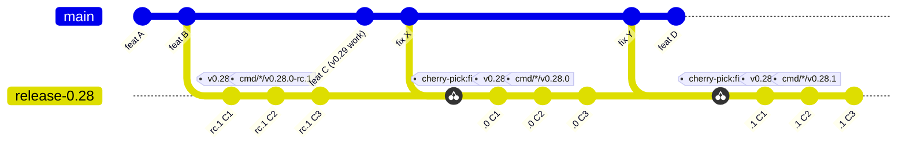
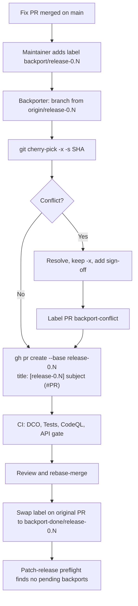
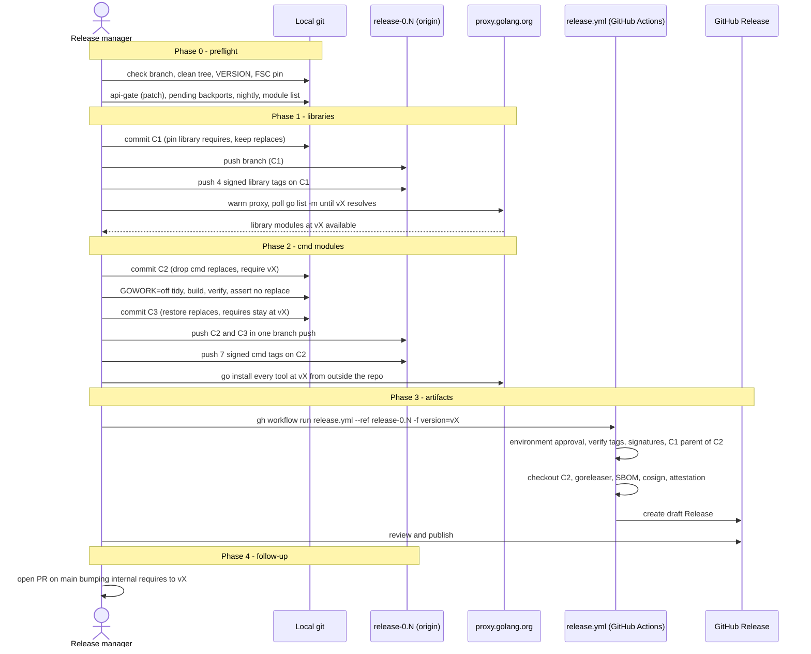
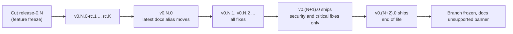
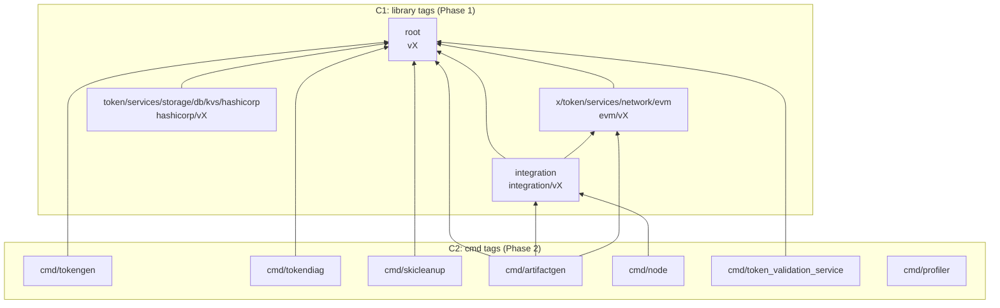
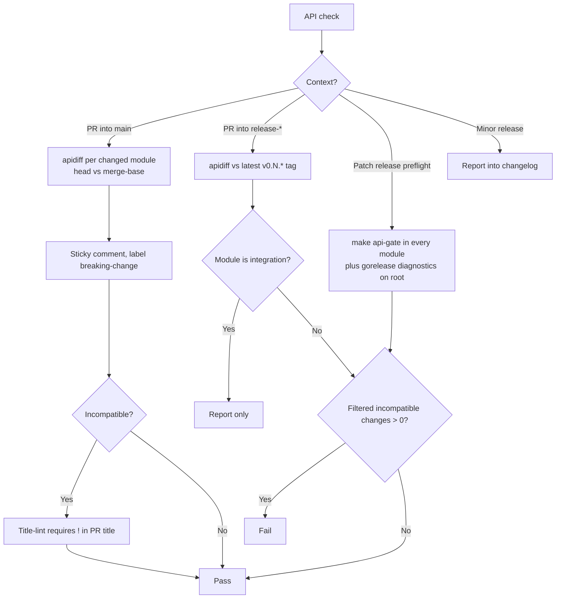
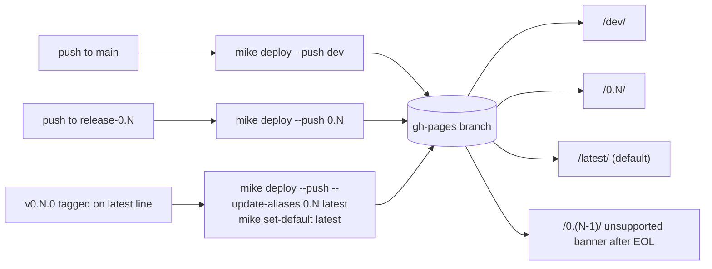

# Release Process Proposal

| | |
|---|---|
| **Status** | Draft — open for maintainer discussion |
| **Author** | Angelo De Caro |
| **Date** | 2026-11-09 |
| **Base commit** | `8a27c3260`. Later checks also ran on `d8f7a82ff` (FSC v0.28.0). |

This document proposes a release process for Panurus. It uses long-lived release branches, the model of Go, Kubernetes, etcd and Moby. It also covers:

- making the `cmd/*` tools installable with `go install`;
- changelog generation and API compatibility checks with `gorelease` and `apidiff`.

The goal is agreement among maintainers. Nothing here is decided until we agree on it.

---

## 1. Summary

### 1.1 The problem

- Every release is a set of lightweight tags (no message, no signature) on `main`, all applied at once.
- GitHub Releases are written by hand.
- There are no release branches. None of the past "patch" releases came from a branch.
- Nothing protects tags or any branch other than `main`.
- None of the published **submodule** tags can be used by consumers. This includes `integration`, `evm`, `hashicorp` and every `cmd/*` module. `go get` and `go install` both fail for them.

Details and evidence: [Appendix A](#appendix-a-why-change-what-we-found-today).

### 1.2 The proposal at a glance

| Area | Proposal |
|---|---|
| Branches | `main` always holds the next minor version. Cut `release-0.N` at feature freeze. Patches are tagged only on the release branch. |
| Tags | Every module tagged in lockstep: `v0.N.P` plus `<dir>/v0.N.P`. Tags are annotated and signed. RCs are tagged `v0.N.0-rc.K` on the branch. |
| Tagging order | **Two phases on the release branch (etcd model).** C1 pins the library requires and gets the library tags. C2 drops the `cmd/*` replaces and gets the `cmd/*` tags. C3 restores the replaces. |
| Local development | **Local `replace` directives stay on `main` and on release branches.** They are dropped only at the tagged commit C2. No `go.work` is needed, because a root `go.work` breaks FSC's node builder ([§3.4](#34-tagging-order-two-phases-replaces-kept-for-development)). |
| Versioning | Panurus versions are **decoupled** from FSC versions. Each release records its FSC pin in its notes and in a compatibility table. |
| Support | The latest minor gets every fix. The previous minor gets security and critical fixes only. |
| Backports | Every fix merges to `main` first. It is then copied to the release branch with `git cherry-pick -x -s` and merged through a PR titled `[release-0.N] <subject> (#PR)`. Backport PRs merge by **rebase only**. **Backports are manual at first**; automation is deferred. |
| Docs | **Versioned** with `mike`: `/0.N/` per release line, `/latest/` alias, `/dev/` from `main`. |
| API gate | On patch releases and on PRs into `release-*`, the number of incompatible changes `apidiff` reports must be **zero**. `gorelease` is only advisory while the version is `v0.x`. |
| Changelog | One file per release, `docs/releases/vX.Y.Z.md`. It contains the commits grouped by Conventional Commit type plus the per-module API changes from apidiff. It becomes the GitHub Release body. A short `CHANGELOG.md` index links to these files. |
| Artifacts | `release.sh` starts `release.yml` with `workflow_dispatch`. A tag push can't trigger it: GitHub sends no event when more than 3 tags are pushed at once. The workflow builds from C2 with goreleaser (free edition). It produces binaries, checksums, an SBOM, a cosign signature and build provenance. It creates a draft Release. Releases are immutable once published. |

### 1.3 What we ask maintainers to agree on

1. The six **proposed decisions** in [§5](#5-proposed-decisions): decoupled FSC versions, support window, tools as separate modules, versioned docs, manual backports, profiler tagged and installable.
2. The overall model: release branches, lockstep signed tags, two-phase tagging, rebase-only backports, `workflow_dispatch` releases.
3. The [rollout plan](#7-rollout-plan) as a series of PRs, ending with `v0.28.0`.
4. Answers to the [open questions](#6-open-questions).

### 1.4 How this proposal was verified

We tested the proposal instead of only reasoning about it. All tests ran in local worktrees and local module proxies, with no commit, push or remote tag.

| How | What |
|---|---|
| **Run** | The full two-phase release, simulated through a local module proxy (§3.3). The C2/C3 tidy and build with `GOWORK=off`. The profiler split, including a full `profile.sh` run. The tokengen refactor. gorelease and apidiff on every module. The `go.work` failure in FSC's nwo. mike with the current pins. goreleaser across 4 modules. `cherry-pick -x -s` with DCO. buf against a tag. Retractions of old-path versions. |
| **Checked against docs or source** | GitHub's 3-tag event limit. The `pull_request_target` change on 2026-12-02. Immutable releases. Ruleset capabilities. Scorecard's branch discovery. The DCO app rules. goreleaser's validate pipe. |
| **Not verified yet** | Listed in [§6](#6-open-questions), item 10. |

---

## 2. The process

### 2.1 Branches and tags

- **`main`** is always the next minor version. All work, including fixes, lands on `main` first.
- **`release-0.N`** is cut from `main` at feature freeze.
    - Changes arrive through backport PRs only. The single exception: the **release manager** pushes the release commits C1, C2 and C3 directly. That needs a bypass on the `release-*` ruleset for a `panurus-release-managers` team ([§3.11](#311-ci-and-github-settings)).
    - It is never deleted. When a line reaches end of life it is simply frozen.
- **RCs and the final `.0` release are tagged on the branch**, as Go and etcd do. The RCs and the final release are then the same line of commits.
- Optional: right after the cut, tag `v0.(N+1).0-alpha.0` on `main`, as Kubernetes does. Pseudo-versions on `main` then sort above the release branch.



Library tags (`v0.N.P`, `integration/…`, `evm/…`, `hashicorp/…`) sit on C1. The seven `cmd/<tool>/…` tags sit on C2.

> **Why?** Fixes reach every line from one place, and a release line only gets reviewed, low-risk changes. RCs and the final release share history, so what was tested is what ships.
>
> **Alternatives considered:**
>
> - *Keep tagging `main`* (today): past "patches" carried new features, because `main` had moved on.
> - *Go's `release-branch.` prefix*: unusual outside Go. `release-0.N` follows Kubernetes, etcd and Prometheus.
> - *Hugo's one branch per patch*: creates branch churn.

### 2.2 Contributors: day-to-day development

Little changes for contributors.

- Open PRs against `main`, as today. Fixes too.
- Keep the local `replace` directives. Do not commit a `go.work` ([§3.4](#34-tagging-order-two-phases-replaces-kept-for-development)).
- Never put `v0.0.0` or an unpublished version in a `require`. Internal requires point at the last published release.
- A root change that breaks another module is fixed in the same PR. The local `replace` makes every module build against the root in your working tree, so no tag is needed ([FAQ](#8-faq)).
- If your PR fixes a bug in a supported line, ask for the `backport/release-0.N` label.
- Use a Conventional Commit PR title. Add `!` when the API is incompatible; an automatic apidiff check labels the PR `breaking-change` and a title-lint check requires the `!` ([§3.7](#37-api-compatibility-gorelease-and-apidiff)).
- Never run `/update-fsc` against a release branch.

### 2.3 Backports

**Rule:** every fix merges to `main` first, then is backported. The only exception is code that no longer exists on `main`. Such a PR goes straight to the release branch, and its description says why.

**What can be backported:** security fixes, regressions, crash or data-loss bugs, required dependency or security bumps, CI and test fixes, and docs. **New features and API changes cannot.**

**Labels:**

| Label | Meaning |
|---|---|
| `backport/release-0.N` | A backport is requested. |
| `backport-done/release-0.N` | The backport merged. |
| `backport-conflict` | The backport needed manual conflict resolution. |
| `breaking-change` | Applied automatically from apidiff ([§3.7](#37-api-compatibility-gorelease-and-apidiff)). |

**PR title:** `[release-0.N] fix(scope): subject (#orig)`. Keeping the Conventional Commit type inside the title lets the changelog script still parse it. The changelog parser strips the `[release-0.N] ` prefix.

**Mechanics:**

- `git cherry-pick -x -s <sha>` keeps the original author, the original sign-off and the provenance line. It adds the backporter's sign-off.
- **`-s` is mandatory.** The DCO app needs a sign-off that matches the author **or the committer** by name and email (`lib/dco.js`). In a simulated pick, the original sign-off didn't match the author's name. The check passed only because of the backporter's `-s`.
- **Merge method: rebase only** for `release-*` PRs, set by the `release-*` ruleset (`pull_request.allowed_merge_methods: ["rebase"]`).

**Manual procedure (proposed decision 5):**

1. A maintainer adds `backport/release-0.N` to the merged PR on `main`.
2. The backporter runs:

    ```
    git fetch origin
    git checkout -b backport-<PR>-release-0.N origin/release-0.N
    git cherry-pick -x -s <squash-sha>
    gh pr create --base release-0.N --title "[release-0.N] <original subject> (#<PR>)" --body "Backport of #<PR>. Fixes #<issue>"
    ```

3. After the merge, the maintainer swaps the label on the original PR to `backport-done/release-0.N`.
4. Before each patch release, the release manager lists PRs that still have `backport/release-0.N` without `backport-done/release-0.N` (`gh pr list --state merged --label backport/release-0.N`).

On conflict, the backporter resolves it, keeps `-x`, adds their sign-off, and labels the PR `backport-conflict` so reviewers check the resolution. It still merges by rebase.



> **Why rebase only?** The repo sets `squash_merge_commit_message: BLANK`. A squash merge would drop the `-x` line and the original sign-off. No other ruleset targets `release-*`, so nothing blocks the setting (checked).
>
> **Why manual?** It needs no `pull_request_target` workflow, so the 2026-12-02 Actions-policy change does not affect Panurus for now.
>
> **Alternatives considered:**
>
> - *Squash merge*: loses provenance and sign-off (above).
> - *`korthout/backport-action`*: the path if manual load grows. It needs SHA pinning and `label_pattern: ^backport/([^ ]+)$`. It needs a GitHub App token, because PRs opened with `GITHUB_TOKEN` don't trigger CI. It needs least-privilege permissions and must never check out PR code. It needs an Actions policy that allows `pull_request_target` for that workflow: GitHub blocks such workflows on public repositories from 2026-12-02 without one.
> - *`tibdex/backport`*: unmaintained.
> - *Mergify*: needs third-party write access.

### 2.4 Release manager: cutting a release branch

1. Decide whether `feature/zkat-snark-driver` stays out of the line (for 0.28, see [open questions](#6-open-questions)).
2. Create `release-0.N` from `main`.
3. Optionally tag `v0.(N+1).0-alpha.0` on `main`.
4. Create the labels `backport/release-0.N` and `backport-done/release-0.N`.
5. Add the line to the `dependabot.yml` `target-branch` entries (github-actions only).
6. Add the line to the scheduled fuzz/CodeQL/govulncheck ref matrices (latest line only for fuzz and CodeQL).

The runbook `docs/development/release.md` will hold the exact steps ([§3.11](#311-ci-and-github-settings)).

### 2.5 Release candidates

- Tag `v0.N.0-rc.K` on `release-0.N`. Use a dot before `K`, so it sorts numerically.
- **Each RC is a full release run:** three commits and 11 tags.
- The changelog's `PREV` for `v0.N.0` skips RCs.
- mike's `latest` alias moves only at `v0.N.0`.
- goreleaser uses `prerelease: auto`.
- **`@latest` never picks a pre-release** once a real release exists. Exception: during the first RC window, a module that has never been released (profiler) resolves `@latest` to the RC.

### 2.6 Releasing a version

The release manager runs `ci/scripts/release.sh` on `release-0.N`. It replaces `tag-release.sh` and keeps a `--dry` mode.

```
Phase 0  preflight:
         - branch is release-0.N and matches VERSION
         - working tree clean; HEAD == origin/release-0.N
         - VERSION greater than the last v0.N.* tag
         - FSC pinned to a tagged version or a documented commit
         - api-gate passes (patch releases)
         - no merged PR still labelled backport/release-0.N without backport-done
         - nightly runs green on the branch
         - every go.mod is in the explicit module list
Phase 1  commit C1 "chore(release): prepare vX":
         - integration, evm, hashicorp: go mod edit -require <sibling>@vX (root, evm)
         - KEEP their local replaces (dropping them breaks tidy and build at C1)
         push the branch (C1)
         tag (signed) vX, integration/vX, x/token/services/network/evm/vX,
                      token/services/storage/db/kvs/hashicorp/vX
         push those 4 tags → warm the proxy → poll until `go list -m …@vX` succeeds
Phase 2  commit C2 "chore(release): pin cmd modules to vX":
         - per cmd/*: go mod edit -dropreplace … -require root@vX [-require integration@vX …]
           (go mod edit, not go get: go get fails while an old-path version is required)
         - GOWORK=off go mod tidy && go build ./... && go mod verify
         - assert: no replace in any cmd/* go.mod
         commit C3 "chore(release): restore local replaces" (requires stay at vX)
         push C2 and C3 together in one branch push
         tag (signed) cmd/<tool>/vX on C2 (all 7 tools, including profiler)
         push the cmd tags → smoke test from outside the repo:
           GOWORK=off GOBIN=$(mktemp -d) go install …/cmd/<tool>@vX   (every tool)
Phase 3  gh workflow run release.yml --ref release-0.N -f version=vX
         → builds from C2, creates the draft Release (§3.9)
         → the release manager reviews and publishes it
Phase 4  open a PR on main bumping internal requires to vX
```



- Each release adds three commits to the branch.
- **If Phase 1 has been pushed and Phase 2 fails**, the library tags are already permanent. Fix the problem and retry Phase 2 at a new commit C2′. The `cmd/*` tags don't need to sit on the same commit as the libraries; only their version number must match.

> **Why three release commits?** C1 must exist before C2, because C2 requires `root@vX` from the proxy. A `go.mod` cannot contain the hash of its own commit, so the tools can't be pinned in the same commit ([§3.4](#34-tagging-order-two-phases-replaces-kept-for-development)). C3 puts the replaces back so development on the branch keeps working.
>
> **Why push C2 and C3 together?** Otherwise a backport can merge onto C2 and leave the branch without replaces.
>
> **Why direct pushes, not a PR?** A PR rebase-merge re-creates commits with new SHAs. The tags would then have to wait until after the merge.
>
> **Alternatives considered:**
>
> - *Keep C2 reachable only from its tag, not on the branch*: rejected. Keeping C2 on the branch, followed by C3, keeps the tag-on-branch check and `git describe` working. (Scorecard was not a reason: it reads the branch name from `target_commitish`.)
> - *Single phase*: see [§3.4](#34-tagging-order-two-phases-replaces-kept-for-development).

### 2.7 Patch releases

- Same run as [§2.6](#26-releasing-a-version) with `VERSION=v0.N.P`.
- Phase 0 runs the API gate: `make api-gate BASE=v0.N.(P-1) VERSION=v0.N.P` must report zero incompatible changes in **every** module.
- Phase 0 blocks on forgotten backports until each is done or its label is removed.
- `PREV` for the changelog is the previous tag on the same line. Pass `--latest=false` for older lines.
- Never raise the `go` directive in a patch release.
- A dependency's minor version going up is allowed only for security, and the notes say so.

### 2.8 Security releases

- Make the fix privately: a GitHub advisory with a private fork. Panurus has had a "Merge commit from fork" before.
- Merge to `main` and every supported branch.
- Release all supported lines on the same day. Tag `v0.N.P` on **each** supported `release-0.N`.
- Two lines mean two full runs. Budget the time.
- `SECURITY.md` steps 7–8 will say that a security fix is patched and tagged on every supported line.

### 2.9 Support window and end of life

Proposed decision 2: the latest minor gets all fixes. The previous minor gets security and critical fixes only. No promise beyond that until v1. When `v0.(N+1).0` ships, `release-0.(N-1)` reaches end of life.

At end of life:

- Update the `SECURITY.md` table.
- Remove the Dependabot entry and the nightly ref.
- Mark its docs version as unsupported. EOL lines stay published with an "unsupported" banner.
- Leave the branch frozen, not deleted.



---

## 3. Technical design

### 3.1 Version numbers

| Release | Tag | Where |
|---|---|---|
| Release candidate | `v0.N.0-rc.K` (with a dot, so it sorts numerically) | `release-0.N` |
| Minor | `v0.N.0` | `release-0.N` |
| Patch | `v0.N.P` | `release-0.N` |
| Security | `v0.N.P` on **each** supported line | each `release-0.N` |

- **v1.0.0** is when `gorelease`'s exit code becomes a real gate ([§3.7](#37-api-compatibility-gorelease-and-apidiff)).
- Any later major version needs a `/vN` module path.

> **Why decouple from FSC (proposed decision 1)?** Today Panurus copies FSC's version numbers without documenting it ([Appendix A](#a1-versioning-and-tags)). FSC has no release branches, so a coupled Panurus patch line would have no FSC patch line to follow.
>
> **Consequences:** Panurus picks its own minor/patch numbers. Each release states its FSC pin in its notes and in `docs/releases/compatibility.md`. FSC needs no release branches. Patch lines bump FSC only through explicit backport PRs ([§4](#4-corner-cases) #4). [`versioning.md`](../development/versioning.md) and [`update-fsc.md`](../development/update-fsc.md) drop the implicit coupling.
>
> **Alternative considered:** *Keep versions coupled* (status quo). It is undocumented, and it ties every Panurus release to an FSC release.

### 3.2 Tags in a repository with many modules (etcd pattern)

- **Every module is tagged with the same version:**
    - `v0.N.P` for the root module;
    - `integration/v0.N.P`, `x/token/services/network/evm/v0.N.P` and `token/services/storage/db/kvs/hashicorp/v0.N.P` for the libraries;
    - `cmd/<tool>/v0.N.P` for each tool.

    The prefix must match the module's directory exactly. `tools/` is never tagged.
- **Every module is tagged even when it has no changes.** Lockstep keeps versions predictable for users.
- **Tags are annotated and signed** by the release manager with `git tag -s` (SSH or GPG). This also satisfies OSPS-BR-06.01.
- **A ruleset cannot require signed tags.** Its signature rule checks commits only. `release.yml` enforces signatures instead. It re-fetches the tags with `git fetch --force --tags`, because `actions/checkout` can turn an annotated tag into a lightweight one (actions/checkout#290). Then it runs `git verify-tag` against a committed `.github/allowed_signers` file.
- **Tags are never moved or deleted.** The module proxy and checksum database keep a version's hash forever. A bad release is fixed by releasing `v0.N.(P+1)` with `retract v0.N.P // reason` in the affected `go.mod` files.
- **Push the exact list of tags**, never `--tags`. Then warm the proxy for each module with `GOPROXY=https://proxy.golang.org go list -m <mod>@v0.N.P`.
- **Use an explicit module list** in `release.sh` (`GO_MODULES` plus profiler), and fail on any unknown `go.mod`. Today `find -name go.mod` (`tag-release.sh:30-37`, `Makefile:371`) also finds the 12 copies under `.claude/worktrees/`.

> **Alternatives considered:**
>
> - *Sigstore gitsign for tags*: not recommended for human-created tags, because GitHub doesn't show its signatures as "Verified".
> - *Tag only changed modules*: less predictable for users than lockstep.
> - *Move or delete a bad tag*: impossible in practice; the proxy and checksum database keep the hash forever.

### 3.3 Making `cmd/*` installable with `go install`

#### Verified result

We simulated a full two-phase release as `v0.98.7`. It used a local file proxy in front of proxy.golang.org and an isolated module cache.

- `go install github.com/LFDT-Panurus/panurus/cmd/<tool>@v0.98.7` succeeded for every tool, both with CGO enabled and with `CGO_ENABLED=0`.
- `go mod verify` passed for every tool.
- We also checked the adopted variant on `cmd/tokendiag` with `GOWORK=off`. At C2 (no replace, require `v0.27.0`), tidy and build pass. At C3 (replace restored, require kept), tidy and build pass again.

#### Per-tool changes

| Tool | Imports `panurus/integration`? | CGO | Change needed |
|---|---|---|---|
| `tokendiag` | No | none (pure-Go `modernc.org/sqlite`, pgx) | On `main`: require the last release (`v0.27.0`) and keep the `replace`. At C2: drop the `replace` and require `vX`. |
| `skicleanup` | No | none | Same as `tokendiag`. |
| `tokengen` | **Only for driver-identifier `var`s, at 5 sites** (`cobra/pp/fabtokenv1/gen.go:16`, `cobra/pp/zkatdlognoghv1/gen.go:18`, `update.go:16`, `cobra/certfier/keypairgen.go:14`, `main_test.go:17-18`) | none | **Refactor (verified):** move the vars into a local `drivers` package. Tidy then drops `panurus/integration` and 8 indirect deps (go.mod 134→124 lines); build, vet, test and `go mod verify` pass. It still needs FSC `integration` (`cobra/pp/cc/cc.go:18-19`, packager). |
| `artifactgen` | Yes, by design (it generates NWO networks) | none | At C2: drop the replaces; require root, `integration` and `evm` at `vX`. |
| `node` | Yes (test/demo node) | none | At C2: drop the replaces; require `integration vX`. |
| `token_validation_service` | No (root plus FSC benchmark) | none | At C2: drop the `replace`. **The module root is not `package main`**; document `…/token_validation_service/server@vX` and `…/client@vX`. |
| `profiler` | No | none | Never tagged. See below. |

**Profiler (proposed decision 6: tag and install it).**

- Today one package holds two `main` functions (`auto-instrument.go:26`, `inject-tracer.go:21`, the latter behind `//go:build tools`). Only `auto-instrument` can be installed.
- **Restructure (verified):** move them into `cmd/profiler/auto-instrument/` and `cmd/profiler/inject-tracer/`, each a `package main`, and drop the `tools` build tag.
- Change `profile.sh:141,196` to `go run ./inject-tracer` and `go run ./auto-instrument`, and update `README.md:159,168-169`.
- Build, vet and test pass, and a full `profile.sh TestToQuantity` run worked.
- The split also fixes today's `go vet -tags tools` failure ("main redeclared").
- `Makefile:311,326,328` only calls `profile.sh` and needs no change.
- Install paths become `…/cmd/profiler/auto-instrument@vX` and `…/cmd/profiler/inject-tracer@vX`.
- Add it to `GO_MODULES` (`Makefile:45`).

**CGO.** No tool needs CGO. PKCS#11 support is behind `//go:build pkcs11`, and `disabled.go` is built by default. Document that `-tags pkcs11` requires CGO.

#### The FSC `cc/query` and `host/libp2p` replaces

They are in `cmd/tokengen/go.mod:8-9` and `hashicorp/go.mod:7-8`.

- **Why they exist:** FSC's published `integration@v0.27.0` `go.mod` requires those submodules at the placeholder `v0.0.0-000…`. A local `replace` like FSC's own is ignored when someone else depends on the module.
- **What breaks without them:** builds and tests pass. Only `go list -m all` and `make update-dep` (`Makefile:410`) fail.
- **What to do:**
    - Drop them from `tokengen` at C2; `go install` refuses any `replace`.
    - After the refactor, tokengen gets no concrete versions through Panurus `integration`, so `go list -m all` still fails there (verified). This failure comes from FSC: `integration@v0.28.0` itself requires `cc/query` and `libp2p` at `v0.0.0-000…`. Builds and installs are not affected. **Fix upstream in FSC.**
    - Until then, `make update-dep` should use `go list -m -e all` (not tested).
    - Keep the replaces in `hashicorp`. It is a library, and nobody installs it.

#### The same trap inside Panurus

The published `integration` module requires `evm v0.0.0` and `panurus v0.0.0`. `hashicorp` requires an old-path pseudo-version (`go.mod:12`).

- Builds and installs still succeed. `go list -m all` fails in `node` and `tokengen`, and `go get …/hashicorp@v0.27.0` fails.
- **Fix on `main` (rollout PR 3):** every internal require in `integration`, `evm`, `hashicorp` and all `cmd/*` modules points at the **last published release** (`v0.27.0` today), with the replaces kept.
    - Checked: all 9 non-root modules pass tidy, build and `go list -m all` with `GOWORK=off`.
    - `cmd/node` is the exception for `go list -m all`. It fails on the `evm v0.0.0` that comes in through the published `integration`, until v0.28.0 is out.
- **Never** put `v0.0.0` or an unpublished version in a require. Placeholders end up published in library tags. Unpublished versions break tidy and gorelease.

### 3.4 Tagging order: two phases, replaces kept for development

The tools require the libraries at the version being released. That version must exist on the proxy before the tools can pin it.

| Option | Verdict |
|---|---|
| (a) Two-phase tagging on the release branch | ✅ **Adopted.** This is how etcd releases. |
| (b) Require a pseudo-version of the same commit | ❌ Impossible: a `go.mod` cannot contain the hash of its own commit. |
| Single phase: everything requires `vX` and is tagged at one commit | ⚠️ `go install` works, but the `go.sum` committed at that tag can't contain hashes for `vX`. `GOWORK=off go build` at the tag then fails. Too fragile. |
| (c) Merge every `cmd/*` tool into the root module | ❌ **Rejected (proposed decision 3).** |
| (d) Root `go.work` instead of replaces | ❌ **Rejected.** See below. |
| (e) Keep replaces everywhere, drop them only at C2 | ✅ **Adopted.** |

> **Why separate tool modules (proposed decision 3)?** The tools stay separate modules. The cost is that two-phase tagging with C1–C3 is required for every release, including each RC. All seven `cmd/*` modules get tags.
>
> **Alternative considered:** *merge the tools into root* would avoid the two phases. It is rejected by this proposed decision; maintainers can revisit it in the discussion.

**Why not `go.work` (verified):**

- FSC's `nwo/fsc/fsc.go:849-891` (`NodeCmdPackage`) runs `go list -m -f '{{.Path}}|{{.Dir}}'` and splits the output once. In workspace mode that prints all 11 modules. The resulting package path is `"../../../…/integration/token/fungible/dlog/out/cmd/alice"`, which is garbage. Every integration test that builds FSC nodes is affected. Report this upstream to FSC: it should use `go env GOMOD` or `GOWORK=off`.
- Workspace mode changes root's dependency graph (`fabric-chaincode-go/v2` v2.3.0 → a newer pseudo-version).
- A partial workspace (`. + cmd/skicleanup`) fails with "ambiguous import genproto/…/errdetails".
- `integration/nwo/token/platform.go:42` builds tokengen by import path, but `Platform.TokenGen()` (`platform.go:198`) has no callers, so it doesn't matter.

**Consequences of keeping the replaces:**

- CI, the nwo harness and `make` targets keep working with `GOWORK=off`, as they do today.
- On `main` and `release-*`, every internal require points at the last published release ([§3.3](#33-making-cmd-installable-with-go-install)). `release.sh` opens a small PR on `main` after each release to bump these requires to `vX`.
- On branches, CI checks that the replaces are present and that no require is a placeholder.
- The "no `replace` in `cmd/*`" check runs **at tag time**: in `release.sh` before tagging C2, and again in `release.yml` on the commit that `cmd/*/vX` points to.
- [`development.md`](../development/development.md) will say that `go.work` is unsupported and must never be committed.

**Module dependencies and tag phases:**



Arrows point from a module to what it requires at `vX`. At C1 the libraries keep their local replaces. At C2 the `cmd/*` modules drop theirs. `cmd/profiler` requires no other Panurus module. `tools/` is never tagged.

### 3.5 Reporting the version of an installed binary

- `go install pkg@ver` does not record `vcs.*` build settings. The installed `tokengen version` therefore prints `Version: (, , )`, even though `go version -m` shows `v0.98.7`.
- **Fix:** read `debug.ReadBuildInfo().Main.Version`, and fall back to the `vcs.*` settings when it is `(devel)`. No `-ldflags -X` is needed.
- Put this in a shared helper and add a `version` command to every tool.

### 3.6 Go version policy

- Users on an older Go automatically download 1.27.3, because the default is `GOTOOLCHAIN=auto`.
- Document the minimum Go version, and **never raise the `go` directive in a patch release**.
- Don't add `toolchain` lines.

### 3.7 API compatibility: gorelease and apidiff

#### Measured behaviour

| | gorelease | apidiff |
|---|---|---|
| Modules it works on | **Root only** today. Submodules fail because the **published base** carries placeholder requires. Fixing the requires (PR 3) does not help the next comparison. gorelease works on submodules only once both base and head carry the fix: from v0.28.0→v0.28.1 on (verified). | All modules (it resolves through the local `replace`). |
| Root module, per run | 11–14 s | About 10 s per ref to write export data (`-w`, about 6 MB); 0.9 s to compare two export files. |
| Exit code usable as a gate in v0 | **No.** With `-base=v0.27.0 -version=v0.27.1` it prints "valid" and exits 0 despite 10 incompatible changes. | **No.** It always exits 0. |
| Where the base comes from | GOPROXY, so the base must be a published tag; a PR's merge-base is impossible. | Any git worktree. |
| Version suggestion | Only when the base is the latest tag of its major version, so it fails on release branches; always pass `-version`. | n/a |
| Measured changes | v0.26→v0.27: 3 incompatible / 17 compatible · v0.27→HEAD: 10 incompatible / 30 compatible | Same |

**How gorelease picks a version in v0:**

- A **patch** bump is suggested only when there are no API changes and no change to requirements.
- A requirement counts as changed when a dependency's minor version goes up or the `go` directive goes up. For example, v0.26→v0.27 bumped grpc from 1.84 to 1.85, which on its own forces a minor bump.

**Breaking-change markers in commits:**

- **No commit uses them in practice.** Since v0.24.0 only one commit message matches `!`/`BREAKING`, while apidiff found 38 incompatible changes in the same range.
- Therefore **apidiff is the source of the breaking-change signal**, not commit messages.

> **Why apidiff as the gate?** It works on every module, takes any worktree as base, and its output can be counted. Our script supplies the exit code.
>
> **Alternatives considered:**
>
> - *gorelease as the gate*: its exit code is 0 in v0 even with incompatible changes, it works on root only until v0.28.0→v0.28.1, and its base must be a published tag. It stays advisory, and becomes the gate from v1.0.0.
> - *Commit-message markers*: nobody uses them (1 marker vs 38 incompatible changes).

#### Gates

| Context | Gate |
|---|---|
| PR into `main` | apidiff in module mode for each changed module, PR head vs merge-base, using worktrees. Post a sticky comment and add the `breaking-change` label automatically. Require `!` in the PR title (enforced by a title-lint check) when the API is incompatible. **No failure.** |
| PR into `release-*` | Same comparison against the latest `v0.N.*` tag. **Fail** on any filtered incompatible change. **Exception: `integration` is report-only.** It is test infrastructure, and a break that matters fails the `cmd/*` builds through their local replaces anyway. |
| Patch release (`release.sh` Phase 0) | `make api-gate BASE=v0.N.(P-1) VERSION=v0.N.P` reports zero incompatible changes in **every** module. Also run `gorelease -base … -version …` on root for diagnostics, and warn when a requirement's minor version went up. |
| Minor release | Report only. The API changes go into the changelog. |
| From v1.0.0 | `gorelease`'s exit code becomes the gate. |



#### Noise and blind spots

| Problem | Mitigation |
|---|---|
| Mocks (57 `mock`/`mocks` dirs produced 39 of 174 changes), `testutils`, and the `integration` module's exported `Test*` helpers | Neither tool can exclude packages. Filter with `(^\|/)(mocks?\|fakes?\|testutils)(\.\|/\|:\|$)` plus the `integration` `Test*` pattern. A simpler regex misses `package …/mock: added` lines and wrongly matches names like `fakeidentity`. Show the filtered changes collapsed in a `<details>` block. |
| A module path rename (hashicorp) shows up as **0 changes** | Have the script compare the `module` line of `go.mod` between base and head, and print **MODULE PATH CHANGED**. |
| Splitting a package into its own module (`cmd/profiler`) shows up as "package removed" | Allow-list package removals that moved to a new module. |
| Adding a method to an interface is always reported as incompatible (e.g. `ratelimit.Configuration.GetRateLimitIdleTimeout`) | An `.apidiff-allow` file for interfaces that consumers never implement. It needs review. |
| Only one build configuration is seen per run | Run a second pass with `GOFLAGS=-tags=pkcs11` and CGO enabled, which shows 4 incompatible and 4 compatible differences. Run on `GOOS=linux` in CI. |
| Generics: loosening a constraint is flagged, but **tightening one (`any`→`comparable`) is not reported** | Review by hand; mention it in the docs. |
| A new module with no base version (profiler) | gorelease's base is `none`. apidiff is skipped and the module is listed as "new". With lockstep tagging it goes straight to `v0.28.0`, skipping `v0.1.0`, which is acceptable. |
| Retracted versions | gorelease reports only *dependencies* that were retracted. List retractions in the changelog by hand. |
| `golang.org/x/exp` has no tags | Pin both tools in `tools/tools.go` and `tools/go.mod` at the pseudo-version root already uses (`v0.0.0-20261014143641-f0251eb4aa3e`). Re-check the output format whenever it is bumped. |

#### CI cost

- About 1–2 minutes for the root module and about 3–4 minutes for all modules.
- Cache the base export files with `actions/cache`, keyed on the base commit SHA. Combined with `setup-go`'s cache, that roughly halves the time.

### 3.8 Changelog

**Two sources feed it:**

1. **Commits.** Run `git log --format=%s PREV..NEW`. Map each commit to its PR with `gh api repos/LFDT-Panurus/panurus/commits/{sha}/pulls`. Don't rely on a `(#N)` suffix: rebase merges are allowed and used, for example a969d028a, 3bace3d93 and 7b0dc28ce. Skip the release commits C1–C3. Group the commits as follows:

    | Section | Commits |
    |---|---|
    | ⚠️ Breaking | from apidiff, cross-referenced to the PRs |
    | Features | `feat` |
    | Fixes | `fix` |
    | Performance | `perf` |
    | Docs | `docs` |
    | CI/Build | `ci`, `build` |
    | Dependencies | `chore(deps)`, `Bump*` |
    | Other | anything that doesn't match (about 8%) |

    Authors and links come from `gh pr view`.

2. **API changes for each module.** The gorelease verdict (root only), then the apidiff incompatible and compatible lists grouped by package, plus the collapsed mock/test block.

**Where it lives:**

- `docs/releases/vX.Y.Z.md`: the complete notes for one release.
- `CHANGELOG.md`: an index of links.
- The GitHub Release body comes from goreleaser `--release-notes docs/releases/vX.Y.Z.md`. Use only this path; don't also call `gh release create`.

**For a patch release:**

- `PREV` is the previous tag *on the same line* (`git describe --tags --abbrev=0 --match 'v0.N.*'`).
- If GitHub's notes API is used, pass `--notes-start-tag`; otherwise it compares against the newest tag globally.
- Pass `--latest=false` for older lines.

**Proposed commands:**

```
make api-report [BASE=v0.27.0] [HEAD=HEAD] [MODULES=…] [TAGS=pkcs11] [FORMAT=md|json]
make api-gate   BASE=v0.28.1 VERSION=v0.28.2       # exit 1 on any filtered incompatible change
make changelog  VERSION=v0.28.0 [PREV=v0.27.0]      # writes docs/releases/v0.28.0.md
make release    VERSION=v0.28.0 [DRY=1]             # ci/scripts/release.sh (§2.6)
```

These go in `ci/scripts/api-report.sh` and `ci/scripts/changelog.sh`. Base them on the `go-api-report` skill's worktree/tag logic, which ran across all 11 modules in about 2 minutes. That skill currently lacks:

- an explicit `BASE`;
- filtering;
- JSON output;
- an exit code usable as a gate;
- caching;
- pinned tool versions.

> **Why a script and one file per release?** It merges commit data with the per-module apidiff results, which no generic tool has.
>
> **Alternatives considered:**
>
> - *git-cliff*: not needed; the script groups by Conventional Commit type and gets authors and links from `gh pr view`.
> - *GitHub's auto-generated notes* (today): an optional `.github/release.yml` keeps the "Generate release notes" button in the GitHub UI useful. The current labels describe topics, not change types, so they can't drive the sections.
> - *A single large `CHANGELOG.md`*: it would conflict when edited on several release branches.

### 3.9 Release artifacts and supply chain

The workflow `.github/workflows/release.yml` is triggered by **`workflow_dispatch` with input `version`**, run on ref `release-0.N`. `release.sh` starts it in Phase 3. Every step runs from SHA-pinned actions.

1. **Gate the job** on a `release` environment with required reviewers and a deployment-branch policy for `release-*`. Otherwise anyone with write access (18 collaborators) could run it.
2. **Verify the tags.**
    - All 11 tags exist. The library tags point at C1, the `cmd/*` tags point at C2, and C1 is the parent of C2.
    - The tags are re-fetched with `--force`, and `git verify-tag` passes against `.github/allowed_signers`.
    - No `cmd/*` `go.mod` at C2 contains a `replace`.
3. **Check out C2** (`cmd/tokengen/vX`).
4. **Build with goreleaser (free edition).**
    - One `.goreleaser.yaml` with a per-build `dir:` for each of the 7 modules. Verified with goreleaser v2.20.0 on 4 modules; no `go.work` is needed.
    - Set `GORELEASER_CURRENT_TAG=vX` and `GORELEASER_PREVIOUS_TAG` explicitly. Without them goreleaser picked `x/token/services/network/evm/v0.99.0`, which is not semver.
    - Run with **`--skip=validate`**, because the root tag sits on C1 and not on HEAD. The free edition has no narrower option: validation is the dirty-tree check, the exact-tag check and the shallow-clone warning together (`internal/pipe/git/git.go:178-199`).
    - **Replace the skipped checks explicitly:**
        - `test -z "$(git status --porcelain)"`;
        - `test "$(git rev-parse HEAD)" = "$(git rev-parse cmd/tokengen/vX^{commit})"`;
        - the C1 → C2 parent check.
    - Gitignore `dist/`. A stray build output such as `cmd/node/node` makes the tree dirty.
    - Set `release.target_commitish: release-0.N` so Scorecard sees the branch, and `prerelease: auto`. Notes come from `--release-notes docs/releases/vX.Y.Z.md`. `release.mode` controls the notes only.
5. **Produce these outputs:**
    - `checksums.txt`;
    - an SBOM per archive (Syft);
    - a keyless cosign signature, `checksums.txt.sigstore.json`;
    - build provenance from `actions/attest-build-provenance`, also uploaded as `*.intoto.jsonl` for the 10/10 Scorecard "Signed-Releases" score.

    The provenance shows event `workflow_dispatch` and ref `refs/heads/release-0.N`, not the tag. Document verification as `gh attestation verify --signer-workflow LFDT-Panurus/panurus/.github/workflows/release.yml`.
6. **Create the draft Release.** The release manager publishes it. Enable **immutable releases** first; today every release shows `immutable: false`.

**Scope:**

- **There is one GitHub Release per version**, on the root tag. The tag points at C1, while the binaries come from C2. The release notes state this.
- `release.yml` must exist on every release branch, because dispatch runs the copy on the chosen ref. Backport any change to it.
- **The repo builds no Docker images.** `monitoring-docker-images` uses `:latest` (`Makefile:193-196`), which makes old release branches irreproducible. Pin those images.

> **Why `workflow_dispatch`?** GitHub creates no event when more than three tags are pushed at once. The root tag also can't be pushed alone and last, because Phase 2 needs `root@vX` already on the proxy.
>
> **Alternatives considered:**
>
> - *Tag-push trigger*: never fires for an 11-tag release.
> - *Push the trigger tag alone*: the root tag must go out in Phase 1. Dispatch is gated with an environment instead, and the provenance identity is documented.
> - *goreleaser Pro*: `ignore_tags` and monorepo support are paid-only. The free edition with `--skip=validate` plus explicit checks covers the need.
> - *`slsa-github-generator`*: unmaintained, and it must be pinned by tag. `actions/attest-build-provenance` is used instead.

### 3.10 Versioned docs

Proposed decision 4: versioned docs with `mike`. `/dev/` from `main`, `/0.N/` per line, a `latest` alias, on a `gh-pages` branch.



- Add `mike` (hash-pinned) to `requirements.txt`.
- `docs.yml`: on `main` run `mike deploy --push dev`. On `release-0.N` run `mike deploy --push 0.N`. After `v0.N.0` is tagged on the latest line, run `mike deploy --push --update-aliases 0.N latest` plus `mike set-default latest`.
- Add `release-*` to the `docs.yml` triggers (`:4-16`) and to the deploy conditions (`:63,67,73`).
- Regenerate `requirements.txt` with `uv pip compile --generate-hashes -c <current pins>`. That adds only mike 2.2.0, verspec, pyparsing and inversion. An unconstrained recompile bumps 12 packages. Add the missing trailing newline to `requirements.in`.
- `mkdocs.yml`: add `extra.version.provider: mike`. Verified with material 9.7.7: `mkdocs build --strict` passes, and the `mike deploy`/`set-default` commands produce the expected `gh-pages` content.
- `edit_uri` doesn't matter: no edit button is rendered unless `content.action.edit` is enabled. Enable it only if per-branch edit links are wanted.
- mike pushes from `main` and `release-*` share the existing `pages` concurrency group.
- EOL lines stay published, with an "unsupported" banner.
- A docs fix on a release line is backported like code. The docs workflow redeploys `/0.N/` on push to the branch.

**The live site is Jekyll, not MkDocs.** Pages is `legacy` from `main` `/` ("Jekyll v3.10.0"). `/docs/development/general.html` returns 200, and `/development/general/` returns 404. The Actions deploy "succeeds" but has never been served. The switch therefore changes every URL.

**Cutover:**

1. Deploy `gh-pages` with mike.
2. Flip the Pages source to `gh-pages` (`PUT /repos/…/pages`). The `github-pages` environment may need to allow `gh-pages` (not tested).
3. Remove the `deploy-pages` jobs.
4. Add redirect stubs for the old `/docs/*.html` URLs.

> **Alternatives considered:**
>
> - *Stay on Jekyll* (the site actually served today): it ignores the MkDocs site and has no versions.
> - *Unversioned MkDocs from `main`*: users of an older line would read docs for code they don't run.

### 3.11 CI and GitHub settings

#### Must change

1. **`tests.yml`:**
    - add `release-*` to the triggers at `:5` and `:7`;
    - extend `itest` at `:202` with `startsWith(github.base_ref,'release-') || startsWith(github.ref,'refs/heads/release-')`;
    - the `fsc-version` default at `:11` only matters for `workflow_dispatch` (the input is empty on push and PR); make it empty;
    - add a check that the replaces are present and no internal require is a placeholder (the no-replace check runs at tag time, [§3.4](#34-tagging-order-two-phases-replaces-kept-for-development));
    - run buf against the last `v0.N.*` tag as well as the branch tip.
2. **`nightly-fsc.yml` and `bump-fsc`:** guard with `if: github.ref == 'refs/heads/main'`, and never bump a release branch to FSC `main`. **Fix the current nightly failure before the first cut.**
3. **`checks.mk:169`:** on a release branch, default `BUF_BREAKING_AGAINST` to `.git#tag=$(git describe --tags --abbrev=0 --match 'v[0-9]*.[0-9]*.[0-9]*' --exclude '*-*')`.
    - That syntax was verified with buf 1.74.0.
    - Exclude pre-releases, because `v[0-9]*` also matches `v0.10.0-cbdc.1`.
    - CI needs `fetch-depth: 0` or fetched tags; shallow clones have none.
    - The current default `.git#branch=main` already fails in a clone without a local `main`.
    - Update `AGENTS.md:19` to match.
4. **`Makefile:369-375`:** add a guard so `update-all-deps-latest` refuses to run on `release-*`.
5. **Rulesets:**
    - a **branch ruleset on `refs/heads/release-*`**:
        - no deletion and no force-push;
        - PRs required with at least one approval, merge method **rebase only**;
        - required checks: DCO, Tests, and CodeQL;
        - linear history;
        - **bypass for the `panurus-release-managers` team**, for the C1–C3 pushes;
        - at least as strong as `main`'s rules. Scorecard takes the minimum Branch-Protection score across the branches it sees. It finds release branches **only** through the Release `target_commitish`, which is why `release.yml` sets it;
    - **re-enable ruleset 5047032** for `main`. It requires CodeQL, so CodeQL must also run on `release-*` (see "Should change");
    - a **tag ruleset on `refs/tags/v*` and `refs/tags/**/v*`**: creation is restricted to the release-managers team; nobody can update or delete tags. Annotated tags pushed by bypass actors are fine. **The ruleset cannot require signed tags** ([§3.2](#32-tags-in-a-repository-with-many-modules-etcd-pattern));
    - a **`release` environment** with required reviewers and a `release-*` deployment-branch policy ([§3.9](#39-release-artifacts-and-supply-chain)).
6. **Release-manager role:** create the `panurus-release-managers` team. Record who holds signing keys in `.github/allowed_signers` and in `MAINTAINERS.md`.
7. **Labels:** add `backport/release-0.N`, `backport-done/release-0.N`, `backport-conflict` and `breaking-change`. Create the per-line labels at each cut.
8. **Versioned docs:** see [§3.10](#310-versioned-docs).

#### Should change

- **`codeql-analysis`, `md_links`, `protect-integration-test-types`:** add `release-*` to the triggers.
- **Scheduled `codeql` and `nightly-fuzz`:** use a ref matrix covering `main` and the **latest** supported release branch.
    - For fuzzing on the release branch, use a shorter `fuzztime`.
    - Include the ref in the fuzz job's issue title (`:331`) and cache key (`:289-291`).
- **`dependabot.yml`:** add `target-branch: release-0.N` entries for github-actions only. Go modules stay out of scope, as the file's header explains. Add and remove the entries at each cut and end of life.
- **Vulnerability scanning on release lines:** govulncheck runs only on push and PR. Add a scheduled govulncheck job over a ref matrix of the supported `release-*` branches.
- **FSC compatibility table (proposed decision 1):** add `docs/releases/compatibility.md` listing each Panurus line and its FSC pin. Remove the implicit "same version as FSC" expectation from [`update-fsc.md`](../development/update-fsc.md).
- **[`SECURITY.md`](../../SECURITY.md):** add a supported-versions table. Say in steps 7–8 that a security fix is patched and tagged on every supported line.
- **Docs to update or add:**
    - rewrite [`versioning.md`](../development/versioning.md) as the actual policy;
    - add a backport section to [`general.md`](../development/general.md); it hardcodes `main` at `:7,54-63,129,212`;
    - add a release-branch variant to [`update-fsc.md`](../development/update-fsc.md); it hardcodes `main` at `:32,186` and documents the FSC replaces at `:50-66`;
    - mention backport PRs in `CONTRIBUTING.md:22` and `DEVELOPMENT.md:47-51,94`;
    - document `tag-release`/`release` in [`makefile.md`](../development/makefile.md);
    - update the stale "Assessed release v0.17.0" in `README.md:65` and the OpenSSF baseline docs.
- **`feature/zkat-snark-driver`** (36 ahead, 28 behind, in the CI triggers): decide before the cut whether it stays out of 0.28 and merges after.
- **New runbook `docs/development/release.md`** covering the cut, RC, release, patch, security release (two lines means two full runs; budget the time) and end of life. Link it from `AGENTS.md`, and add a `.claude/skills/release/SKILL.md` symlink per the runbook rule.

#### Nice to have

- `CODEOWNERS`, using the `panurus-maintainers` team (`MAINTAINERS.md:32`).
- A PR template with "Backport to: release-0.N" checkboxes.
- Issue templates for a release checklist and a backport request.
- Turn the version field in `bug_report.yml:67-70` into a dropdown of supported lines.
- **Retract the unusable tags in v0.28.0 (verified possible).** Go reads retractions from the latest version's `go.mod` and never parses the broken ones.
    - Root module: `retract [v0.1.0, v0.13.0]` and `retract v0.10.0-cbdc.1`. These are the old-path versions; cbdc.1 is also old-path.
    - hashicorp: `retract [v0.14.2, v0.27.0]`, the wrong-path versions.
    - Effect: they disappear from `go list -m -versions`, `go list -m -u`, pkg.go.dev and Dependabot/Renovate. `@latest` is unaffected.
- Add milestones by version (`v0.28.1`), or record version tracking by label.

> **Why retract?** The proxy lists all the old tags, and a retraction hides them (verified). The cbdc tag is old-path too.
>
> **Alternative considered:** *Leave the old tags as they are*: they stay visible in version lists, pkg.go.dev and update bots, although none of them can be used.

---

## 4. Corner cases

| # | Case | Handling |
|---|---|---|
| 1 | A bad tag has been pushed | Never retag. Release `v0.N.P+1` with `retract`. Immutable releases also burn the tag name. |
| 2 | Phase 1 pushed, Phase 2 fails | Fix and tag the `cmd/*` modules at a new commit with the same version ([§2.6](#26-releasing-a-version)). |
| 3 | Security fix on several lines | Make it privately (GitHub advisory with a private fork). Merge to `main` and every supported branch, then release all lines on the same day. Panurus has had a "Merge commit from fork" before. |
| 4 | FSC needs a fix on a released line | Versions are decoupled. Bump FSC on the branch only through a `[release-0.N] chore(deps): …` PR, preferably to an FSC tag; otherwise pin an FSC commit and state it in the notes and the compatibility table. Never run `/update-fsc` against a release branch. |
| 4b | FSC releases a new minor during a Panurus patch line | Not taken on the branch unless it carries a needed fix. gorelease warns about the minor bump (#7). |
| 5 | A backport needs an API change | Not allowed; the gate blocks it. Defer it to the next minor, or add the API without breaking the existing one. |
| 6 | A backport conflicts | The backporter resolves it, keeps `-x`, adds their sign-off, and labels the PR `backport-conflict` so reviewers check the resolution. It merges by rebase. |
| 6b | A backport is forgotten | The patch-release preflight lists merged PRs labelled `backport/release-0.N` without `backport-done/release-0.N`, and blocks until each is done or the label is removed. |
| 7 | A dependency's minor version goes up in a patch release | gorelease warns. Allow it only for security, and say so in the notes. |
| 8 | A new module appears between releases | Tag it at the lockstep version, list it as "new" in the changelog, and add it to `GO_MODULES` (`Makefile:45` currently omits `cmd/profiler`). |
| 9 | A module is removed or renamed | apidiff can't see it, so the script's `go.mod` path check catches it. Old tags remain on the proxy forever, so document their status. |
| 10 | A tool is installed with an old Go | `GOTOOLCHAIN=auto` downloads 1.27.3. Never raise the `go` directive in a patch release. |
| 11 | A nightly job finds a bug on a release branch | The fuzz and CodeQL ref matrix opens an issue that includes the ref. The fix goes to `main` first, then is backported. |
| 12 | Release line reaches end of life | Update the `SECURITY.md` table, remove the Dependabot entry and the nightly ref, mark its docs version as unsupported, and leave the branch frozen, not deleted. |
| 12b | A docs fix on a release line | Backport it like code. The docs workflow redeploys `/0.N/` on push to the branch. |
| 13 | Building at a `cmd/*` tag | C2 has no replaces and requires published versions, so `GOWORK=off go build` works. `release.sh` checks it before tagging. |
| 13b | A backport merges between C2 and C3 | Prevented: C2 and C3 are pushed together. |
| 13c | Someone uses a local `go.work` | It is gitignored (`.gitignore:6-7`), so it can't be committed by accident. Locally it breaks FSC's node builder ([§3.4](#34-tagging-order-two-phases-replaces-kept-for-development)); the dev docs warn about this. |
| 14 | Profiler is tagged for the first time | It goes straight to the lockstep version (`cmd/profiler/v0.28.0`). Restructure it first so both tools install ([§3.3](#33-making-cmd-installable-with-go-install)). |
| 15 | `token_validation_service` is not `package main` at the module root | Document the `…/server` and `…/client` install paths. |
| 16 | More than 3 tags pushed at once | No push event is created. That's why `release.yml` uses `workflow_dispatch`. |
| 17 | A release in the RC window | Each RC is a full run. A never-released module resolves `@latest` to the RC. `latest` docs and the changelog `PREV` ignore RCs. |
| 18 | A module with no changes | It is still tagged (lockstep). |

---

## 5. Proposed decisions

The author proposed these on 2026-11-08. They need maintainer agreement.

| # | Question | Proposed decision | Consequences |
|---|---|---|---|
| 1 | Panurus and FSC versions | **Decouple.** | Panurus picks its own minor/patch numbers. Each release states its FSC pin in its notes and in `docs/releases/compatibility.md`. FSC needs no release branches. Patch lines bump FSC only through explicit backport PRs ([§4](#4-corner-cases) #4). `versioning.md` and `update-fsc.md` drop the implicit coupling. |
| 2 | Support window | **Latest minor: all fixes. Previous minor: security and critical fixes only.** No promise beyond that until v1. | `SECURITY.md` table lists two lines. Nightly fuzz/CodeQL ref matrix covers `main` plus the latest line. When `v0.(N+1).0` ships, `release-0.(N-1)` reaches EOL. |
| 3 | Tools in the root module | **Separate modules.** | Two-phase tagging with C1–C3 ([§2.6](#26-releasing-a-version)) is required for every release, including each RC. All seven `cmd/*` modules get tags. |
| 4 | Docs | **Versioned, with `mike`.** | `/dev/` from `main`, `/0.N/` per line, `latest` alias, `gh-pages` branch ([§3.10](#310-versioned-docs)). |
| 5 | Backports | **Manual at first.** | Labels plus a documented cherry-pick procedure ([§2.3](#23-backports)). No `pull_request_target` workflow, so the 2026-12-02 Actions-policy change does not affect Panurus for now. |
| 6 | Profiler | **Tag and install it.** | Restructure into `cmd/profiler/auto-instrument` and `cmd/profiler/inject-tracer` packages ([§3.3](#33-making-cmd-installable-with-go-install)); add to `GO_MODULES` (`Makefile:45`). |

---

## 6. Open questions

For the discussion:

1. Do we agree on the six proposed decisions in [§5](#5-proposed-decisions)?
2. Who joins `panurus-release-managers`, and who holds signing keys (`.github/allowed_signers`, `MAINTAINERS.md`)?
3. Does `feature/zkat-snark-driver` (36 ahead, 28 behind) stay out of 0.28 and merge after the cut?
4. Do we tag `v0.29.0-alpha.0` on `main` right after the cut (optional, Kubernetes style)?
5. Do we retract the unusable old tags in v0.28.0 ([§3.11](#nice-to-have))?
6. Milestones by version (`v0.28.1`), or version tracking by label?
7. Do we want per-branch edit links in the docs (`content.action.edit`)?
8. At what manual load do we adopt `korthout/backport-action`?
9. Who reports the two FSC upstream issues: placeholder requires in FSC `integration`, and `NodeCmdPackage` in workspace mode?
10. Items not yet verified (to close during rollout):
    - whether the `github-pages` environment needs `gh-pages` allowed;
    - `go list -m -e all` as the `update-dep` fix;
    - the full goreleaser config with all 7 modules, cosign and the attestation (only 4 modules were built);
    - a real proxy run of a release. The simulations used local file proxies.

---

## 7. Rollout plan

Each PR needs an issue per [`AGENTS.md`](../../AGENTS.md). The `cmd/*` replaces stay on `main`. The GitHub settings land before anything that uses them. API tooling does not wait for module hygiene.

| # | PR | Depends on |
|---|---|---|
| 1 | **Fix the nightly FSC update** (it is failing now) | — |
| 2 | **Policy docs:** rewrite `versioning.md` (decoupled versions, branches, tags, support window, RCs); `SECURITY.md` supported-versions table; `docs/development/release.md` runbook (cut, RC, release, patch, security, EOL, manual backport, release-manager role); backport section in `general.md`; `docs/releases/compatibility.md`; release-branch variant of `update-fsc.md`; "never commit `go.work`" note | — |
| 3 | **Module hygiene:** every internal require → last published release (`v0.27.0`), replaces kept, including hashicorp; tokengen `drivers` refactor (5 sites); shared version helper and `version` command in every tool; `go list -m -e all` in `make update-dep`; CI check for "replaces present, no placeholder requires" | — |
| 4 | **Profiler restructure:** split into `auto-instrument/` and `inject-tracer/`; update `profile.sh`, the README and `GO_MODULES` | — |
| 5 | **API tooling:** pin `apidiff`/`gorelease` in `tools/`; `ci/scripts/api-report.sh`, `changelog.sh` (PR lookup via API, strips `[release-0.N]`); `make api-report`, `api-gate`, `changelog`; the filter regex; `.apidiff-allow`; `integration` report-only; `CHANGELOG.md` index | — |
| 6 | **GitHub settings** (maintainers, by hand): `panurus-release-managers` team; `release-*` ruleset (rebase only, bypass for release managers, CodeQL required); tag ruleset; `release` environment; re-enable the `main` ruleset after CodeQL runs on `release-*`; immutable releases; labels; `.github/allowed_signers` | 7 (CodeQL on `release-*`) |
| 7 | **CI for release branches:** triggers (tests, CodeQL, md_links, protect-*), `itest` gate, FSC guards, buf base with tags fetched, scheduled govulncheck/fuzz/CodeQL ref matrix, API-diff PR job, `checks.mk` default, `update-all-deps-latest` guard | 5 |
| 8 | **Release script:** `ci/scripts/release.sh` (preflight, explicit module list, C1/C2/C3, signed tags, explicit pushes, proxy warm-up, tag-time no-replace check, dispatch of `release.yml`, follow-up PR on `main`, `--dry`). Replaces `tag-release.sh` | 3, 4, 5 |
| 9 | **Release workflow:** `release.yml` (dispatch, environment gate, tag/signature/topology checks, goreleaser from C2 with explicit checks, SBOM, cosign, attestation, draft); `.goreleaser.yaml`; `dist/` in `.gitignore` | 6, 8 |
| 10 | **Versioned docs:** mike in `requirements.txt` (constrained recompile), `docs.yml` deploys per branch, `mkdocs.yml` version provider, Pages cutover with redirect stubs | 6 |
| 11 | **Dry run, then release:** decide on `feature/zkat-snark-driver`; cut `release-0.28`; run `v0.28.0-rc.1` end to end; verify `go install` of every tool from outside the repo, the draft Release, the attestation, and `/0.28/` docs. Then release `v0.28.0` with the retractions ([§3.11](#nice-to-have)). | all |

The automated backport workflow is deferred until the manual load justifies it.

---

## 8. FAQ

**Why can't we just tag `main` like today?**
`main` already holds the next minor's features. Past "patches" (v0.8.1, v0.10.1, v0.12.1, v0.14.1, v0.14.2, v0.15.1) were tagged on `main`, had no matching `.0`, and contained new features. And today's submodule tags can't be consumed at all ([Appendix A](#a2-submodules-cannot-be-used-by-consumers)).

**Why three release commits?**
The tools must require the libraries at `vX`, and `vX` must be on the proxy first. A `go.mod` can't contain the hash of its own commit. So C1 gets the library tags, C2 pins and tags the tools, and C3 restores the local replaces for development ([§2.6](#26-releasing-a-version)).

**Why not `go.work`?**
A root `go.work` breaks FSC's `NodeCmdPackage`, which every integration test that builds FSC nodes uses. It also changes root's dependency graph, and a partial workspace fails with an ambiguous import ([§3.4](#34-tagging-order-two-phases-replaces-kept-for-development)).

**If I change the root module and the EVM driver (or another submodule) stops compiling, do I need a tag first?**
No. Fix both modules in the same PR. Tags are only needed at release time.

Each submodule keeps its local `replace` to the root directory (for example `replace github.com/LFDT-Panurus/panurus => ../../../../..` in `x/token/services/network/evm/go.mod`). The `replace` makes the submodule build against the root code in your working tree, whatever version the `require` line names. The `require` line only says which published version a consumer gets when the `replace` is ignored.

So the flow on `main` is:

1. Change the root module.
2. In the same PR, update `x/token/services/network/evm` (and any other affected module) so it compiles again.
3. CI runs `go vet` in every module in `GO_MODULES` (`checks.mk:44-48`), so a broken submodule fails the PR.
4. Merge. No tag, no `go.mod` version bump.

We verified this. With `evm` requiring `v0.27.0` and the `replace` kept, adding a method to `driver.Network` in the root made `evm` fail at once (`network.go:85: *Network does not implement driver.Network`). The root's local code was used, not v0.27.0.

The `require` version matters only at release time. Phase 1 (C1) rewrites the library requires to the new `vX`, and Phase 2 (C2) does the same for the tools ([§2.6](#26-releasing-a-version)). After the release, a small PR on `main` bumps the requires to `vX`, so the next release starts from a published version.

Why replace `v0.0.0-00010101000000-000000000000` with a real version, then? The placeholder is harmless locally, because the `replace` hides it. But it is published inside the submodule's tag, and consumers can't resolve it ([Appendix A](#a2-submodules-cannot-be-used-by-consumers)). A real published version resolves for everyone.

**Why not merge the tools into the root module?**
It would remove the two phases. Proposed decision 3 keeps them as separate modules; this is open for discussion.

**Do I need to do anything different as a contributor?**
Barely. PRs still target `main`. Ask for a backport label on fixes for supported lines. Add `!` to the PR title when apidiff flags an incompatible change. Don't commit `go.work`, and don't put placeholder versions in requires ([§2.2](#22-contributors-day-to-day-development)).

**Who can release?**
Members of the `panurus-release-managers` team. They alone can create tags (tag ruleset) and push C1–C3 (ruleset bypass). The `release` environment requires reviewer approval before `release.yml` runs. Today anyone with write access (18 collaborators) could run such a workflow.

**What happens if a release goes wrong?**
Tags are never moved or deleted. A bad release is fixed by the next patch with `retract` in the affected `go.mod` files. If Phase 2 fails after Phase 1 was pushed, retry Phase 2 at a new commit C2′ with the same version. The GitHub Release stays a draft until the release manager reviews it ([§4](#4-corner-cases)).

**Why is v0.28 the first release branch?**
Every `hashicorp` tag up to v0.27.0 has the wrong module path, fixed only in `8a27c3260`. `cmd/profiler` became a separate module in the same commit. A `release-0.27` branch would inherit the broken paths.

**Does this slow down development on `main`?**
No. `main` keeps its replaces and its workflow. The additions are an apidiff PR check that comments and labels but never fails on `main`, and one small PR after each release bumping internal requires to `vX`.

**Why rebase-only for backports?**
The repo's squash setting (`squash_merge_commit_message: BLANK`) drops the `-x` provenance line and the original sign-off ([§2.3](#23-backports)).

**Why is `integration` exempt from the API gate?**
It is test infrastructure. A break that matters already fails the `cmd/*` builds through their local replaces.

---

## Appendix A. Why change: what we found today

Evidence came from four tracks:

1. **Install experiments:** the `cmd/*` tools were made installable, and a full release was simulated through a local module proxy.
2. **gorelease/apidiff:** both tools were run against `v0.26.0`, `v0.27.0` and `HEAD`.
3. **Industry research:** how the Go toolchain, Kubernetes, Moby, Hugo, etcd, Prometheus and Cilium run their releases.
4. **Repo audit:** the repository, CI and GitHub settings, using read-only `gh api` calls.

Nothing was committed, tagged, pushed or changed on GitHub.

### A.1 Versioning and tags

- **Panurus version numbers copy FSC version numbers, but no document says so.**
    - At every tag from v0.8.0 to v0.27.0 (18 tags), the root `go.mod` pins FSC at exactly the same version.
    - The versions Panurus "skipped" (v0.19, v0.20, v0.23, v0.25, …) are exactly the FSC versions Panurus didn't release on.
    - FSC itself has **no release branches**.
- **None of the past "patch" releases came from a branch.**
    - v0.8.1, v0.10.1, v0.12.1, v0.14.1, v0.14.2 and v0.15.1 were all tagged directly on `main`.
    - None of them has a matching `.0` release, and their notes contain new features.
- **All 100 tags are lightweight; none is annotated or signed.**
- **`v0.10.0-cbdc.1` is a tag pointing at a fork commit.** That commit is on no branch of `origin`, yet proxy.golang.org serves it.
- Root tags up to **v0.13.0** declare the old module path `github.com/hyperledger-labs/fabric-token-sdk`.
- Every `hashicorp` tag up to **v0.27.0** has the wrong module path (`.../identity/storage/kvs/hashicorp`). It was fixed only in `8a27c3260`.
- **Conclusion: the first release branch has to be `release-0.28`.** A `release-0.27` branch would inherit the broken paths.
- `cmd/profiler` became a separate module in `8a27c3260` and has never been tagged. `cmd/tokendiag` and `x/.../evm` have only three tags each.
- [`ci/scripts/tag-release.sh`](../../ci/scripts/tag-release.sh) has these limitations:
    - it tags whatever commit is checked out (`HEAD`) and checks nothing first;
    - it creates lightweight tags (`:77`);
    - it rejects pre-release versions such as `-rc.1` (`:22`);
    - it ends by printing `git push origin --tags` (`:81`), which would push every local tag.

### A.2 Submodules cannot be used by consumers

The submodules contain local `replace` directives. They also `require` placeholder versions of the root module that only resolve through those local replaces:

| Module | What it requires today |
|---|---|
| `cmd/tokengen` (`go.mod:15`) and other `cmd/*` modules | `panurus v0.10.1`, which declares the **old** module path |
| `cmd/token_validation_service` | `panurus v0.0.0` |
| `integration` (`go.mod:10-11`) | `panurus v0.0.0` and `evm v0.0.0` |
| `evm` | `v0.0.0-00010101000000-000000000000` |
| `hashicorp` (`go.mod:12`) | `v0.4.1-0.2025…`, which is the old module path |

Consequences:

- `go install …/cmd/<tool>@latest` fails for every tool with *"contains one or more replace directives"* (checked).
- `go get …/evm@v0.27.0`, `…/integration@v0.27.0` and `…/cmd/tokengen@v0.27.0` all fail because the placeholder versions can't be resolved (checked).
- `gorelease` fails on every submodule for the same reason. It works only on the root module.

### A.3 CI and GitHub

| Item | Current state |
|---|---|
| `tests.yml:5,7` | Runs only on `main` and `feature/zkat-snark-driver`. |
| `tests.yml:202` | `itest` runs only when `github.ref == 'refs/heads/main' \|\| github.base_ref == 'main'`, so **backport PRs would skip all integration tests**. |
| `tests.yml:11` | The `fsc-version` input defaults to FSC `main`. |
| `.github/actions/bump-fsc/action.yml:11` | Hardcodes FSC's `refs/heads/main`. |
| `nightly-fsc.yml` | Scheduled, so it runs on `main` only. It **is currently failing** (2026-11-06 and 2026-11-07). |
| `codeql`, `md_links`, `protect-integration-test-types` | Their triggers don't include `release-*` branches. |
| `nightly-fuzz`, `scorecard` | Scheduled, so they run on the default branch only. |
| `docs.yml` | Deploys only from `main`. The Pages environment allows only `main`. |
| Workflows triggered by a tag | None. Every Release was created by hand with GitHub's auto-generated notes. |
| `checks.mk:169` | `BUF_BREAKING_AGAINST ?= .git#branch=main` |
| Rulesets | The only active branch ruleset is the org DCO ruleset, on the default branch only. The repo's `main` ruleset (5047032) is **disabled**. There is **no tag ruleset**. |
| Labels | No backport or cherry-pick labels, and no `breaking-change` label. |
| Milestones | By calendar quarter or by theme, never by version. |
| `SECURITY.md` | **No supported-versions table.** OSPS-DO-04.01 and DO-05.01 are therefore "Not Met" ([`docs/openssf/baseline_level_3.md:37-38`](../openssf/baseline_level_3.md)). |
| `CODEOWNERS`, PR template | Neither exists. |
| `go.mod` directives | All 12 `go.mod` files are at `go 1.27.3`. None has a `toolchain` or `retract` line. |

---

## Sources

- Go: [MinorReleases](https://go.dev/wiki/MinorReleases), [Go-Release-Cycle](https://go.dev/wiki/Go-Release-Cycle), [security policy](https://go.dev/doc/security/policy), [module reference](https://go.dev/ref/mod)
- Kubernetes: [cherry-picks](https://github.com/kubernetes/community/blob/master/contributors/devel/sig-release/cherry-picks.md), [patch releases](https://kubernetes.io/releases/patch-releases/), [publishing-bot](https://github.com/kubernetes/publishing-bot)
- Moby: [BRANCHES-AND-TAGS.md](https://github.com/moby/moby/blob/master/project/BRANCHES-AND-TAGS.md), [PATCH-RELEASES.md](https://github.com/moby/moby/blob/master/project/PATCH-RELEASES.md), [#52266](https://github.com/moby/moby/issues/52266)
- Hugo: [hugoreleaser](https://github.com/gohugoio/hugoreleaser)
- etcd: [release guide](https://github.com/etcd-io/etcd/blob/main/Documentation/contributor-guide/release.md), [release.sh](https://github.com/etcd-io/etcd/blob/main/scripts/release.sh), [release_mod.sh](https://github.com/etcd-io/etcd/blob/main/scripts/release_mod.sh)
- Prometheus: [RELEASE.md](https://github.com/prometheus/prometheus/blob/main/RELEASE.md)
- Cilium: [backports](https://docs.cilium.io/en/stable/contributing/release/backports/)
- Backport tooling: [korthout/backport-action](https://github.com/korthout/backport-action), [pull_request_target security](https://docs.github.com/en/actions/reference/security/securely-using-pull_request_target), [DCO app](https://github.com/dcoapp/app)
- Release artifacts: [immutable releases](https://docs.github.com/en/code-security/supply-chain-security/understanding-your-software-supply-chain/immutable-releases), goreleaser [monorepo](https://goreleaser.com/customization/monorepo/) / [sign](https://goreleaser.com/customization/sign/) / [sbom](https://goreleaser.com/customization/sbom/), [Scorecard checks](https://github.com/ossf/scorecard/blob/main/docs/checks.md)
