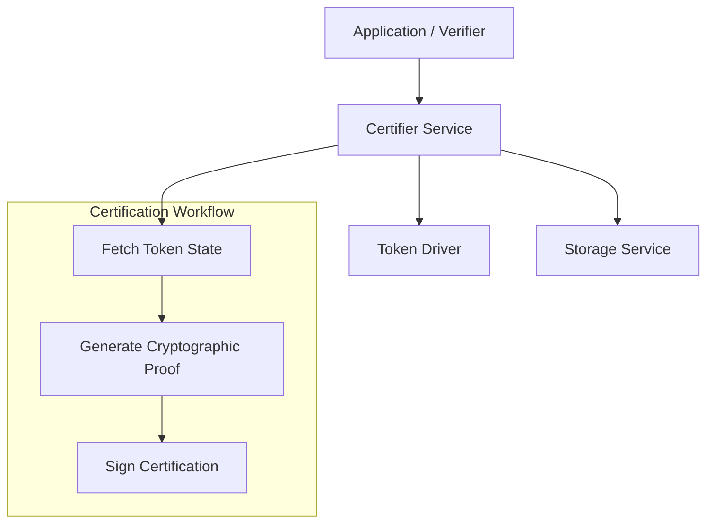

# Certifier Service

The **Certifier Service** (`token/services/certifier`) provides specialized capabilities for generating and managing token certifications. Certifications are cryptographic proofs of the validity or ownership of a token that can be verified by third parties, often off-chain.

## Core Responsibilities

The Certifier Service is responsible for:
*   **Certification Generation**: Creating cryptographic attestations for specific tokens based on the current state of the ledger.
*   **Proof Verification**: Providing mechanisms to verify certifications without requiring a direct connection to the DLT.
*   **Privacy-Preserving Proofs**: Generating proofs (e.g., Zero-Knowledge Proofs) that demonstrate a token's existence while selectively hiding sensitive details like its exact quantity or owner.

## Architecture

The Certifier Service is particularly critical for privacy-preserving drivers like `zkatdlog` when graph hiding is required.

## Key Capabilities

### Off-Chain Verification
Certifications allow for "lightweight" verification of token existence. For example, a user can present a certification to a third party (like an exchange or a merchant) to prove that the token exists on the ledger, without that third party having to query the DLT directly.

### Role of Certifiers
In some system configurations, specific nodes are designated as **Certifiers**. These nodes are trusted to inspect the ledger and issue certifications. The Certifier Service provides the necessary Views and APIs for these nodes to receive certification requests, verify the requested token existence in their local `TokenDB`, and respond with a signed certification.

### Integration with Drivers
The service leverages the **Driver API** to generate the actual cryptographic proof. Different drivers may implement certifications in different ways (e.g., a simple signature over the token ID for cleartext tokens, or a complex ZKP for privacy-preserving ones).

## Driver Resolution

`NewCertificationClient` and `NewCertificationService` resolve a certification driver by the name the
TMS public parameters report through `CertificationDriver()`, looking it up in a package-private
registry (`token/services/utils/drivers.Holder`).

**No driver registers itself today, so certification is inactive.** The `dummy` and `interactive`
drivers implement the interface but nothing adds them to the registry: the `init()`-based
self-registration was removed in `df071e82f` when the SDK moved to explicit `dig` dependency
injection, and the exported `Register` hook it used went with it in `3f367bb20`. Both constructors
therefore return `certifier driver [...] not found`. Nothing reaches that error in practice, because
`RegisterView` skips certification unless the public parameters report `GraphHiding()`, and both
shipped drivers report `false`. Re-enabling certification means wiring the driver through the
container in `token/sdk/dig`, not reinstating a global registry.

The registry itself is safe for concurrent use, and the map it holds is unreachable from outside its
package: `Get` and `Register` both take its lock, so a lookup overlapping a registration cannot
observe the map mid-write. This matters because in Go an unsynchronised map read racing a write is
not a recoverable error — the runtime throws `concurrent map read and map write` and the process
dies. Code resolving a driver must go through `Get` rather than reading the map.
