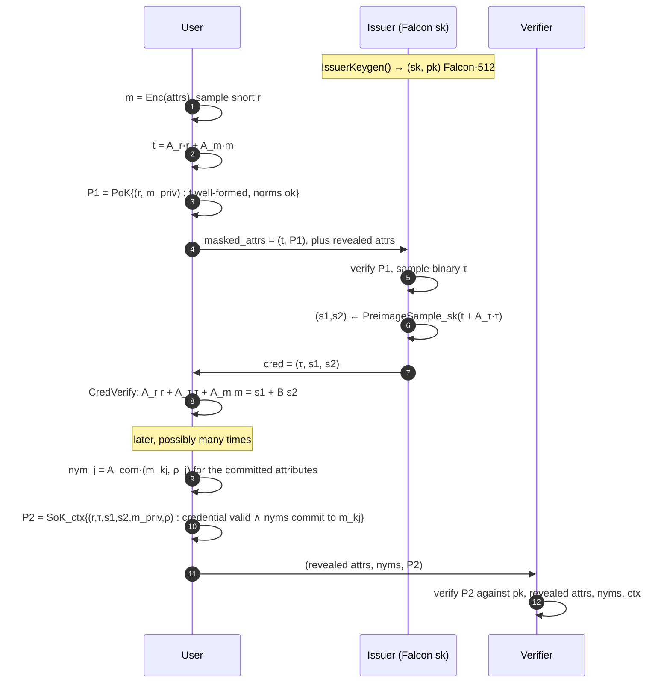

# The Lazer Anonymous Credential Scheme: a Technical Description

This document explains, in full detail, the lattice-based anonymous credential scheme implemented in
`x/token/services/identity/lazer/anoncreds`. It is written for readers with a master-level background in
cryptography: you should know what a digital signature, a commitment scheme and a zero-knowledge proof are,
and you should be comfortable with basic linear algebra over polynomial rings. Every lattice-specific
concept the scheme uses is introduced in [Background](#2-background) before it is needed.

For how Panurus uses the scheme (pseudonyms, signatures, audit), see
[Lazer: post-quantum anonymous identities](identity-lazer.md). This page is about the cryptography
underneath.

!!! warning "Status: experimental"
    The scheme is a research-grade construction. The parameters of the attribute commitments have not had a
    concrete security review (see [Limitations and open issues](#11-limitations-and-open-issues)), and the
    unforgeability argument has not been formally proven. Do not use it in production.

!!! note "Fixed: credential-less forgery"
    An earlier version of the scheme (also lazer's Python reference `cbdc.py`) let anyone produce a valid
    presentation **without any issued credential** whenever every revealed attribute was zero, which includes the
    Panurus configuration (nothing revealed). The current code adds a public non-zero target $\mathbf{c}_0$ to the
    credential equation. [§10.1](#101-unforgeability-of-credentials) describes the attack and the fix. Credentials
    issued before the fix do not verify any more and must be reissued.

---

## Table of contents

1. [Introduction](#1-introduction)
2. [Background](#2-background)
3. [Scheme overview](#3-scheme-overview)
4. [Public parameters and attribute encoding](#4-public-parameters-and-attribute-encoding)
5. [Issuance](#5-issuance)
6. [Attribute commitments (nyms) and signatures of knowledge](#6-attribute-commitments-nyms-and-signatures-of-knowledge)
7. [Presentation](#7-presentation)
8. [The proof systems and their parameters](#8-the-proof-systems-and-their-parameters)
9. [Serialization, sizes and input validation](#9-serialization-sizes-and-input-validation)
10. [Security analysis (informal)](#10-security-analysis-informal)
11. [Limitations and open issues](#11-limitations-and-open-issues)
12. [Mapping to the code](#12-mapping-to-the-code)
13. [Exercises](#13-exercises)
14. [References](#14-references)

---

## 1. Introduction

### 1.1 Anonymous credentials in one paragraph

An *anonymous credential* system [Cha85, CL01] has three roles:

- an **issuer**, who certifies attributes of a user (an enrollment id, an organizational unit, a role, ...);
- a **user** (holder), who receives a credential on their attributes;
- a **verifier**, who checks *presentations* of credentials.

Two properties set it apart from an ordinary certificate. *Selective disclosure*: in a presentation the user
reveals only some attributes and proves that the others are certified without showing them. *Unlinkability*:
two presentations of the same credential cannot be linked to each other, or to the issuance session, by
anyone, including the issuer. The classic constructions (CL signatures [CL01], used by Idemix [CV02], and
BBS+) rely on the hardness of factoring or of discrete logarithms in pairing groups. A large quantum computer
would break them through Shor's algorithm.

### 1.2 What this scheme is

The scheme in `anoncreds` is a **post-quantum** anonymous credential. Its security rests on lattice problems
(Module-SIS, Module-LWE and NTRU). It is a C port of the reference `python/cbdc/cbdc.py` in the
[lazer](https://github.com/lazer-crypto/lazer) library [LSS24]. That is why the C identifiers carry the
prefix `cbdc_`. The construction combines three ingredients:

1. a **blind signature** in the style of Beullens, Lyubashevsky, Nguyen and Seiler [BLNS23a]: the issuer signs a
   lattice commitment to the attributes with a **Falcon-512** trapdoor [Falcon, GPV08], without seeing the
   hidden attributes;
2. **lattice zero-knowledge proofs** from the LNP framework [LNP22], as implemented in lazer, used at
   issuance (proof $P_1$), at presentation (proof $P_2$) and for standalone signatures of knowledge;
3. **Ajtai-style commitments** [Ajt96] to single attributes ("nyms"), which are linked to the credential
   inside $P_2$.

The overall design follows the lattice anonymous credential framework of Bootle, Lyubashevsky, Nguyen and
Sorniotti [BLNS23b] and the anonymous credential example of the LaZer paper [LSS24].

### 1.3 Notation

| Symbol | Meaning |
|---|---|
| $p = 12289$ | the "small" modulus of the scheme (the Falcon modulus) |
| $d = 64$ | ring degree of the scheme |
| $\mathcal{R}_p = \mathbb{Z}_p[X]/(X^{64}+1)$ | the ring all public relations live in |
| $\mathcal{R}^{(512)}_p = \mathbb{Z}_p[X]/(X^{512}+1)$ | the Falcon-512 ring |
| bold lowercase $\mathbf{v}\in\mathcal{R}_p^n$ | a vector of $n$ ring elements ("polys") |
| bold uppercase $\mathbf{A}\in\mathcal{R}_p^{m\times n}$ | a matrix over $\mathcal{R}_p$ |
| $\lVert\mathbf{v}\rVert_2$, $\lVert\mathbf{v}\rVert_\infty$ | norms of the coefficient vector of $\mathbf{v}$, with coefficients taken in the centred range $(-p/2, p/2]$ |
| $\mathbf{I}_n$ | identity matrix |
| $\mathbf{m}=(m_0,\dots,m_4)$ | the encoded attributes, $m_i\in\mathcal{R}_p$ |
| $\mathsf{Rev}$, $\mathsf{Com}$ | index sets of revealed and committed attributes |

Coefficients are always represented in the centred range, so "short" means "with small centred
coefficients".

---

## 2. Background

This section reviews what you need to follow the protocols. For a broad introduction to lattice cryptography
see Peikert's survey [Pei16].

### 2.1 Polynomial rings and module lattices

The scheme computes in $\mathcal{R}_p=\mathbb{Z}_p[X]/(X^{64}+1)$. An element is a polynomial of degree less
than 64 with coefficients mod $p$, and multiplication is reduced with $X^{64}=-1$ (a *negacyclic*
convolution). Because $p \equiv 1 \pmod{128}$, $X^{64}+1$ splits completely mod $p$, so multiplication can be
done fast with the Number Theoretic Transform (NTT).

Vectors and matrices over $\mathcal{R}_p$ are "module" objects: an $m\times n$ matrix over $\mathcal{R}_p$ acts
like an $(64m)\times(64n)$ structured matrix over $\mathbb{Z}_p$. Working with modules over a small ring rather
than with one big ring lets the designer pick dimensions (and so security) at a finer granularity [LS15].

**Ring embedding (used for Falcon).** Falcon-512 works in $\mathcal{R}^{(512)}_p=\mathbb{Z}_p[X]/(X^{512}+1)$. Since
$(X^8)^{64}=X^{512}=-1$, every $a\in\mathcal{R}^{(512)}_p$ can be written uniquely as
$a(X)=\sum_{i=0}^{7}X^i\,a_i(X^8)$ with $a_i\in\mathbb{Z}_p[Y]/(Y^{64}+1)\cong\mathcal{R}_p$. This gives an
$\mathcal{R}_p$-module isomorphism $\psi:\mathcal{R}^{(512)}_p\to\mathcal{R}_p^8$. Multiplying by a fixed
$h\in\mathcal{R}^{(512)}_p$ is $\mathcal{R}_p$-linear, so there is a matrix $\mathbf{B}\in\mathcal{R}_p^{8\times 8}$
with $\psi(h\cdot s)=\mathbf{B}\,\psi(s)$ for all $s$. In the code, `lin_toisoring` builds the matrix $\mathbf{B}$
(`cbdc_decode_pk`), `poly_toisoring` implements $\psi$ and `poly_fromisoring` implements $\psi^{-1}$. (Lazer's map may permute coefficients
compared with the textbook map above. That does not matter, as long as the same map is used everywhere.) This
is how the Falcon public key, which lives in a degree-512 ring, enters relations over the degree-64 ring
$\mathcal{R}_p$ that the proof system handles.

### 2.2 Hard problems

- **Module-SIS** (M-SIS) [LS15]: given a uniform $\mathbf{A}\in\mathcal{R}_q^{m\times n}$, find a non-zero
  $\mathbf{z}$ with $\mathbf{A}\mathbf{z}=\mathbf{0}$ and $\lVert\mathbf{z}\rVert\le\beta$. It is the
  module/ring generalization of Ajtai's SIS problem [Ajt96]. Binding of commitments and soundness of the
  proofs reduce to it.
- **Module-LWE** (M-LWE) [LPR10, LS15]: distinguish $(\mathbf{A},\mathbf{A}\mathbf{s}+\mathbf{e})$ with short
  $\mathbf{s},\mathbf{e}$ from $(\mathbf{A},\mathbf{u})$ with uniform $\mathbf{u}$. Hiding of commitments and
  zero knowledge reduce to it. An equivalent "Hermite normal form" view, used below, is that
  $\mathbf{A}'\mathbf{r}$ looks uniform when $\mathbf{A}'=[\mathbf{I}\mid\mathbf{A}]$ and $\mathbf{r}$ is short.
- **NTRU** (and NTRU-SIS): for a Falcon public key $h=g/f \bmod p$ with short secret $f,g$, the key looks
  random, and it is hard to find short $(s_1,s_2)$ with $s_1+s_2h\equiv c$ for a given $c$ without the
  trapdoor. Falcon's unforgeability rests on this [Falcon].

### 2.3 Ajtai commitments

With a public uniform matrix $\mathbf{A}=[\mathbf{a}_0\mid\mathbf{A}']$, an Ajtai-type commitment to a short
message $a$ with short randomness $\mathbf{r}$ is

$$\mathsf{Com}(a;\mathbf{r})=\mathbf{a}_0\,a+\mathbf{A}'\mathbf{r}\in\mathcal{R}_p^{k}.$$

- *Binding*: two different short openings of the same value give a short non-zero kernel vector of
  $\mathbf{A}$, which solves M-SIS.
- *Hiding*: $\mathbf{A}'\mathbf{r}$ is pseudorandom under M-LWE (or statistically close to uniform when
  $\mathbf{r}$ has enough entropy, by the leftover hash lemma), so it masks $\mathbf{a}_0a$.

The scheme uses this commitment twice. With $\mathbf{A}=[\mathbf{A}_r\mid\mathbf{A}_m]$ it commits to all
attributes at issuance, and with $\mathbf{A}_{\mathrm{com}}$ it commits to a single attribute (a "nym").

### 2.4 Lattice trapdoors, preimage sampling and Falcon

Gentry, Peikert and Vaikuntanathan [GPV08] showed that a *trapdoor* (a short basis) for the lattice
$\Lambda^\perp=\{\mathbf{s}:\mathbf{A}\mathbf{s}\equiv 0\}$ lets you sample a short $\mathbf{s}$ with
$\mathbf{A}\mathbf{s}\equiv\mathbf{c}$ for *any* target $\mathbf{c}$, from a discrete Gaussian that leaks
nothing about the trapdoor. "Hash-and-sign" signatures sign $\mu$ by sampling a preimage of
$\mathbf{c}=H(\mu)$.

**Falcon** [Falcon] instantiates GPV over NTRU lattices. The secret key is a short basis $(f,g,F,G)$ of the NTRU
lattice and the public key is $h=g f^{-1}\bmod p$ in $\mathcal{R}^{(512)}_p$. A preimage of $c$ is a pair of
short polynomials $(s_1,s_2)$ with

$$s_1+s_2\,h\equiv c\pmod p,\qquad \lVert(s_1,s_2)\rVert_2^2\le\lfloor\beta^2\rfloor=34\,034\,726\ \ (\text{Falcon-512}),$$

sampled with fast Fourier sampling [DP16] at a Gaussian width of about $\sigma\approx 165.7$. Here **the scheme
does not use Falcon as a signature on messages**: the issuer calls the preimage sampler
(`falcon_preimage_sample`) directly on a target that comes out of the protocol, not on a hash. The bound
$34\,034\,726$ is exactly Falcon-512's acceptance bound and shows up literally in the code and in the $P_2$
parameters ($\sqrt{34034726}\approx 5833.9$).

### 2.5 Zero-knowledge proofs from lattices (LNP / lazer)

The proofs are produced by lazer's *linear-relation* front end (`lin_prover_*`, `lin_verifier_*`), built on the
LNP proof system [LNP22]. Abstractly, for a public $\mathbf{A}\in\mathcal{R}_p^{n'\times n}$ and
$\mathbf{u}\in\mathcal{R}_p^{n'}$, it proves knowledge of a witness $\mathbf{w}\in\mathcal{R}_p^n$ such that

1. $\mathbf{A}\mathbf{w}+\mathbf{u}=\mathbf{0}\pmod p$, and
2. the witness is split into blocks $\mathbf{w}=(\mathbf{w}_1,\dots,\mathbf{w}_k)$, and for each block either
   - all coefficients are binary, or
   - $\lVert\mathbf{w}_j\rVert_2\le B_j$ (an *exact* Euclidean norm bound).

Points worth knowing:

- **Exact norm proofs.** Older lattice proofs only showed that the extracted witness was short up to a large
  "slack" factor. LNP proves $\ell_2$ bounds *exactly*, through a quadratic relation on a committed vector,
  and binary-ness through $w_i(w_i-1)=0$. The extracted witness therefore satisfies the same bounds as the
  honest one. This matters a lot here, because the credential relation is only meaningful if $(s_1,s_2)$
  really are below Falcon's bound.
- **Upper bounds only.** Every norm constraint is of the form $\lVert\mathbf{w}_j\rVert\le B_j$, and binary
  coefficients include 0, so the **zero vector always meets every constraint**. If a statement is homogeneous
  ($\mathbf{u}=\mathbf{0}$), then $\mathbf{w}=\mathbf{0}$ is a valid witness and the proof says nothing. A
  statement is only meaningful when $\mathbf{u}$ is a non-zero value that no short vector can reach without
  secret knowledge. This is the root cause of the break described in
  [§10.1](#101-unforgeability-of-credentials).
- **Proving mod $p$ inside a larger modulus.** The proof system works over $\mathcal{R}_q$ with a much larger
  prime $q$ ($q\approx2^{43}$ for $P_1$, $2^{51}$ for $P_2$, $2^{38}$ for the SoK). A relation mod $p$ is lifted
  as $\mathbf{A}\mathbf{w}+\mathbf{u}=p\,\mathbf{v}$ with a quotient vector $\mathbf{v}$ that has one
  entry per row, and an (approximate) $\ell_\infty$ bound on $\mathbf{v}$ is proven so that nothing wraps
  around mod $q$. That is why the generated headers report "approximate infinity: dimension 8 / 14 / 2", one
  per row of the respective statement. `cbdc_params_ok` checks those row counts against the constants of the
  scheme.
- **ABDLOP commitments.** Internally the prover commits to the witness with the ABDLOP commitment of
  [LNP22], which combines Ajtai [Ajt96] and BDLOP [BDLOP18] commitments, and then runs a Σ-protocol-like
  interaction made non-interactive with Fiat–Shamir [FS86].
- **Fiat–Shamir with aborts** [Lyu09, Lyu12]. To be zero-knowledge, the responses go through *rejection
  sampling*, so the prover sometimes restarts. The header comments give the expected number of runs
  ("repetition rate": about 9.5 for $P_1$, 6.6 for $P_2$, 9.8 for the SoK).
- **Context binding (signatures of knowledge).** `lin_prover_prove_ctx` hashes an extra context string
  `ctx` into the Fiat–Shamir challenge. The proof is then a *signature of knowledge* [CL06] on `ctx`: it can
  only be produced by someone who knows a witness, and it does not verify for any other `ctx`.

---

## 3. Scheme overview

### 3.1 The five attributes

A credential certifies $N=5$ attributes of $32$ bytes each (`CBDC_NATTRS`, `CBDC_ATTRLEN`). The scheme does
not interpret them. In Panurus they are a user secret `usk` (index 0), and domain-separated SHA-256 hashes of
the organizational unit, enrollment id, revocation handle and role (indices 1–4, see `schema.go`).

### 3.2 Protocol flow

### 3.3 Algorithms at a glance

| Algorithm | Run by | Input → Output | C / Go |
|---|---|---|---|
| KeyGen | issuer | — → $(sk,pk)$ Falcon-512 | `cbdc_issuer_keygen` / `IssuerKeygen` |
| Mask | user | attrs, $\mathsf{Rev}_I$ → $(\mathbf{t},P_1)$, state $\mathbf{r}$ | `cbdc_user_maskattrs` / `User.MaskAttrs` |
| Issue | issuer | revealed attrs, $(\mathbf{t},P_1)$ → cred $(\tau,s_1,s_2)$ | `cbdc_issuer_issue` / `Issuer.Issue` |
| CredVerify | user | cred → ok | `cbdc_user_credverify` / `User.CredVerify` |
| Commit | user | attr → nym, opening $\boldsymbol\rho$ | `cbdc_user_commit` / `Commit` |
| OpeningVerify | anyone | nym, attr, $\boldsymbol\rho$ → ok | `cbdc_opening_verify` / `OpeningVerify` |
| SokProve / SokVerify | user / anyone | nym, ctx → proof → ok | `cbdc_user_sokprove`, `cbdc_verifier_sokverify` |
| PresGen | user | cred, $\mathsf{Rev}$, nyms+openings, $\mathsf{Com}$, ctx → $P_2$ | `cbdc_user_presgen` / `User.PresGen` |
| PresVer | verifier | revealed attrs, nyms, $\mathsf{Com}$, $P_2$, ctx → ok | `cbdc_verifier_presver` / `Verifier.PresVer` |

---

## 4. Public parameters and attribute encoding

### 4.1 Nothing-up-my-sleeve matrices

All public matrices are derived deterministically on first use (`cbdc_pp_do_init`, guarded by
`pthread_once`). Four 32-byte seeds are $\mathsf{seed}_b=\mathrm{SHAKE128}(b)$ for $b\in\{0,1,2,3\}$, and
matrices are expanded uniformly in $\mathcal{R}_p$ from a seed and a domain separator:

| Matrix | Size over $\mathcal{R}_p$ | Seed, domain | Role |
|---|---|---|---|
| $\mathbf{A}_r$ | $8\times16$ | $\mathsf{seed}_0$, 1 | randomness part of the issuance commitment |
| $\mathbf{A}_m$ | $8\times5$ | $\mathsf{seed}_0$, 2 | attribute part of the issuance commitment |
| $\mathbf{A}_\tau$ | $8\times8$ | $\mathsf{seed}_0$, 3 | issuer randomness |
| $\mathbf{A}_{\mathrm{com}}=[\mathbf{a}_0\mid\mathbf{A}'_{\mathrm{com}}]$ | $2\times11$ | $\mathsf{seed}_3$, 1 | nym commitment key |
| $\mathbf{c}_0$ | $8\times1$ | $\mathrm{SHAKE128}(\texttt{"panurus/lazer/anoncreds/c0/v1"}\Vert pk)$, 0 | public non-zero target, per issuer (`cbdc_derive_c0`) |

The seeds $\mathsf{seed}_1,\mathsf{seed}_2,\mathsf{seed}_3$ also seed the public randomness of the proof
systems $P_1$, $P_2$ and the SoK (`lin_prover_init(…, cbdc_p1pp, …)` and so on). Because everything comes from
public seeds through an extendable-output function, nobody knows a trapdoor for these matrices. That is what
binding needs.

The issuer's public key $pk$ is a Falcon-512 key (897 bytes). Each user and verifier decodes it into
$h\in\mathcal{R}^{(512)}_p$ and converts it into $\mathbf{B}\in\mathcal{R}_p^{8\times8}$ (`cbdc_decode_pk`), as
in [§2.1](#21-polynomial-rings-and-module-lattices). In the code $\mathbf{B}$ is called `B2`, and
$\mathbf{B}_1=\mathbf{I}_8$.

### 4.2 Encoding attributes as short polynomials

A 32-byte attribute is turned into one polynomial $m\in\mathcal{R}_p$ (`cbdc_encattrs`): each byte $b$ gives
two coefficients, its high and low nibble, mapped from $\{0,\dots,15\}$ into the centred range $\{-7,\dots,8\}$
by $x\mapsto x-16$ if $x>8$:

$$b\ \mapsto\ \big(\mathrm{c}(\lfloor b/16\rfloor),\ \mathrm{c}(b \bmod 16)\big),\qquad \mathrm{c}(x)=\begin{cases}x-16 & x>8\\ x & \text{otherwise}\end{cases}$$

So $32$ bytes $\to 64$ coefficients, which is exactly one ring element. The map is injective, so distinct
attributes give distinct polynomials. The norms that matter:

- per attribute, $\lVert m_i\rVert_\infty\le 8$, so $\lVert m_i\rVert_2\le\sqrt{64\cdot 64}=64$ always (this is
  the bound used in $P_2$ and in the SoK);
- for all five, a uniformly random byte string gives $\mathbb{E}\lVert\mathbf{m}\rVert_2^2=320\cdot 21.5=6880$,
  i.e. $\lVert\mathbf{m}\rVert_2\approx 83$. $P_1$ requires $\lVert\mathbf{m}\rVert_2\le 91$, which a random
  vector violates with small probability (about $5\cdot10^{-5}$ by a quick simulation). `cbdc_attrs_ok` /
  `AttrsOK` checks this beforehand, and the caller resamples the hidden attribute (in Panurus, `usk`) if it
  fails.

---

## 5. Issuance

Issuance is a two-message protocol: user → issuer $(\mathbf{t},P_1)$, issuer → user $(\tau,s_1,s_2)$. The
issuer sees the attributes with indices in $\mathsf{Rev}_I$ in the clear (Panurus: $\{1,2,3,4\}$) and none of
the others (Panurus: `usk`).

### 5.1 User: masking the attributes (`cbdc_user_maskattrs`)

1. Encode $\mathbf{m}=\mathrm{Enc}(\text{attrs})\in\mathcal{R}_p^5$.
2. Sample $\mathbf{r}\in\mathcal{R}_p^{16}$ from a discrete Gaussian with $\sigma=1.55\cdot2=3.1$
   (`polyvec_grandom(r, 1, …)`), with a fresh seed each attempt, until
   $\lVert\mathbf{r}\rVert_2\le109$. The expected norm is $\sqrt{1024}\cdot3.1\approx99$, so a few attempts at
   most.
3. Compute the **masked attributes**

   $$\mathbf{t}=\mathbf{A}_r\mathbf{r}+\mathbf{A}_m\mathbf{m}\in\mathcal{R}_p^8.$$

   This is an Ajtai commitment to $\mathbf{m}$ with randomness $\mathbf{r}$. It hides $\mathbf{m}$ under M-LWE
   ($\mathbf{A}_r$ is $8\times16$ with a short $\mathbf{r}$) and binds under M-SIS.
4. Split $\mathbf{m}=\mathbf{m}_{\mathrm{pub}}+\mathbf{m}_{\mathrm{priv}}$, where $\mathbf{m}_{\mathrm{pub}}$ has
   the non-revealed entries zeroed and $\mathbf{m}_{\mathrm{priv}}$ the revealed ones (`cbdc_split`). Likewise
   $\mathbf{A}_m^{\mathrm{priv}}$ is $\mathbf{A}_m$ with the revealed columns zeroed (`cbdc_AMpriv`).
5. Prove $P_1$ (next section) and output $\mathrm{enc}(\mathbf{t})\,\Vert\,P_1$. Keep $(\mathbf{r},\mathbf{m})$ as
   the user state. Only $\mathbf{r}$ is secret beyond the attributes, and `Export`/`Import` serialize just
   $\mathbf{r}$.

### 5.2 The issuance proof $P_1$

$P_1$ proves knowledge of $\mathbf{w}=(\mathbf{r},\mathbf{m}_{\mathrm{priv}})\in\mathcal{R}_p^{21}$ such that

$$\underbrace{\big[\,\mathbf{A}_r\ \big|\ \mathbf{A}_m^{\mathrm{priv}}\,\big]}_{\mathbf{A}\in\mathcal{R}_p^{8\times21}}\begin{pmatrix}\mathbf{r}\\ \mathbf{m}_{\mathrm{priv}}\end{pmatrix}+\underbrace{\big(\mathbf{A}_m\mathbf{m}_{\mathrm{pub}}-\mathbf{t}\big)}_{\mathbf{u}}=\mathbf{0},\qquad \lVert\mathbf{r}\rVert_2\le109,\quad\lVert\mathbf{m}_{\mathrm{priv}}\rVert_2\le91.$$

(`cbdc_p1_statement`. Parameters: `params/anoncreds_p1_params.py`, with blocks `[0..15]` and `[16..20]` and
`wl2 = [109, 91]`.) The issuer rebuilds $\mathbf{u}$ from the revealed attributes it received, so the proof
shows at the same time that:

- $\mathbf{t}$ is a *well-formed* commitment with short opening, so the issuer is not tricked into signing an
  arbitrary target, and
- the revealed attributes really are the ones inside $\mathbf{t}$, because $\mathbf{m}_{\mathrm{pub}}$ is fixed
  by the issuer's own input.

$P_1$ is *not* bound to a context string (`lin_prover_prove` without `ctx`). See
[§10.6](#106-remarks-on-the-issuance-protocol).

### 5.3 Issuer: blind signing (`cbdc_issuer_issue`)

1. Check the indices, decode $\mathbf{t}$, rebuild $(\mathbf{A},\mathbf{u})$ from the revealed attributes and
   verify $P_1$. The proof must also consume the input exactly (`off + len == masked_attrslen`).
2. Sample 64 random bytes and expand them to a **binary** vector $\boldsymbol\tau\in\{0,1\}^{8\times64}\subset\mathcal{R}_p^8$
   (`cbdc_expand_tau`, MSB first).
3. Form the target $\mathbf{c}=\mathbf{t}+\mathbf{A}_\tau\boldsymbol\tau+\mathbf{c}_0\in\mathcal{R}_p^8$, map it into the
   Falcon ring, $c=\psi^{-1}(\mathbf{c})\in\mathcal{R}^{(512)}_p$, and sample a Falcon preimage

   $$(s_1,s_2)\leftarrow\mathsf{PreimageSample}_{sk}(c),\qquad s_1+s_2h\equiv c .$$

4. Map back, $\mathbf{s}_1=\psi(s_1)$, $\mathbf{s}_2=\psi(s_2)\in\mathcal{R}_p^8$, and output the credential
   $\mathsf{cred}=(\boldsymbol\tau,\mathbf{s}_1,\mathbf{s}_2)$, encoded as the 64 bytes of $\tau$ followed by a
   Gaussian entropy coding of $\mathbf{s}_1,\mathbf{s}_2$.

By linearity of $\psi$ and the definition of $\mathbf{B}$, the credential satisfies the **credential
equation**

$$\boxed{\ \mathbf{A}_r\mathbf{r}+\mathbf{A}_\tau\boldsymbol\tau+\mathbf{A}_m\mathbf{m}+\mathbf{c}_0=\mathbf{s}_1+\mathbf{B}\,\mathbf{s}_2,\qquad\lVert(\mathbf{s}_1,\mathbf{s}_2)\rVert_2^2\le 34\,034\,726,\quad\boldsymbol\tau\ \text{binary}\ }$$

In other words, $(\mathbf{s}_1,\mathbf{s}_2)$ is a short preimage, under the NTRU lattice of the issuer, of a
commitment to the user's attributes shifted by an issuer-chosen binary vector and by the public constant
$\mathbf{c}_0$.

**Why $\mathbf{c}_0$.** Without it the equation is *homogeneous* in the witness once the attributes are hidden, and
the all-zero vector satisfies it. With $\mathbf{c}_0$ uniform and fixed by the issuer key, a short solution is a
Falcon-like forgery. See [§10.1](#101-unforgeability-of-credentials).

**Why the issuer adds $\mathbf{A}_\tau\boldsymbol\tau$.** In plain GPV hash-and-sign the target is a random-oracle
output, which the signer does not choose and the adversary cannot control. Here the *user* picks
$\mathbf{t}$. The fresh binary $\boldsymbol\tau$, chosen by the issuer after it has seen $\mathbf{t}$, takes
away the user's full control of the target, and the security proof of the underlying blind signature relies on
it [BLNS23a]. The binary constraint on $\boldsymbol\tau$ is part of every later proof.

**Blindness.** The issuer sees only $\mathbf{t}$ (computationally hiding) and $P_1$ (zero-knowledge), so it
learns nothing about the hidden attributes. It does learn $(\boldsymbol\tau,\mathbf{s}_1,\mathbf{s}_2)$, but
these never leave the user in the clear again: in presentations they are part of the hidden witness. That is
what makes issuance and presentations unlinkable.

### 5.4 User: checking the credential (`cbdc_user_credverify`)

The user decodes $(\boldsymbol\tau,\mathbf{s}_1,\mathbf{s}_2)$, checks
$\lVert\mathbf{s}_1\rVert_2^2+\lVert\mathbf{s}_2\rVert_2^2\le34\,034\,726$ and evaluates the credential
equation with their own $(\mathbf{r},\mathbf{m})$. This is a cheap, non-zero-knowledge check. It catches a
malicious or faulty issuer before the credential is stored. The decoder must consume exactly `credlen` bytes
(`cbdc_dec_cred`).

---

## 6. Attribute commitments (nyms) and signatures of knowledge

### 6.1 Nyms

A **nym** is a commitment to a single attribute $m$ with the key $\mathbf{A}_{\mathrm{com}}\in\mathcal{R}_p^{2\times11}$
(`cbdc_user_commit`):

$$\mathsf{nym}=\mathbf{A}_{\mathrm{com}}\begin{pmatrix}m\\ \boldsymbol\rho\end{pmatrix}=\mathbf{a}_0\,m+\mathbf{A}'_{\mathrm{com}}\boldsymbol\rho\in\mathcal{R}_p^2,$$

with $\boldsymbol\rho\in\mathcal{R}_p^{10}$ uniform in $[-2,2]$ per coefficient, resampled until
$\lVert\boldsymbol\rho\rVert_2\le39$ (the expected norm is $\sqrt{640\cdot2}\approx35.8$). The **opening** is
$\boldsymbol\rho$ (`cbdc_commit_export`). `cbdc_opening_verify` decodes it, checks the norm bound and recomputes
the nym. Nyms are what Panurus publishes as pseudonymous identities. Fresh $\boldsymbol\rho$ makes two nyms of
the same attribute unlinkable. Reusing an opening (`CommitWithOpening`) reproduces the same nym on purpose.
Note the consequence: Panurus reuses the openings of `nymEID` and `nymRH` when it creates a new pseudonym from
reference audit info (`KeyManager.Identity(ctx, auditInfo)`). Those nyms are then byte-identical, so **anyone**,
not only the auditor, can link such pseudonyms.

- *Hiding* is computational, under M-LWE for the $2\times10$ block $\mathbf{A}'_{\mathrm{com}}$.
- *Binding* reduces to M-SIS on $\mathbf{A}_{\mathrm{com}}$: two valid openings $(m,\boldsymbol\rho)\neq(m',\boldsymbol\rho')$
  of one nym give a non-zero $\mathbf{z}$ with $\mathbf{A}_{\mathrm{com}}\mathbf{z}=\mathbf{0}$ and
  $\lVert\mathbf{z}\rVert_2\le2\sqrt{64^2+39^2}\approx150$. Only 2 rows make this the weakest link of the scheme
  ([§11](#11-limitations-and-open-issues)).

### 6.2 Signature of knowledge of an opening

`cbdc_user_sokprove` proves, bound to a context `ctx`, knowledge of $\mathbf{w}=(m,\boldsymbol\rho)\in\mathcal{R}_p^{11}$ with

$$\mathbf{A}_{\mathrm{com}}\mathbf{w}-\mathsf{nym}=\mathbf{0},\qquad\lVert m\rVert_2\le64,\quad\lVert\boldsymbol\rho\rVert_2\le39$$

(parameters `params/anoncreds_popen_params.py`). With `ctx` = domain separator ‖ message, this is a
**signature on the message under the public key `nym`** [CL06]. Panurus signs transactions this way with the
nym of `usk`. The auditor knows the openings of the *other* nyms, which use independent $\boldsymbol\rho$, so it
can recompute them but cannot produce such a signature for `nymSK`.

Unforgeability against an honest nym does not follow from knowledge soundness alone. The reduction:

1. embeds a uniform ISIS target $\mathbf{y}$ as the nym, which is indistinguishable under M-LWE;
2. simulates signatures with the zero-knowledge simulator (ROM);
3. extracts from a forgery a short $(m^*,\boldsymbol\rho^*)$ with $\mathbf{A}_{\mathrm{com}}(m^*,\boldsymbol\rho^*)=\mathbf{y}$.

So signature unforgeability rests on **inhomogeneous M-SIS (ISIS) for the 2-row key $\mathbf{A}_{\mathrm{com}}$
with bound $\sqrt{64^2+39^2}\approx75$**. A rough estimate (root Hermite factor $\approx1.0039$) gives about
120 bits core-SVP, slightly below the usual 128-bit target. This is a different and stronger assumption than the
norm-150 collision problem behind binding ([§6.1](#61-nyms)).

---

## 7. Presentation

### 7.1 Inputs

To present, the user picks

- $\mathsf{Rev}\subseteq\{0..4\}$: attributes revealed to the verifier (passed in the clear, others zeroed);
- $\mathsf{Com}=(k_1,\dots,k_\ell)$, $\ell\le3$ (`CBDC_MAXCOM`): attributes for which nyms
  $\mathsf{nym}_1,\dots,\mathsf{nym}_\ell$ (with openings $\boldsymbol\rho_j$) are supplied, nym $j$ committing to
  $m_{k_j}$;
- a context `ctx`.

`cbdc_com_valid` requires the $k_j$ to be distinct, in range, and **disjoint** from $\mathsf{Rev}$.
Attributes neither revealed nor committed are simply hidden.

### 7.2 The presentation proof $P_2$

The witness is $\mathbf{w}\in\mathcal{R}_p^{75}$ (`cbdc_user_presgen`):

| Columns | Block | Size | Constraint |
|---|---|---|---|
| 0–15 | $\mathbf{r}$ | 16 | $\lVert\cdot\rVert_2\le109$ |
| 16–23 | $\boldsymbol\tau$ | 8 | binary |
| 24–39 | $(\mathbf{s}_1,\mathbf{s}_2)$ | 16 | $\lVert\cdot\rVert_2\le\sqrt{34034726}$ |
| 40–44 | $m_0,\dots,m_4$ ($\mathbf{m}_{\mathrm{priv}}$) | 5×1 | each $\lVert m_i\rVert_2\le64$ |
| 45–54, 55–64, 65–74 | $\boldsymbol\rho_1,\boldsymbol\rho_2,\boldsymbol\rho_3$ | 3×10 | each $\lVert\cdot\rVert_2\le39$ |

(Partition and bounds exactly as in `params/anoncreds_p2_params.py`.) The statement
$\mathbf{A}\mathbf{w}+\mathbf{u}=\mathbf{0}$ has $8+3\cdot2=14$ rows (`cbdc_p2_statement`):

$$
\left[\begin{array}{ccccc|ccc}
\mathbf{A}_r & \mathbf{A}_\tau & -\mathbf{I}_8 & -\mathbf{B} & \mathbf{A}_m^{\mathrm{priv}} & \mathbf{0} & \mathbf{0} & \mathbf{0}\\\hline
\mathbf{0} & \mathbf{0} & \mathbf{0} & \mathbf{0} & \mathbf{a}_0\,\mathbf{e}_{k_1}^{\!\top} & \mathbf{A}'_{\mathrm{com}} & \mathbf{0} & \mathbf{0}\\
\mathbf{0} & \mathbf{0} & \mathbf{0} & \mathbf{0} & \mathbf{a}_0\,\mathbf{e}_{k_2}^{\!\top} & \mathbf{0} & \mathbf{A}'_{\mathrm{com}} & \mathbf{0}\\
\mathbf{0} & \mathbf{0} & \mathbf{0} & \mathbf{0} & \mathbf{a}_0\,\mathbf{e}_{k_3}^{\!\top} & \mathbf{0} & \mathbf{0} & \mathbf{A}'_{\mathrm{com}}
\end{array}\right]
\begin{pmatrix}\mathbf{r}\\ \boldsymbol\tau\\ \mathbf{s}_1\\ \mathbf{s}_2\\ \mathbf{m}_{\mathrm{priv}}\\ \boldsymbol\rho_1\\ \boldsymbol\rho_2\\ \boldsymbol\rho_3\end{pmatrix}
+
\begin{pmatrix}\mathbf{A}_m\mathbf{m}_{\mathrm{pub}}+\mathbf{c}_0\\ -\mathsf{nym}_1\\ -\mathsf{nym}_2\\ -\mathsf{nym}_3\end{pmatrix}
=\mathbf{0}
$$

where $\mathbf{e}_{k}$ is the $k$-th unit vector of length 5, so $\mathbf{a}_0\mathbf{e}_k^\top$ puts $\mathbf{a}_0$
into the column of attribute $m_k$. Read row by row:

- **The first 8 rows** are the credential equation of [§5.3](#53-issuer-blind-signing-cbdc_issuer_issue) with the
  revealed attributes moved to the public side:
  $\mathbf{A}_r\mathbf{r}+\mathbf{A}_\tau\boldsymbol\tau+\mathbf{A}_m^{\mathrm{priv}}\mathbf{m}_{\mathrm{priv}}+\mathbf{A}_m\mathbf{m}_{\mathrm{pub}}+\mathbf{c}_0=\mathbf{s}_1+\mathbf{B}\mathbf{s}_2$.
  Because of $\mathbf{c}_0$, the public side is never zero, even if nothing is revealed.
  Together with the norm and binary constraints, the user proves that they hold a valid credential from the
  issuer whose key gives $\mathbf{B}$, on attributes that agree with the revealed ones.
- **Block $j$ (2 rows)** says $\mathbf{a}_0\,m_{k_j}+\mathbf{A}'_{\mathrm{com}}\boldsymbol\rho_j=\mathsf{nym}_j$. The
  attribute in the nym is *the same witness column* as in the credential rows. That is how the proof ties
  nyms to certified attributes. Swapping two nyms or claiming the wrong index changes the statement, and the
  proof fails (see `TestPresentationWithNyms`).
- **Unused blocks** (when $\ell<3$) have zero rows and $\mathbf{u}$-entries, and the honest prover sets the
  corresponding $\boldsymbol\rho_j=\mathbf{0}$, which meets the bound trivially. One fixed parameter set
  therefore serves every $\ell\in\{0,1,2,3\}$.
- Committed attributes are never revealed (disjointness), so their columns of $\mathbf{A}_m^{\mathrm{priv}}$ stay
  non-zero and they stay in $\mathbf{m}_{\mathrm{priv}}$.

Before proving, `cbdc_user_presgen` checks that the witness really satisfies the statement: the credential
equation and norm bound (`cbdc_cred_ok`, shared with `CredVerify`), and that each nym opens to the attribute at
its index (`cbdc_com_ok`). On a false statement the LNP prover's rejection sampling never terminates normally and
can crash the process. The check makes such misuse return an error instead.

The proof is produced with `lin_prover_prove_ctx`, so $P_2$ is a signature of knowledge on `ctx`. Panurus sets
`ctx` = domain ‖ SHA-256(issuer public key) to tie a presentation to one issuer (`identityContext` in
`schema.go`). Another application could bind it to a nonce or a message instead.

### 7.3 Verification (`cbdc_verifier_presver`)

The verifier checks the index sets, decodes each nym (exact length, canonical encoding), encodes the revealed
attributes, rebuilds $(\mathbf{A},\mathbf{u})$ from *its own* copy of $\mathbf{B}$, the revealed attributes, the
nyms and the index list, and runs `lin_verifier_verify_ctx`. The proof must also consume exactly `preslen`
bytes. Since the verifier builds the statement, every public input (key, revealed values, nyms, indices,
`ctx`) is authenticated by the proof. Panurus goes further and *hardcodes* $\mathsf{Com}=(0,2,3)$ in the
verifier instead of reading it from the identity.

---

## 8. The proof systems and their parameters

The three parameter sets are generated by lazer's `scripts/lin-codegen.sage` from the Python files in
`anoncreds/params/` into `anoncreds_params.h` (see
[identity-lazer.md › Proof system parameters](identity-lazer.md#proof-system-parameters)). The table collects
the figures reported in the generated header:

| | $P_1$ (issuance) | $P_2$ (presentation) | SoK (nym opening) |
|---|---|---|---|
| statement $\mathbf{A}$ over $\mathcal{R}_p$ | $8\times21$ | $14\times75$ | $2\times11$ |
| norm constraints | $\ell_2$: $[109, 91]$ | binary $\tau$; $\ell_2$: $109$, $5833.9$, $5\times64$, $3\times39$ | $\ell_2$: $[64, 39]$ |
| proof modulus $q$ | $\approx2^{43}$ | $\approx2^{51}$ | $\approx2^{38}$ |
| knowledge error | $\le2^{-127}$ | $\le2^{-127}$ | $\le2^{-127}$ |
| soundness assumption | MSIS(17, 78, $2^{33.95}$) | MSIS(20, 139, $2^{40.62}$) | MSIS(17, 64, $2^{32.25}$) |
| zero-knowledge assumption | MLWE(28, 29, $[-1,1]$) | MLWE(32, 32, $[-1,1]$) | MLWE(24, 29, $[-1,1]$) |
| root Hermite factor (MSIS / MLWE) | 1.00428 / 1.00426 | 1.00439 / 1.00440 | 1.00437 / 1.00439 |
| expected repetitions | 9.46 | 6.59 | 9.82 |
| proof size | ≈ 19.8 KiB | ≈ 36.9 KiB | ≈ 16.5 KiB |

A root Hermite factor around $1.0043$–$1.0044$ is the usual target for roughly 128-bit security against
lattice reduction. Check concrete claims with the lattice estimator [APS15]. Note that these figures cover the
*proof systems* only. The binding of the nym key $\mathbf{A}_{\mathrm{com}}$ (an M-SIS instance with only 2
rows over $\mathcal{R}_p$, $p=12289$) is a separate assumption, and it is much weaker.

Two consistency constants of `anoncreds.h` must match the parameters: `CBDC_COM_ROWS = 2` (rows of
$\mathbf{A}_{\mathrm{com}}$) and `CBDC_MAXCOM = 3`. `cbdc_params_ok` (`cbdc_params_check` reports which check
failed) checks that the number of rows of $P_1$, $P_2$ and SoK statements is $8$, $8+3\cdot2$ and $2$, and it
also cross-checks everything else that `anoncreds.c` hard-codes against the generated tables: the ring degree
and modulus, the witness length (21, 75, 11), the binary part ($\boldsymbol\tau$, elements 16–23 of $P_2$),
and, for each $\ell_2$ group, the witness elements it covers and its squared bound (`CBDC_L2SQR_BND_*` in
`anoncreds.h`: $109^2$, $91^2$, $34034726$, $64^2$, $39^2$, the table above). Initialization aborts otherwise,
because a mismatch would produce unsound statements, or statements the prover cannot satisfy.

---

## 9. Serialization, sizes and input validation

### 9.1 Encodings

- **Uniform vectors** mod $p$ (nyms, $\mathbf{t}$, openings, user state) use 14 bits per coefficient
  ($\lceil\log_2 12289\rceil=14$) plus a one-byte terminator (`CBDC_ENCLEN`):
  - nym: $2$ polys → $2\cdot64\cdot14/8+1=225$ bytes;
  - opening $\boldsymbol\rho$: $10$ polys → $1121$ bytes;
  - user state $\mathbf{r}$: $16$ polys → $1793$ bytes;
  - $\mathbf{t}$: $8$ polys → $897$ bytes.
- **Credential**: 64 bytes of $\boldsymbol\tau$, then $\mathbf{s}_1,\mathbf{s}_2$ with lazer's Gaussian coder
  (`coder_enc_grandom3`, parameter $\lceil\log_2(165/1.55)\rceil=7$, matching Falcon's $\sigma$). This needs
  about 9.4 bits per coefficient on average, so a credential is about 1.3 KB (the buffer bound is 3000 bytes).
- **Proofs** use lazer's own encoding. Buffers are sized at $1.2\times$ the nominal proof length
  (`CBDC_PROOFLEN`). The prover writes at most that many bytes (`lin_prover_prove_ctx_bnd`, from a local lazer
  patch); a proof that would not fit is discarded and proven again with fresh coins (`cbdc_prove`), and the
  operation fails if it never fits. Every encoder of `anoncreds.c` is bounded in the same way.

### 9.2 Defensive decoding

Every input that can come from another party is treated as hostile:

- fixed-length inputs (nyms, openings, user state) must have the exact length;
- variable-length inputs are bounded by their maximum (`cbdc_maxlen_*`) and decoded in place by a bounded
  coder (`coder_dec_begin_bnd`, `lin_verifier_verify_ctx_bnd`). lazer's decoder used to scan the unary codes
  of the hints and of the Gaussian elements without a bound, so that a crafted proof made it read past the end
  of any buffer (an earlier version copied inputs into a buffer with 64 bytes of zero padding, which a long
  unary run crossed); the bounded coder stops at the end of the input and decoding fails, see the local
  patches in [the module documentation](identity-lazer.md#local-patches). No copy or padding is needed;
- decoders (`cbdc_dec_vec`, `cbdc_dec_cred`) and proof verifiers must consume their input exactly (canonical
  encodings, no trailing bytes);
- decoded openings and user states are checked against their norm bounds;
- issuer keys are validated without exiting: a malformed public key (header byte, a coefficient $\ge q$) makes
  `cbdc_user_init`, `cbdc_verifier_init` and `cbdc_issuer_init` fail, and `cbdc_issuer_init` also checks that the
  private key decodes and matches the public key;
- the prover is never run on a false statement: the credential (`cbdc_cred_ok`) and every commitment
  (`cbdc_com_ok`) are checked before `cbdc_user_presgen`, the commitment before `cbdc_user_sokprove`, and the norm
  bound of the attributes (`cbdc_attrs_ok`) before `cbdc_user_maskattrs`;
- states track whether they are initialized and masked: export before masking, and every function on a state
  whose initialization failed or that was cleared, fail instead of dereferencing freed memory;
- the Go layer checks lengths again, returns `ErrInvalid` on a cleared object and never panics on malformed
  input. Fuzz targets cover every decoder of untrusted input (`FuzzSokVerify`, `FuzzPresVer`, `FuzzIssue`,
  `FuzzCredVerify`, `FuzzImport`, `FuzzCommitWithOpening`, `FuzzNewVerifier`), with their inputs placed right
  before an inaccessible page so that an out-of-bounds read crashes.

Secrets are wiped before their memory is released: the issuer key on `cbdc_issuer_clear`, the masking
randomness $\mathbf{r}$ and the encoded attributes on `cbdc_user_clear` (and when a new masking or import
replaces them), the opening $\boldsymbol\rho$ on `cbdc_commit_clear`, seeds, witnesses and decoded credentials
after use, and the prover's copy of the witness in lazer (local patch). The Go wrapper wipes its copies of the
attributes.

### 9.3 Concurrency

Public parameters are read-only after the `pthread_once` initialization. Lazer functions that convert their
operands in place (for example, into NTT form) always get a private copy (`cbdc_mat_copy`). A `Verifier` or
`User` object holds mutable prover/verifier state and must not be used concurrently (Panurus keeps a pool of
verifiers).

---

## 10. Security analysis (informal)

This section gives the intuition behind each property and the assumption it rests on. It is not a proof. The
formal treatment of the underlying blind signature is in [BLNS23a], and of the credential framework in
[BLNS23b].

### 10.1 Unforgeability of credentials

*Goal:* no coalition of users that obtained $Q$ credentials can present a credential on an attribute vector
that was never issued.

#### A past attack: the zero witness

This subsection describes the scheme **before** $\mathbf{c}_0$ was added. It shows why $\mathbf{c}_0$ is
essential. In that version, the only public term in the first 8 rows of $P_2$ was
$\mathbf{u}_{0..7}=\mathbf{A}_m\mathbf{m}_{\mathrm{pub}}$. Whenever every revealed attribute encodes to $0$, and in
particular when **nothing is revealed** (Panurus always presents with $\mathsf{Rev}=\emptyset$), these rows are
homogeneous:

$$\mathbf{A}_r\mathbf{r}+\mathbf{A}_\tau\boldsymbol\tau-\mathbf{s}_1-\mathbf{B}\mathbf{s}_2+\mathbf{A}_m^{\mathrm{priv}}\mathbf{m}_{\mathrm{priv}}=\mathbf{0}.$$

All constraints are upper bounds ([§2.5](#25-zero-knowledge-proofs-from-lattices-lnp-lazer)), so
$(\mathbf{r},\boldsymbol\tau,\mathbf{s}_1,\mathbf{s}_2,\mathbf{m})=\mathbf{0}$ is a valid witness. The commitment
rows then say only $\mathbf{A}'_{\mathrm{com}}\boldsymbol\rho_j=\mathsf{nym}_j$, which holds for any
$\mathsf{nym}_j=\mathsf{Com}(0;\boldsymbol\rho_j)$. Anyone who knows only the issuer **public** key can therefore:

1. `User.Import` an all-zero state with all-zero attributes. `User.CredVerify` even accepts the all-zero
   credential $(\boldsymbol\tau,\mathbf{s}_1,\mathbf{s}_2)=\mathbf{0}$.
2. Create $\mathsf{nym}_j=\mathsf{Com}(0;\boldsymbol\rho_j)$ for $j=1,2,3$ and run `PresGen`. `PresVer` with
   $\mathsf{Rev}=\emptyset$ **accepts**.
3. In Panurus, sign any message with a SoK of the opening $(0,\boldsymbol\rho_1)$ of `nymSK`. The resulting
   identity and signature pass `Verifier.Verify`.

This was reproduced end to end through the exported API. The forged nyms commit to $0$, so the auditor's `Match`
fails for any real enrollment id: the forged identities are unauditable, but they verify. The flaw comes from
porting [BLNS23a] to credentials. In lazer's blind signature (`src/blindsig.c`) the target of $P_2$ is
$\mathbf{A}_m\mu$ for a public, non-zero message $\mu$, so the statement is never homogeneous. The credential
version moved every attribute to the witness and lost that anchor.

Revealing an attribute is not a sufficient mitigation, because a revealed value of 32 zero bytes encodes to the
zero polynomial and gives $\mathbf{u}=\mathbf{0}$ again.

#### The fix: a public non-zero target

The code derives a public uniform constant $\mathbf{c}_0\in\mathcal{R}_p^8$ from the issuer key,
$\mathbf{c}_0=\mathrm{XOF}(\texttt{"panurus/lazer/anoncreds/c0/v1"}\,\Vert\,pk)$ (`cbdc_derive_c0`). Then:

- the issuer samples a preimage of $\mathbf{t}+\mathbf{A}_\tau\boldsymbol\tau+\mathbf{c}_0$;
- the credential equation becomes
  $\mathbf{A}_r\mathbf{r}+\mathbf{A}_\tau\boldsymbol\tau+\mathbf{A}_m\mathbf{m}+\mathbf{c}_0=\mathbf{s}_1+\mathbf{B}\mathbf{s}_2$;
- $P_2$ puts $\mathbf{c}_0$ into $\mathbf{u}_{0..7}$, and `CredVerify` adds it.

$P_1$ and all dimensions (and so all parameters) are unchanged. A forger without a credential must now find a
short preimage of a uniform target, which is an NTRU/M-SIS inhomogeneous problem (a Falcon-like forgery).
Combining issued credentials does not help either. In $\mathsf{cred}_1+\mathsf{cred}_2-\mathsf{cred}_3$ the
coefficient of $\mathbf{c}_0$ stays $1$, but $\boldsymbol\tau_1+\boldsymbol\tau_2-\boldsymbol\tau_3$ is not binary,
and $\lVert(\mathbf{s}_1,\mathbf{s}_2)\rVert$ grows by about $\sqrt3$ beyond Falcon's tight bound. This is exactly
the role of the binary $\boldsymbol\tau$ and the exact norm proofs in [BLNS23a].

A *hidden* random "nonce attribute" would not work, because a forger simply sets it to 0. A *revealed* one would
link presentations. The fix restores the structure of [BLNS23a], but its one-more-unforgeability theorem is
stated for a random-oracle message, so the reduction should be re-checked before anyone claims a proof. As a
regression check, a proof produced for the zero witness against the old statement is rejected by the fixed
verifier, and `TestZeroWitnessForgery` (in `anoncreds`) and `TestForgeryWithoutCredential` (in `lazer`) make sure
the forgery stays impossible.

#### Intuition

Knowledge soundness of $P_2$ lets a reduction extract $(\mathbf{r},\boldsymbol\tau,\mathbf{s}_1,\mathbf{s}_2,\mathbf{m})$
that satisfy the credential equation with the *exact* bounds. Together with the soundness of $P_1$
(the issuer only signs well-formed commitments), that is a one-more forgery of the underlying blind signature.

### 10.2 Correct attribute disclosure

The revealed attributes enter $\mathbf{u}$, and the hidden ones are bound inside the same equation. A user
who reveals a value different from the certified one would have to find two short openings of
$\mathbf{A}_r\mathbf{r}+\mathbf{A}_m\mathbf{m}$ (M-SIS), or a new preimage (forgery).

### 10.3 Anonymity and unlinkability

- **Issuer blindness:** $\mathbf{t}$ hides the non-revealed attributes (M-LWE) and $P_1$ is zero-knowledge
  (M-LWE, in the ROM).
- **Presentation unlinkability:** $P_2$ is zero-knowledge, so it reveals nothing beyond the statement. The
  statement depends only on the issuer key, the revealed attributes, the nyms and `ctx`. Fresh nyms are
  unlinkable by commitment hiding. So two presentations, or a presentation and the issuance transcript, can
  be linked only through what the user chooses to reveal or reuse (for example a reused nym opening).

### 10.4 Binding of nyms

A nym commits to one specific attribute only as long as $\mathbf{A}_{\mathrm{com}}$ is binding (M-SIS with 2
rows, collisions of norm about 150). A user who breaks it could prove a presentation for a nym and later open
it to another value. In Panurus, that means fooling the auditor about the enrollment id or the revocation
handle. Breaking binding would still not let anyone forge credentials (an NTRU/M-SIS problem) or signatures against an honest nym (ISIS with bound 75,
[§6.2](#62-signature-of-knowledge-of-an-opening)).

### 10.5 Signatures of knowledge

For the SoK and for $P_2$, `ctx` is hashed into the Fiat–Shamir challenge, so a proof for one context gives
nothing for another (simulation-sound extractability in the ROM, [CL06]). The tests check that a proof fails
under a different `ctx`, a different nym and a different issuer.

### 10.6 Remarks on the issuance protocol

- $P_1$ has no context. Replaying someone else's $(\mathbf{t},P_1)$ only produces a credential on a
  commitment whose opening $(\mathbf{r},\mathbf{m})$ the attacker does not know, which is useless for
  presenting. An issuer that wants session binding (for example against denial of service) must add it at a
  higher layer.
- Issuance is round-optimal (two messages), like [BLNS23a, Fis06]. The issuer keeps no state between
  sessions.

---

## 11. Limitations and open issues

1. **Unforgeability is argued, not proven.** The credential-less forgery of the earlier version is fixed with
   $\mathbf{c}_0$ ([§10.1](#101-unforgeability-of-credentials)), but no formal reduction for the credential scheme
   with a fixed public target exists yet.
2. **Commitment binding strength.** $\mathbf{A}_{\mathrm{com}}\in\mathcal{R}_p^{2\times11}$ with $p=12289$ gives,
   by a rough estimate, about 80-bit core-SVP hardness for norm-150 collisions. That affects audit soundness.
   Finding an opening, which is what signature forgery needs, is about 120 bits ([§6.2](#62-signature-of-knowledge-of-an-opening)). Before any production use, run the lattice estimator [APS15]. If needed, raise `CBDC_COM_ROWS` and
   regenerate the `popen` and `p2` parameters.
3. **Size.** A presentation is about 37 KB and a SoK about 16 KB, far larger than pairing-based credentials
   (a few hundred bytes). The linear-size LNP proofs [LNP22] dominate. Succinct lattice proofs (LaBRADOR
   [BS23], and the zero-knowledge toolkit built on it [LSS26]) are a possible direction.
4. **Missing features.** There is no revocation, no scope-exclusive (deterministic) pseudonyms, no predicates
   on attributes (ranges, inequalities), and no verifiable encryption of attributes for an auditor. The
   scheme supports exactly 5 attributes of 32 bytes and at most 3 nyms per presentation.
5. **Side channels.** The code makes no constant-time claims beyond those of lazer and Falcon.
6. **Patched lazer.** Bounds checking, non-exiting key decoding and zeroization rely on local patches to lazer
   ([module documentation](identity-lazer.md#local-patches)) that are not upstream yet.

---

## 12. Mapping to the code

| Concept | Symbol | C (`anoncreds.c`) | Go (`anoncreds.go`) |
|---|---|---|---|
| public matrices | $\mathbf{A}_r,\mathbf{A}_m,\mathbf{A}_\tau,\mathbf{A}_{\mathrm{com}}$ | `cbdc_AR`, `cbdc_AM`, `cbdc_ATAU`, `cbdc_Acom`, `cbdc_pp_do_init` | — |
| Falcon key as matrix | $\mathbf{B}$ | `cbdc_decode_pk`, field `B2` | — |
| attribute encoding | $\mathrm{Enc}$ | `cbdc_encattrs`, `cbdc_attrs_ok` | `AttrsOK` |
| masked attributes | $\mathbf{t}$, $P_1$ | `cbdc_user_maskattrs`, `cbdc_p1_statement` | `User.MaskAttrs` |
| issuance | $\boldsymbol\tau$, $(\mathbf{s}_1,\mathbf{s}_2)$ | `cbdc_issuer_issue`, `cbdc_expand_tau` | `Issuer.Issue` |
| public target | $\mathbf{c}_0$ | `cbdc_derive_c0`, field `c0` | — |
| credential check | credential equation | `cbdc_user_credverify`, `cbdc_cred_ok`, `cbdc_dec_cred` | `User.CredVerify` |
| user state | $\mathbf{r}$ | `cbdc_user_export`, `cbdc_user_import` | `User.Export`, `User.Import` |
| nym | $\mathbf{A}_{\mathrm{com}}(m,\boldsymbol\rho)$ | `cbdc_user_commit`, `cbdc_commit_compute`, `cbdc_commit_import` | `Commit`, `CommitWithOpening`, `Commitment.Opening` |
| opening check | — | `cbdc_opening_verify` | `OpeningVerify` |
| SoK | proof on `ctx` | `cbdc_user_sokprove`, `cbdc_verifier_sokverify` | `Commitment.SokProve`, `SokVerify` |
| presentation | $P_2$ | `cbdc_user_presgen`, `cbdc_p2_statement`, `cbdc_verifier_presver` | `User.PresGen`, `Verifier.PresVer` |
| parameters | — | `anoncreds_params.h`, `cbdc_params_ok`, `cbdc_params_check` | `ParamsOK` |
| issuer key check | — | `cbdc_pubkey_ok`, `falcon_check_keypair` (patched lazer) | `PubKeyOK`, `NewIssuer` |

A complete runnable example of every step is `anoncreds/cmd/anoncreds_demo/main.go`. The test file
`anoncreds_test.go` shows the negative cases (wrong context, swapped nyms, foreign nyms, overlapping indices,
corrupted or truncated proofs, other issuer); `regression_test.go` the crafted inputs and misuse cases of §9.2,
and `fuzz_test.go` the fuzz targets.

---

## 13. Exercises

1. Show that the map $\psi$ of [§2.1](#21-polynomial-rings-and-module-lattices) is an $\mathcal{R}_p$-module
   isomorphism, and write the $8\times8$ matrix of multiplication by $X$.
2. Using only the credential equation, show that if the user could choose $\boldsymbol\tau$ themselves, then two
   credentials on related targets would give a short vector in the NTRU lattice of the issuer. What does
   this say about the role of $\boldsymbol\tau$?
3. Prove that the attribute encoding is injective. Compute exactly $\Pr[\lVert\mathbf{m}\rVert_2>91]$ for
   uniformly random attributes, or bound it with a Chernoff/Hoeffding argument.
4. Suppose $P_2$ did not include the commitment rows, and nyms were proven with separate SoKs. Describe an
   attack in which a user presents a nym of an attribute they do not hold.
5. Estimate, with the lattice estimator [APS15], the hardness of finding a norm-150 kernel vector of a uniform
   $\mathbf{A}_{\mathrm{com}}\in\mathcal{R}_{12289}^{k\times(k+9)}$ for $k=2,3,4$.
6. Explain why committed and revealed index sets must be disjoint (`cbdc_com_valid`). What would happen in
   $P_2$ to a committed attribute whose column of $\mathbf{A}_m^{\mathrm{priv}}$ had been zeroed?
7. Verify that $\mathbf{w}=\mathbf{0}$ satisfies the $P_2$ statement without $\mathbf{c}_0$ when $\mathsf{Rev}=\emptyset$. Then
   show that adding a uniform $\mathbf{c}_0$ to the target turns forging without a credential into an
   inhomogeneous NTRU-SIS problem. Why must $\mathbf{c}_0$ not be a *hidden* witness value?

---

## 14. References

**Anonymous credentials and blind signatures**

- [Cha82] D. Chaum. *Blind Signatures for Untraceable Payments.* CRYPTO 1982.
- [Cha85] D. Chaum. *Security without Identification: Transaction Systems to Make Big Brother Obsolete.* Communications of the ACM 28(10), 1985.
- [CL01] J. Camenisch, A. Lysyanskaya. *An Efficient System for Non-transferable Anonymous Credentials with Optional Anonymity Revocation.* EUROCRYPT 2001.
- [CV02] J. Camenisch, E. Van Herreweghen. *Design and Implementation of the idemix Anonymous Credential System.* ACM CCS 2002.
- [CL06] M. Chase, A. Lysyanskaya. *On Signatures of Knowledge.* CRYPTO 2006.
- [Fis06] M. Fischlin. *Round-Optimal Composable Blind Signatures in the Common Reference String Model.* CRYPTO 2006.
- [BLNS23a] W. Beullens, V. Lyubashevsky, N. K. Nguyen, G. Seiler. *Lattice-Based Blind Signatures: Short, Efficient, and Round-Optimal.* ACM CCS 2023. [ePrint 2023/077](https://eprint.iacr.org/2023/077).
- [BLNS23b] J. Bootle, V. Lyubashevsky, N. K. Nguyen, A. Sorniotti. *A Framework for Practical Anonymous Credentials from Lattices.* CRYPTO 2023. [ePrint 2023/560](https://eprint.iacr.org/2023/560).

**Lattice foundations**

- [Ajt96] M. Ajtai. *Generating Hard Instances of Lattice Problems.* STOC 1996.
- [GPV08] C. Gentry, C. Peikert, V. Vaikuntanathan. *Trapdoors for Hard Lattices and New Cryptographic Constructions.* STOC 2008. [ePrint 2007/432](https://eprint.iacr.org/2007/432).
- [LPR10] V. Lyubashevsky, C. Peikert, O. Regev. *On Ideal Lattices and Learning with Errors over Rings.* EUROCRYPT 2010.
- [LS15] A. Langlois, D. Stehlé. *Worst-Case to Average-Case Reductions for Module Lattices.* Designs, Codes and Cryptography 75(3), 2015.
- [Pei16] C. Peikert. *A Decade of Lattice Cryptography.* Foundations and Trends in Theoretical Computer Science, 2016. [ePrint 2015/939](https://eprint.iacr.org/2015/939).
- [APS15] M. R. Albrecht, R. Player, S. Scott. *On the Concrete Hardness of Learning with Errors.* Journal of Mathematical Cryptology 9(3), 2015. Tool: [lattice-estimator](https://github.com/malb/lattice-estimator).

**Signatures**

- [Falcon] P.-A. Fouque, J. Hoffstein, P. Kirchner, V. Lyubashevsky, T. Pornin, T. Prest, T. Ricosset, G. Seiler, W. Whyte, Z. Zhang. *Falcon: Fast-Fourier Lattice-based Compact Signatures over NTRU.* Specification v1.2, NIST PQC, 2020. [falcon-sign.info](https://falcon-sign.info/). Standardized by NIST as FN-DSA.
- [DP16] L. Ducas, T. Prest. *Fast Fourier Orthogonalization.* ISSAC 2016. [ePrint 2015/1014](https://eprint.iacr.org/2015/1014).
- [FS86] A. Fiat, A. Shamir. *How to Prove Yourself: Practical Solutions to Identification and Signature Problems.* CRYPTO 1986.
- [Lyu09] V. Lyubashevsky. *Fiat-Shamir with Aborts: Applications to Lattice and Factoring-Based Signatures.* ASIACRYPT 2009.
- [Lyu12] V. Lyubashevsky. *Lattice Signatures without Trapdoors.* EUROCRYPT 2012.

**Zero-knowledge proofs and the lazer library**

- [BDLOP18] C. Baum, I. Damgård, V. Lyubashevsky, S. Oechsner, C. Peikert. *More Efficient Commitments from Structured Lattice Assumptions.* SCN 2018. [ePrint 2016/997](https://eprint.iacr.org/2016/997).
- [LNP22] V. Lyubashevsky, N. K. Nguyen, M. Plançon. *Lattice-Based Zero-Knowledge Proofs and Applications: Shorter, Simpler, and More General.* CRYPTO 2022. [ePrint 2022/284](https://eprint.iacr.org/2022/284).
- [BS23] W. Beullens, G. Seiler. *LaBRADOR: Compact Proofs for R1CS from Module-SIS.* CRYPTO 2023. [ePrint 2022/1341](https://eprint.iacr.org/2022/1341).
- [LSS24] V. Lyubashevsky, G. Seiler, P. Steuer. *The LaZer Library: Lattice-Based Zero Knowledge and Succinct Proofs for Quantum-Safe Privacy.* ACM CCS 2024. [ePrint 2024/1846](https://eprint.iacr.org/2024/1846). Code: [github.com/lazer-crypto/lazer](https://github.com/lazer-crypto/lazer).
- [LSS26] *A Toolkit for Succinct Lattice-Based Zero Knowledge Proofs.* ACM CCS 2026. [ePrint 2026/1289](https://eprint.iacr.org/2026/1289).
