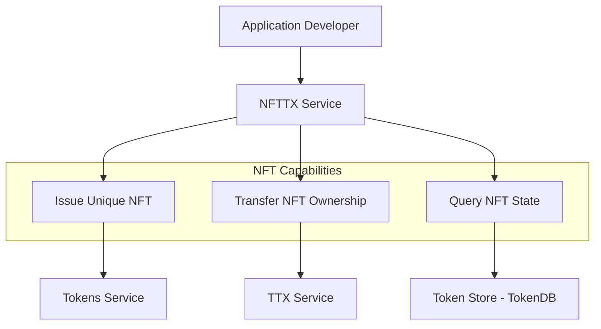

# NFTTX Service

The **NFTTX Service** (`token/services/nfttx`) provides specialized support for **Non-Fungible Tokens (NFTs)**. It extends the core token transaction capabilities to handle the unique properties and lifecycle requirements of NFTs, such as guaranteed uniqueness and rich metadata handling.

## Core Responsibilities

The NFTTX Service is responsible for:
*   **NFT Transaction Orchestration**: Managing the assembly and signing of transactions specifically involving NFTs.
*   **Uniqueness Enforcement**: Providing mechanisms to ensure that each NFT created has a globally unique identifier within its namespace.
*   **Metadata Management**: Handling the storage and retrieval of rich metadata associated with an NFT, which can include URIs, attributes, and ownership history.
*   **Querying NFTs**: Providing specialized APIs to query the current owner and state of specific NFTs.

## Interaction with Panurus Layers

The NFTTX Service is an **Application Service** that leverages the core Token API and other infrastructure services.



## Key Capabilities

### Guaranteed Uniqueness
Unlike fungible tokens, each NFT must be unique. The NFTTX Service often utilizes a specific `UniqueID` attribute in the token request. The service ensures that this identifier is correctly generated (e.g., using a UUID or a content-based hash) and validated by the token driver to prevent duplicates on the ledger.

#### The uniqueness service and its salt

`uniqueness.Service.ComputeID` derives an NFT's `UniqueID` from the state's JSON, so the
same state always yields the same id — that is how an issuer spots a duplicate. It keeps a
random 32-byte salt in a KVS, sampled once and reused, to stop anyone deriving ids for
guessable states.

> **Note:** the salt is not yet mixed into the digest, so today the id is a plain
> `sha256(json(state))` and that protection does not hold. See issue #2683.

Rotating the salt changes every id, so a salt that merely *failed to read* must never be
replaced. Presence is read with `KVS.Get`; there is deliberately no `Exists`-style probe,
because a bare `bool` cannot tell an absent key from an unreadable store (issue #2626).

A backend reports a missing key in one of two ways:

| Backend | Missing key |
|---|---|
| in-memory, badger | `uniqueness.ErrKeyNotFound` — wrap it (`errors.Wrapf`, or `errors.Join` to keep your own cause) so `errors.Is` still matches |
| hashicorp vault | a **nil error**, destination untouched |

`ComputeID` therefore treats an **empty** salt as absent, which covers both. Any other
error means the read failed: it is propagated, and nothing is written.

### Rich Metadata
NFTs often carry extensive metadata (e.g., links to digital artwork, serial numbers, or physical asset descriptions). The NFTTX Service provides standardized ways to include this metadata in the token request's metadata fields, ensuring it is properly signed and (if required by the driver) obfuscated on the ledger.

### Reading an NFT's State

An NFT keeps its state in the token's type field, as base64. `OutputStream.StateAt`
decodes it into a value you pass in:

```go
house := &House{}
if err := outputs.StateAt(0, house); err != nil {
    return errors.Wrap(err, "failed to get house state")
}
```

**Always check the error.** `StateAt` returns one when:

- `index` is outside the stream,
- the type is not valid base64,
- the type holds no state,
- the state does not fit the passed value.

On an error the passed value is useless: it is left empty or half-filled. On success it
has really been written to.

To read an NFT already in a wallet, use `OwnerWallet.QueryByKey`. It finds the NFT by a
field of its state and decodes it the same way. It returns `ErrNoResults` if nothing
matches.

### NFT Wallets
The service integrates with the **Identity Service** to manage specialized NFT wallets. These wallets are optimized for tracking ownership of distinct assets rather than aggregate balances, making it easy for applications to display a user's collection of NFTs.
