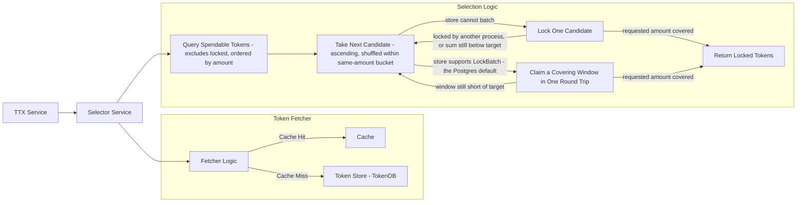

# Selector Service

The **Selector Service** (`token/services/selector`) picks the unspent tokens (UTXOs) that fund a transaction and holds them under a temporary lock while the transaction is assembled, so that concurrent transactions of the same wallet do not try to spend the same tokens.

## Core Responsibilities

The Selector Service is responsible for:
*   **UTXO Selection**: Finding a set of spendable tokens that cover the total quantity required for a transfer operation.
*   **Double-Spending Mitigation**: Temporarily locking selected tokens during the transaction assembly phase to prevent multiple concurrent transactions from attempting to spend the same tokens.
*   **Candidate Enumeration**: Walking the wallet's candidate tokens, locking each one as it is encountered, and stopping as soon as the accumulated amount covers the request. Under `sherdlock`, candidates already locked by another process are excluded from the query itself, and the remaining candidates are ordered ascending by amount with only same-amount candidates shuffled against each other (see [How Selection Works](#how-selection-works)). Under `simple`, candidates are walked in database order with no amount ranking.

## Interaction with TTX and Storage

The Selector Service bridges the gap between the high-level **TTX Service** and the internal **TokenDB**.



**How the components interact:**
- **Selector Service**: Creates a selector instance per transaction and orchestrates the Selection Logic steps.
- **Query Spendable Tokens**: Selector calls the Fetcher to retrieve available tokens.
- **Fetcher Logic**: Checks cache first (fast path), queries Token Store - TokenDB on cache miss (slow path).
- **Take Next Candidate**: Under `sherdlock`, the selector takes the next token from a candidate set ordered ascending by amount, with only same-amount candidates shuffled against each other, and already-locked tokens excluded from the set entirely. Under `simple`, candidates are taken in database order and amount plays no part in the choice.
- **Lock a candidate**: Whenever the lock store can claim several candidates in one round trip (the Postgres backend, under every `lockStrategy`), the selector grows a window of candidates up to the outstanding amount and claims the whole window at once instead of locking one token at a time. This is the actual hot path under Postgres, not a fallback; see step 3 ("Locking a candidate") of [the step-by-step walkthrough](#a-single-select-call-step-by-step-sherdlock).

## Key Components

### Selector Manager
The `SelectorManager` is the entry point for obtaining a `Selector` instance anchored to a specific transaction. It ensures that the selection process is consistent and tied to the lifecycle of a single token request.

## How Selection Works

Selection is a **greedy first-fit**: both drivers walk candidate tokens, locking each as it
is encountered, and stop as soon as the running sum covers the request. It is amount-aware
only in how it orders and groups candidates (see below); it is not a smallest-fit or
largest-fit strategy, and the number of inputs is not minimized. `Selector.selectInternal`
(`token/services/selector/sherdlock/selector.go`) is the sherdlock implementation; `simple`'s
equivalent is `selector.selectByID` (`token/services/selector/simple/selector.go`).

### A single `Select` call, step by step (sherdlock)

1. **Entry.** `StubbornSelector.Select` (for a manager-issued selector) or `Selector.Select`
   parses the requested quantity and calls `selectInternal`, which runs the loop below once.
   `StubbornSelector` wraps that single attempt in the backoff loop described in step 5.

2. **Next candidate.** `nextCandidate` asks the candidate cache for the next token, skipping
   anything this call has already lost a lock race on (the *blacklist*, scoped to one
   `Select` call — see [Ordering and the sufficiency window](#ordering-and-the-sufficiency-window)
   for how it picks among several candidates that would each cover the request alone). Three
   outcomes:
   - **Blacklisted token** → skipped, and the call remembers that a locked token exists
     (so an empty scan later isn't mistaken for "no funds anywhere").
   - **Scan exhausted (nil)** → go to step 5.
   - **Usable candidate** → go to step 3.

3. **Locking a candidate.** The selector type-asserts its locker for batch support once, up
   front (`asBatchLocker`/`BatchTokenLocker`). Whichever path is taken, the loop grows a
   *window* of candidates whose amounts sum to at least the amount still outstanding (or until
   the cache runs out, or until `maxBatchWindow = 256` candidates are collected — a cap needed
   because the Postgres claim statement binds `2n+5` parameters and the wire protocol refuses
   more than 65535), then claims it:
   - **Batch path (Postgres, every `lockStrategy`)**: one round trip claims the whole window via
     `BatchLocker.LockBatch`, which reports, per candidate, whether it was **won**, found
     **stale** (no longer spendable — spent, or no longer owned here), or neither (lost the
     race to another claimant). Won tokens are added to the running sum; stale candidates are
     blacklisted for good and the cache is told it's behind the store (one invalidation covers
     every stale candidate in the window); contended candidates are blacklisted for this call
     only, and the loop remembers that locked tokens exist.
   - **Single-token fallback** (no batch-capable locker): the same three outcomes, one
     `TryLock` call per candidate, distinguished by error sentinel
     (`driver.ErrTokenNotSpendable` = stale, `driver.ErrTokenAlreadyLocked` = contended, any
     other error = a genuine store error — counted separately, but handled identically to a
     lost race from the caller's point of view).
   - **Either path**: a lock denial wrapping `token.SelectorRateLimited` aborts the whole
     `Select` call immediately — it is not retried.

4. **Progress check.** If the running sum now covers the request, the call returns the
   selected token IDs. Otherwise it loops back to step 2.

5. **Exhaustion.** When the candidate scan comes up empty with no locked token observed, an
   empty result is ambiguous: it may mean the wallet is genuinely out of funds, or that every
   remaining token is momentarily locked by someone else and hidden from the scan by the
   anti-join (step 2 of [Ordering and the sufficiency window](#ordering-and-the-sufficiency-window)).
   `HasEnoughSpendableTokens` disambiguates with a lock-ignoring balance check against the
   **full requested amount** (not the amount still outstanding — the balance already includes
   tokens this call itself has locked, so comparing against the outstanding amount would count
   them twice and be vacuously true as soon as anything was selected):
   - **Balance insufficient** → `token.SelectorInsufficientFunds`, immediately.
   - **Balance sufficient** → the cache is refetched (charging one unit of a hardcoded
     `maxImmediateRetries = 5` budget; refetching is skipped for the very first fetch of a
     `Select` call, which starts with nothing to refresh) and the loop resumes from step 2.
     Once the budget is spent, the call gives up with
     `token.SelectorSufficientButLockedFunds` instead of refetching again.

6. **Backing off.** `StubbornSelector.Select` wraps the whole sequence above in an outer loop:
   on `SelectorSufficientButLockedFunds` it releases every lock this attempt took, sleeps a
   random interval uniform in `[0, retryInterval)`, and retries the entire selection from a
   fresh candidate cache. It sleeps after *every* failed attempt, including the last — so the
   worst case is `(numRetries + 1) * retryInterval` on average half that, not
   `numRetries * retryInterval`. Any other error, including `SelectorInsufficientFunds` and
   `SelectorRateLimited`, exits immediately without backing off.

### What `simple` does differently

`simple`'s `selectByID` is structurally similar — scan, lock, stop on cover, retry on
shortfall — but several things work differently, not just "the same minus sherdlock's
mechanisms":

- **No batching, no anti-join, no amount ordering.** Candidates come from the database in
  whatever order the query returns them, already-locked tokens are not excluded from the
  query, and each is locked with one call.
- **Locks are released between every retry attempt**, not held across them: a `simple` retry
  starts over with nothing locked, where sherdlock's immediate-retry layer keeps its
  already-won locks and only refetches the candidate source.
- **`reclaim`**: a lock attempt passes `reclaim = (numRetry == 1) || (this is not the first
  scan of this `Select` call)` — i.e. true on the very first attempt too when `numRetry == 1`,
  and from the second attempt onward otherwise. A reclaiming lock checks whether the current
  holder's consuming transaction has reached `Deleted` and, if so, takes the lock over.
- **A concurrency re-check after covering the request.** Once a scan's locked tokens cover the
  target, `simple` makes one more `GetTokens` call to confirm they still exist before
  returning them (see [`simple`: connection usage per selection](#simple-connection-usage-per-selection)
  for why this runs after the candidate cursor is closed, not while it's open).
- **Three possible outcomes on final failure, not one.** When the retry budget
  (`numRetry`) is exhausted, `simple` checks, in order: did the concurrency re-check fail on an
  earlier attempt → `token.SelectorSufficientFundsButConcurrencyIssue`; else are funds
  sufficient but some locked → `token.SelectorSufficientButLockedFunds`; else →
  `token.SelectorInsufficientFunds`. Sherdlock's backoff loop only ever ends in the latter two.
- **The retry sleep is skipped on the attempt that gives up for good** — `simple` sleeps
  between attempts but not after the final one, so its worst case is `numRetry - 1` sleeps
  uniform in `[0, retryInterval)`. The sleep is also a plain `time.Sleep`, not cancellable by
  the caller's context (sherdlock's backoff wait is).

### Error sentinels

`token/selector.go` declares five:

| Sentinel | Returned by `sherdlock` | Returned by `simple` |
|---|---|---|
| `SelectorInsufficientFunds` | yes | yes |
| `SelectorSufficientButLockedFunds` | yes | yes |
| `SelectorSufficientFundsButConcurrencyIssue` | no | yes |
| `SelectorSufficientButNotCertifiedFunds` | no | no — declared but currently returned by neither driver |
| `SelectorRateLimited` | detected (from the `Locker`/`BatchLocker`) and propagated, never produced by the selector itself | same |

### Ordering and the sufficiency window

Two `sherdlock`-only mechanisms shape which candidate the scan reaches first, both aimed at
the same problem: concurrent selectors of one wallet converging on the same token and
colliding (issue [#2395](https://github.com/LFDT-Panurus/panurus/issues/2395)).

1. **Anti-join against locked tokens.** The candidate query excludes any token currently held
   by a lock in the `TokenLocks` table (a `NOT EXISTS` against `TokenLocks`, in the shared
   query builder `buildSpendableTokensQuery`, `token/services/storage/db/sql/common/tokens.go`
   — used by both the unbounded iterator the selector reads and the bounded
   `QuerySpendableTokens`). This stops a selector from *starting* a race it is bound to lose;
   the lock acquisition itself remains the race-safe backstop, since this read-then-act check
   is not itself race-free. It's why an empty scan is ambiguous and needs the
   `HasEnoughSpendableTokens` check in step 5 above.

2. **Size-ordered, bucket-shuffled candidates.** Candidates are ordered ascending by amount
   (served straight from the `idx_spendable_amount_<prefix>` index on
   `(owner_wallet_id, token_type, amount)`, so no separate sort step is needed), then shuffled
   only *within* runs of byte-equal amount (`bucketedIterator.NewPermutation()`,
   `token/services/selector/sherdlock/fetcher.go`). A strict smallest-fit rule was deliberately
   avoided — it would just relocate all contention onto the single smallest token instead of
   spreading it. This shuffle only has something to randomize when several tokens share the
   same amount; on a wallet of mostly-distinct amounts every bucket has size 1, which is why
   mechanism 3 below exists. `NewPermutation`'s cost scales with the size of the cached
   candidate list and is paid on every cache hit under the `eager`/`mixed` fetcher strategies
   — see the [benchmark report](selector-postgres-benchmark-report.md#findings) for measured
   numbers; no optimization of it has been made as of this writing.

3. **The sufficiency window.** Because mechanism 2's shuffle only randomizes byte-equal
   amounts, a wallet of mostly-distinct amounts would otherwise deterministically send every
   small request to the single smallest token. `nextCandidate` widens the randomization for
   that case: once the ascending scan reaches an *anchor* candidate that alone covers the
   amount outstanding, every later candidate is also sufficient, so it peeks ahead over up to
   `sufficiencyWindow = 4` of them — stopping early at one whose amount exceeds
   `maxSufficiencyRatio = 5` times the *anchor's* amount, to keep the choice close to a
   smallest fit — and returns one chosen uniformly at random, buffering the rest (`pending`)
   so later calls still see them, in order, before anything newer. The magnitude cap is
   anchor-relative rather than outstanding-amount-relative on purpose: anchoring on the
   outstanding amount would reject the very first lookahead candidate on a wallet whose
   smallest token already exceeds 5x a small request, collapsing the window to size 1 in
   exactly the regime it exists for. Blacklisted candidates never enter the window (letting
   them in would spend part of the random pick on a guaranteed no-op) and the buffer is
   dropped at the start of every `Select` call and whenever a fresh candidate cache is
   installed, so a backoff retry re-examines the wallet fresh rather than replaying candidates
   peeked before other processes had a chance to release their locks.

The `driver` key does **not** select a selection algorithm — both drivers walk candidates
greedily and stop on first cover — only which of the mechanisms above apply; see
[What `simple` does differently](#what-simple-does-differently).

### Strategies that are not implemented

Deterministic amount-aware strategies — strict smallest-first, largest-first,
First-In-First-Out, or minimizing the number of inputs — are **not** implemented and cannot
be configured, even though `sherdlock` orders candidates ascending by amount (mechanism 2
above): that ordering is bucket-shuffled specifically to avoid becoming a deterministic
smallest-fit rule. There is no strategy abstraction in the code and no configuration key that
selects one. Making selection fully amount-aware (e.g. minimizing input count) is tracked in
[issue #2017](https://github.com/LFDT-Panurus/panurus/issues/2017).

## Locking Mechanism
To prevent double-spending *before* the transaction is committed to the ledger, the Selector Service uses a local `TokenLocks` table in the **Storage Service** (see "TokenLocks" box in diagram above).

**Lock lifecycle:**
1.  **Lock Acquisition**: When the selector takes a candidate token, it attempts to insert a record in the `TokenLocks` table.
2.  **Concurrency Control**: If another concurrent process has already locked that token, the insertion fails, and the selector moves on to the next candidate.
3.  **Lock Release**: Locks are released as soon as the transaction that took them reaches
    a terminal finality status (`Confirmed` or `Deleted`) — see "Release on settlement"
    below — with the lease-expiry sweep as a backstop for locks whose consumer never
    reaches finality (crashed or abandoned transactions, or `Orphan`).

#### Release on settlement

The finality path — `finality.Listener.runOnStatus` for the live subscription, and
`TTXRecoveryHandler.applyFinalityLogic` for recovery on restart — releases a
transaction's locks (`token.SelectorManager.Unlock`) the moment its status is known to
be terminal, for both `Confirmed` and `Deleted` alike: a failed transaction will never
spend the tokens it selected, so there is no reason to hold them either. This closes
the window, previously bounded only by `leaseExpiry` (default several minutes), during
which a settled transaction's already-spent-for tokens stayed locked and therefore
invisible to other selectors — the dominant source of lock contention on hot tokens
under concurrent load (issue #2395). A non-terminal status (`Busy`/`Unknown`) never
releases anything on either path: the transaction is still in flight, so dropping its
locks would let a concurrent selection re-offer the same tokens. The one other give-up path
that does release is `Listener.OnStatus` once its bounded retry budget is exhausted on a
transaction the ledger **rejected** (`network.Invalid`): a rejected transaction never spent
its inputs, so the token store's view of them is right whether or not the rejection was
persisted locally, and the locks protect nothing.

What the release needs is therefore not "the verdict is known" but "local state agrees with
the ledger". The success paths have that by construction — they release only after the status
persisted — and a rejection has it for free, because there is nothing to apply. Every other
outcome fails that test and keeps its locks, because handing the tokens of a possibly
in-flight transaction (or of one whose tokens are already spent on the ledger) to a
concurrent `Select` is strictly worse than holding them a few minutes longer. That covers
five cases:

*   `Busy`/`Unknown`: still in flight.
*   A status code the listener cannot classify at all (`ErrUnrecognizedStatus`).
*   `Listener.OnError` — the notification could not be delivered, which on the EVM driver is
    raised precisely when no verdict could be obtained (every poll in the finality window
    failed to reach the chain, or the watch ended without one).
*   **`network.Valid` whose local persistence kept failing.** The transaction committed and
    its inputs are spent on the ledger, but the retry budget ran out applying it locally, so
    the token store still shows those inputs as unspent. Releasing their locks hands them to
    a concurrent `Select`, which would build a transfer out of tokens that are already gone —
    a transaction that cannot validate, and an "insufficient funds" for the wallet that
    really does own them. The recovery sweep re-derives the status from the ledger, applies
    the request and releases the locks then.
*   An `OnStatus` retry loop on a rejection that was *interrupted* rather than exhausted,
    i.e. one whose context was canceled (node shutdown, or an abandoned notification).

The last case is easy to mistake for the release-worthy one, because
`utils.RetryRunner` reports it as an ordinary error — `ctx.Err()`, returned as soon as the
context is done, before the first attempt or from the backoff sleep between attempts — so
`OnStatus` decides by inspecting its own context rather than the error it was handed. That
distinction matters in both directions: a store error that merely *wraps*
`context.Canceled`/`context.DeadlineExceeded` from the store's own internal deadline, while
the listener's context is still live, is an ordinary persistence failure on a rejected
transaction and does still release. The recovery sweep, which re-derives the status from
the ledger, and the lease-expiry sweep behind it are the backstops that do not need to know
the verdict. Release is best-effort: a failure to unlock is logged and does not fail the
settlement or recovery path, since the lease-expiry sweep below still reclaims the lock
eventually.

Only the node that *selected* the tokens releases them. An auditor's finality listener
(`auditor.Service.Append`) and the recovery handler over an audit store are wired with
`finality.NewNoSelectorManagerProvider`, because an auditor inspects transactions assembled
and spent elsewhere and therefore holds no selection locks of its own: resolving a selector
manager there could only issue a `DELETE` matching zero rows, and would log a warning per
finalized transaction on a TMS with no usable selector manager.

#### Lease expiry

Every `leaseCleanupTickPeriod`, `sherdlock` runs a cleanup pass over the `TokenLocks`
table that releases a lock when **either** of the following holds.

> **Both `leaseExpiry` and `leaseCleanupTickPeriod` must be non-zero for the cleanup
> goroutine to start.** `Config.GetLeaseExpiry()`/`GetLeaseCleanupTickPeriod()` treat an
> unset *or* explicitly-zero YAML value the same way: 0 is substituted with the default
> (`leaseExpiry`: several minutes; `leaseCleanupTickPeriod`: about a minute), so writing
> `leaseExpiry: 0` in configuration does **not** disable the sweep — it silently falls
> back to the default instead. The sweep can only be disabled by an in-process caller
> that constructs `sherdlock.NewManager` directly with `leaseExpiry`/
> `leaseCleanupTickPeriod` of `0`, bypassing the `Config` getters; there is currently no
> supported way to disable the sweep from YAML configuration, by design — locks held by
> `Orphan` consumers, or by a consumer whose release-on-settlement call failed, would
> otherwise never be released and those tokens would remain permanently unselectable.
> If the sweep is disabled this way, `NewManager` logs a warning naming both values.

*   the **consuming** transaction — the one that took the lock, stored in
    `consumer_tx_id` — has reached `Deleted` or `Orphan`, so it will never spend the
    token; or
*   the lease is older than `leaseExpiry`, which covers the consumer that crashed or was
    abandoned without ever reaching a terminal status.

In the common case a lock is now released by "Release on settlement" above well before
its lease would expire; this pass remains the backstop for `Orphan` consumers (which the
finality path does not observe) and for any release-on-settlement call that failed.

Two properties of the pass are worth spelling out:

*   **The status that matters is the consumer's, not the producer's.** A lock row is keyed
    by `(tx_id, idx)`, which identifies the *locked token* and therefore the transaction
    that created it. That transaction's status says nothing about whether the lock is
    still live, so it is never used to expire a lease.
*   **Expiry is per token, not per transaction.** Only the affected `(tx_id, idx)` rows are
    deleted; the other outputs of the same transaction keep their locks.

The pass is the same statement on every SQL backend (SQLite and Postgres), so lock
expiry behaviour is identical across those backends. `created_at` is stored as
`TIMESTAMPTZ`, so the comparison with the database-side `NOW()` expression is always
timezone-consistent on Postgres regardless of the session `TimeZone` setting.
On Postgres a single replica per TMS runs the pass per tick, elected through an advisory
lock; SQLite is non-distributed and always runs it locally.

The in-memory locker described below does not use the `TokenLocks` table and never
expires locks via `Cleanup`; its lifecycle is entirely managed in process.

#### Lock-acquisition strategies (Postgres, `sherdlock` only)

The Postgres `TokenLockStore` supports three lock-acquisition strategies, selected via
`token.storage.db.lockStrategy` (see [Configuration](#configuration)). SQLite and `simple`
are unaffected: SQLite's `LoadStorageConfig` call reads and ignores the key, and `simple`
never reaches this configuration path at all.

*   **`insert` (default).** A plain `INSERT` into `TokenLocks`; a lost race surfaces as a
    server-side unique-constraint violation on `(tx_id, idx)`, caught and translated to
    `driver.ErrTokenAlreadyLocked`.
*   **`onConflict`.** `INSERT ... ON CONFLICT (tx_id, idx) DO NOTHING RETURNING`; a lost
    race is a clean zero-row result instead of a server-side error.
*   **`skipLocked`.** Behaves like `onConflict` for a single-token `Lock` call, and
    additionally implements `BatchLocker.LockBatch`: given a covering window of candidate
    `(tx_id, idx)` pairs, it claims them in one statement using
    `FOR UPDATE OF <tokens> SKIP LOCKED` against the `Tokens` rows, joined with the same
    `INSERT ... ON CONFLICT DO NOTHING` backstop, so a claimant walks past a row a
    concurrent claimant is already mid-claim on instead of colliding with it.

Under every strategy `LockBatch` inserts the lock rows in `(tx_id, idx)` order, whatever order
the caller listed its candidates in, rather than leaving the order to the query planner. The
candidates are shuffled within equal-amount runs (see
[Ordering and the sufficiency window](#ordering-and-the-sufficiency-window)), so concurrent
claimants list overlapping windows in different orders; inserting the same keys in different
orders makes the claims wait for each other and deadlock, which Postgres reports only
after `deadlock_timeout` (1 s by default). Fixing the insertion order removed a deadlock that
previously cost a second plus a retry on every occurrence — see the
[benchmark report](selector-postgres-benchmark-report.md#findings) for the measured
before/after throughput.

**What each strategy actually changes, precisely — the mechanism has a narrower effect
than "reduces lock contention" might suggest:**

*   **Server-side unique-constraint errors are eliminated only for callers that take the
    single-token `Lock` path directly.** `Selector.selectInternal` discovers the capability
    through `sherdlock.asBatchLocker` and, when present (i.e. under Postgres
    regardless of strategy, since `LockBatch` is defined on the strategy-aware store),
    always claims its covering window through `LockBatch` — which already issues
    `INSERT ... ON CONFLICT DO NOTHING` under every strategy, `insert` included.
    `insert`'s error-surfacing single-token `Lock` path is therefore not on `sherdlock`'s
    hot path at all; it only matters for a `Locker` implementation that does not satisfy
    `BatchLocker` (a custom or older backend, or a rolling deploy where some replicas have
    not yet upgraded). This is the case `postgres.TokenLockStore.RoundTrips()` and
    `.UniqueViolations()` are instrumented to measure directly, rather than being inferred
    from a conflict-rate benchmark, which cannot see it.
*   **`FOR UPDATE SKIP LOCKED` only helps against a genuinely simultaneous holder, not
    against an already-committed lock — the dominant conflict mode under load.** It lets a
    claimant skip a row a rival transaction is mid-claim on *at that exact instant*; it does
    nothing for a row whose lock row was already committed moments earlier, which loses the
    race the same way under every strategy. This is why `skipLocked` does not come out ahead
    on the measured workloads — see the
    [benchmark report's recommendation table](selector-postgres-benchmark-report.md#recommendation-by-workload):
    for multiple nodes on one database, use the `insert` default or `onConflict`; avoid
    `skipLocked`.
*   **Round-trip reduction comes from batching the claim into one statement per covering
    window, not from strategy choice.** `LockBatch` issues exactly one round trip per
    window under every strategy (`onConflict`/`insert` via a multi-row
    `INSERT ... ON CONFLICT DO NOTHING`, `skipLocked` via the `FOR UPDATE SKIP LOCKED` join
    above). The saving comes from the batch claim itself (`BatchLocker`), which all three
    strategies share once configured; `lockStrategy` chooses only *how* that one round trip
    claims the window, not *whether* claiming is batched.

**A batched claim reports *why* a candidate was not won, not just that it was not.** The claim
statement answers with the tokens it won and, separately, the candidates it refused because they
are no longer spendable — spent, marked unspendable, or no longer owned here — leaving "another
claimant holds it" as the remainder (`driver.BatchLockOutcome`). The selector needs the
distinction because the two call for opposite handling: a contended candidate is worth retrying
and keeps the caller backing off, while a stale one can never come back and is instead dropped
for good, counted under `stale_candidates_total`, and taken as proof that the candidate snapshot
is behind the store, so the cache is refreshed within the same `Select` call. Classifying costs
no extra round trip — all three verdicts are read off the one statement — but under `skipLocked`
it does require the spendability predicate to be evaluated a second time without the row lock,
since a row `FOR UPDATE SKIP LOCKED` walks past is a contended row and must not be reported as
unspendable. A backend that cannot distinguish the two may report winners only, in which case
every unwon candidate reads as contended; that is sound but blind.

**Discovering the capability.** `BatchLocker` is optional and resolved at runtime, which makes
*how* it is looked up part of the mechanism rather than a detail. The `Locker` the manager is
built with is a `*tokenlockdb.StoreService`, and that type embeds the `driver.TokenLockStore`
**interface** — embedding an interface promotes only that interface's method set, and no driver
interface declares `LockBatch`, deliberately, since not every backend can batch. A plain type
assertion on the wrapper therefore reports "cannot batch" even under Postgres, which would take
this whole mechanism out of every deployment while leaving every test green. `asBatchLocker`
looks at the value *and* at the store it wraps (`StoreService.Unwrap`), and still reports
absence truthfully for a backend that genuinely cannot batch, so the fallback keeps working.

**The window is capped.** A covering window grows until it covers the outstanding amount, which
is unbounded in the *number* of tokens: a wallet of unit-value dust needs one input per unit.
Since the Postgres claim binds `2n+5` parameters and the wire protocol refuses more than 65535,
`maxBatchWindow` (256) bounds a single claim. This does not change what gets selected — the
scan simply claims another window when one is not enough, exactly as it already does when the
candidate cache runs out mid-window — but it keeps a large selection on the batch path instead
of turning it into a store error that the retry budget then burns through.

### In-Memory Locker Internals

The `simple` driver keeps its locks in memory (`token/services/selector/simple/inmemory`)
instead of the `TokenLocks` table. Its state is sharded per owner (the wallet the tokens
are selected for): every owner has its own `shard`, holding that owner's locked tokens
behind its own mutex, and the shards themselves live in a registry map behind a second
mutex. Two owners therefore never serialize against each other, not even while a lock
attempt is waiting on a transaction-status lookup.

Two invariants keep the two mutex levels safe:

*   **Lock order is shard first, registry second.** The only place that takes the
    registry lock while holding a shard lock is the pruning of an empty shard, which must
    observe the shard as empty while holding it. Every operation that needs to walk all
    shards (`IsLocked`, `UnlockByTxID`, the background collector, the locked-token count)
    therefore snapshots the registry, releases the registry lock, and only then takes the
    individual shard locks. Taking the two in the opposite order deadlocks the locker.
*   **A pruned shard is never written to.** When a shard becomes empty it is removed from
    the registry and marked as pruned. A `Lock` that had already obtained that shard
    re-checks the mark under the shard lock and retries on the freshly registered shard,
    so a lock can never end up in a shard no other operation can reach. Pruning also
    removes the registry entry only if it still points at that exact shard, so a stale
    empty shard cannot evict a newer shard holding live locks.

The background collector (the goroutine that frees locks of finalized transactions) copies
a shard's entries, releases the shard lock, and only then looks the transaction statuses
up, so a slow status provider never blocks locking or unlocking. Because the shard is
unlocked in between, each entry is re-validated before removal — same transaction ID and
same last-access time — and entries that were reclaimed or re-accessed meanwhile are kept.

### `simple`: connection usage per selection

One in-flight `Select` under the `simple` driver needs **one** database connection at a time,
not two. This is worth stating explicitly because it used not to hold: `selectByID`
(`token/services/selector/simple/selector.go`) ran its concurrency re-check — a second query,
confirming the tokens it just locked still exist — while the candidate cursor from
`UnspentTokensIteratorBy` was still open. Each selection therefore held two connections for
the duration of that re-check, and a pool smaller than the number of concurrent selectors
could deadlock outright: every connection in the pool handed to an open cursor, every
goroutine blocked waiting for a second one that only another goroutine could release.

`selectByID` now closes the cursor before the re-check — the candidate scan is finished with
it by then, and a retry opens a fresh one — so the pool only has to accommodate the number of
concurrent selectors, with no doubling. `TestSimpleDriverBoundedPool`
(`token/services/selector/simple/contention_test.go`) pins this by driving 16 concurrent
selectors against a pool of 2; restoring the overlapping checkout makes it stall.

The `sherdlock` driver was never exposed to this: its fetcher reads the candidate set fully
into memory (and, under the cached and mixed strategies, usually answers from the cache
without a query at all) rather than iterating a live cursor across other queries.

> **A second, still-open overlap exists on the in-loop reclaim path.** The fix above covers the
> *post-loop* concurrency re-check only. While the candidate cursor is open, each `Lock` call
> made with `reclaim=true` (true from the second scan attempt onward, or from the first when
> `numRetry == 1`) resolves the current holder's status via a nested query
> (`inmemory.locker.lockInShard` → `ttxdb.GetStatus`), which needs a second connection while
> the cursor still holds the first. Under sustained contention with enough concurrent
> selectors relative to pool size, this can still deadlock the whole pool — reproduced by the
> `production-shape` benchmark workload at a 250ms hold time with 16 clients against a pool of
> 10. Tracked as [issue #2474](https://github.com/LFDT-Panurus/panurus/issues/2474); not fixed
> as of this writing.

## Token Fetcher and Cache

The selector uses a **Token Fetcher** to retrieve available tokens from the database. The fetcher uses a **Ristretto cache** (admission/eviction via TinyLFU, not LRU) to improve performance by caching token queries (keyed by wallet+currency).

**Flow**: `Selector.Select()` → `Fetcher.UnspentTokensIteratorBy(wallet, currency)` → `Token Iterator`

**How it works:**
1. Selector requests tokens from Fetcher for a specific wallet and currency
2. Fetcher checks its cache (keyed by wallet+currency)
3. If cache is fresh, returns cached tokens immediately (fast path)
4. If cache is stale, queries database and updates cache
5. Selector iterates through tokens, attempting to lock each one
6. If insufficient tokens, selector requests fresh data and retries

**Iterator lifecycle:** the iterator the fetcher hands out owns a resource — on the lazy
path it wraps the query's `sql.Rows`, and therefore a database cursor and its pooled
connection — so exactly one `Close()` per iterator is required. The selector holds at most
one iterator at a time: step 6 above closes the iterator it displaces before installing the
refreshed one, and `Selector.Close()` closes whichever is current. Both happen under the
selector's mutex, so closing a selector while a retry is in flight neither leaks an iterator
nor races with the retry.

**Adaptive refresh strategy** with two triggers, which differ in who pays for the refresh:
- **Time-based**: Refreshes when data is older than `fetcherCacheRefresh`. This refresh is
  synchronous — the requesting goroutine runs the query itself and waits for it. An
  untouched cache counts as stale, so the first request after startup always pays for it.
- **Query-based**: Refreshes after `fetcherCacheMaxQueries` queries to prevent serving stale
  data in high-throughput scenarios. This refresh runs in the background, and the request
  that triggered it is still answered from the current cache.

Either way the refresh is a single query for *all* wallets and currencies
(`SpendableTokensIteratorBy` with empty arguments), not one per cache key.

A third trigger is explicit: the selector calls `InvalidateCache` on two occasions, both
counted under `cache_invalidations_total`.

*   **A claim proved the snapshot wrong**: a candidate the lock refused as no longer
    spendable (a stale candidate, see above).
*   **A scan ran out of candidates before covering the request**, and the selector is about
    to refetch. Re-reading the same snapshot would not be a retry at all: the candidate query
    hides tokens locked by anyone, so a lock another process released since the snapshot was
    taken is *not in it* and cannot appear by reading it again — and neither can a token this
    call locked itself disappear from it. Without the invalidation the eager and mixed
    strategies hand back the identical set until `fetcherCacheRefresh` expires, spending the
    whole immediate-retry budget to re-read it and failing with
    `SelectorSufficientButLockedFunds` on a wallet that can pay. The lazy strategy reads
    through and implements no `CacheInvalidator`, so nothing is forced or counted for it.

    The **first** fetch of a selection is exempt. A `Select` starts with an empty candidate
    cache, so it always refetches once before anything is known to be stale; forcing a
    refresh there would re-read the whole token store on every call and leave the caching
    strategies doing strictly more work than the lazy one they exist to avoid.

An invalidation is not the same as "mark it old" — it must also beat a refresh that is already in flight. A refresh releases the lock
for the duration of its query, so one that started earlier is holding a snapshot that cannot
contain whatever caused the invalidation; stamping it fresh would swallow the invalidation
for a whole `fetcherCacheRefresh` interval. The fetcher therefore counts invalidations and
compares the count before and after its query. A snapshot that has been overtaken is
**installed but not stamped fresh**: readers get the newer data, the cache stays stale, and
the next request pays for a refresh that reads *after* the invalidation. Invalidation never
empties the cache. Installing the overtaken snapshot, rather than discarding it, matters under
sustained invalidation: see the [benchmark report](selector-postgres-benchmark-report.md#findings)
for the measured effect of each rule on a continuously-settling wallet. `lazy` reads through
and is not affected.

### Fetcher strategies

`fetcherStrategy` picks which of the three implemented fetchers the `sherdlock` driver uses
(`token/services/selector/sherdlock/fetcher.go`). These are the only accepted values, and an
unrecognized one makes the node fail to start rather than falling back silently:

| `fetcherStrategy` | Behaviour | Cache keys apply |
|---|---|---|
| `mixed` (default) | On every request, peeks the eager cache's iterator for that wallet and currency; serves from it when non-empty, falls back to a database query otherwise. | yes |
| `eager` | Always answers from the cache, never from a query scoped to the requested wallet. The cache itself is refreshed on the two triggers above, so a request that finds it stale does pay for the refreshing query inline. | yes |
| `lazy` | Always queries the database and keeps no cache at all. | no |

The trade-off is staleness against query load. `lazy` never offers a token that was already
spent, at the cost of one query per selection request; `eager` amortizes its queries over many
requests — most are answered from memory, and the ones that refresh a stale cache pay for a
single query covering every wallet — but it can offer tokens spent since the last refresh,
which the selector then fails to lock and retries over. `mixed` is the default because it
takes the cache's fast path only when the cache has
something to say about the wallet, and pays for a query otherwise. Which path `mixed` takes is
observable: the `panurus_services_selector_sherdlock_unspent_tokens_invocations` counter is
incremented with `fetcher_type` set to `eager` or `lazy` on every request. Only `mixed`
reports it — under `eager` and `lazy` there is no choice to record, and the counter stays at
zero (see [Metrics](../development/metrics.md)).

The choice is per node, not per TMS: one strategy is resolved at startup and every TMS's
fetcher is built from it.

## Configuration

Configure the selector service in your `core.yaml`:

```yaml
token:
  selector:
    driver: sherdlock                    # Selector implementation and locking backend: sherdlock | simple (default: sherdlock)
    numRetries: 3                        # Retry attempts for token selection (default: 3)
    retryInterval: 5s                    # Wait time between retries (default: 5s)
    leaseExpiry: 3m                      # Lock expiration time (default: 3m)
    leaseCleanupTickPeriod: 1m           # Lock cleanup interval (default: 1m)
    fetcherStrategy: mixed               # Token fetcher: mixed | eager | lazy (default: mixed)
    fetcherCacheSize: 1000               # Cache size in Ristretto cost units (default: 0 = use fetcher default)
    fetcherCacheRefresh: 30s             # Cache refresh interval (default: 0 = use fetcher default)
    fetcherCacheMaxQueries: 100          # Max queries before cache refresh (default: 0 = use fetcher default)
    rateLimitEnabled: false              # Opt-in per-wallet selection rate limiter (default: false)
    rateLimit: 100                       # Requests per second per wallet, once enabled (default: 100)
    rateLimitBurst: 200                  # Burst capacity per wallet, once enabled (default: 2x rate)
    rateLimitMaxBuckets: 4096            # Live wallet buckets the limiter keeps in memory (default: 4096)
  storage:
    db:
      lockStrategy: skipLocked           # Postgres lock-acquisition strategy: insert | onConflict | skipLocked (default: insert)
```

`lockStrategy` is read by the Postgres storage driver, independently of `selector.driver`
above (see [Lock-acquisition strategies](#lock-acquisition-strategies-postgres-sherdlock-only)).
It has no effect under SQLite or `simple`.

### Defaults reference

| Key | Default | Source | YAML-configurable |
|---|---|---|---|
| `driver` | `sherdlock` | `token/sdk/dig/sdk.go`'s `selectorProviders` map resolves `token.selector.driver` directly (`Simple`, `Sherdlock`, and `""` all map to a constructor, `""` landing on sherdlock); `config.Config.GetDriver()`/`defaultDriver` (`config/driver.go`) exist but have no production caller | yes |
| `numRetries` | `3` | `config/driver.go` `defaultNumRetries` | yes |
| `retryInterval` | `5s` | `config/driver.go` `defaultRetryInterval` | yes |
| `leaseExpiry` | `3m` | `config/driver.go` `defaultLeaseExpiry` | yes |
| `leaseCleanupTickPeriod` | `1m` | `config/driver.go` `defaultLeaseCleanupTickPeriod` | yes |
| `fetcherStrategy` | `mixed` | `sherdlock/fetcher.go` `DefaultFetcherStrategy` | yes (sherdlock only) |
| `fetcherCacheSize` | `0` → Ristretto `MaxCost = 1e8` cost units (cost-per-entry is 1, so effectively up to 100M cached wallet+currency entries) | `token/services/utils/cache/ristretto.go` `DefaultMaxCost`, via `cache.NewDefaultRistrettoCache` | yes |
| `fetcherCacheRefresh` | `0` → `1s` | `sherdlock/fetcher.go` `defaultCacheFreshnessInterval` | yes |
| `fetcherCacheMaxQueries` | `0` → `5` (same constant as `maxImmediateRetries`, see below — not an independent number) | `sherdlock/fetcher.go` `defaultCacheMaxQueries` | yes |
| `storage.db.lockStrategy` | `insert` | Postgres `TokenLockStore` | yes, Postgres only |
| `rateLimitEnabled` / `rateLimit` | rate limiting off | `ratelimit/limiter.go` | yes |
| `rateLimit` (once enabled, unset) | `100` req/s per wallet | `ratelimit.DefaultRate` | yes |
| `rateLimitBurst` (once enabled, unset) | `rate * 2`, i.e. `200` by default | `ratelimit.DefaultBurstFactor` | yes |
| `rateLimitMaxBuckets` | `0` → `4096` live wallet buckets | `ratelimit.DefaultMaxBuckets` | yes |
| — rate limiter idle timeout | `5m` | `ratelimit.DefaultIdleTimeout` | **no** — not exposed via `Config` |
| — `sufficiencyWindow` | `4` | `sherdlock/selector.go` | **no** — hardcoded constant |
| — `maxSufficiencyRatio` | `5` | `sherdlock/selector.go` | **no** — hardcoded constant |
| — `maxImmediateRetries` | `5` | `sherdlock/selector.go` | **no** — hardcoded constant |
| — `maxBatchWindow` | `256` | `sherdlock/selector.go` | **no** — hardcoded constant |

The last five rows are not reachable from `core.yaml` at all. They materially shape contention
behavior — the sufficiency window spreads selection across same-sized tokens, the batch window
caps how many candidates one claim covers — but changing them requires a code change, not a
configuration change. If a deployment's token-amount distribution or contention pattern doesn't
fit these shipped values, that is tracked as a selection-algorithm question under
[issue #2017](https://github.com/LFDT-Panurus/panurus/issues/2017), not something to look for a
YAML key for.

### Guidelines: choosing non-default values

- **`storage.db.lockStrategy`: the default `insert` is the right choice for most deployments —
  do not switch to `skipLocked` on the strength of its name alone.** `FOR UPDATE SKIP LOCKED`
  only helps against a holder that is *simultaneously* mid-claim; it does nothing for a lock
  already committed moments earlier, which is the dominant conflict mode under load (see
  [Lock-acquisition strategies](#lock-acquisition-strategies-postgres-sherdlock-only)). The
  [benchmark report's recommendation table](selector-postgres-benchmark-report.md#recommendation-by-workload)
  concurs: for multiple nodes on one database, use the `insert` default or `onConflict`; avoid
  `skipLocked`.
- **`retryInterval` / `numRetries`: lower `retryInterval` for latency-sensitive callers that
  would rather fail fast and let the caller retry; raise `numRetries` only knowing it is not a
  free extra attempt.** Both drivers jitter their backoff sleep uniformly in
  `[0, retryInterval)` — `sherdlock/selector.go`'s `rand.Int64N(backoffInterval)` and
  `simple/selector.go`'s `retryBackoff()` use the identical pattern — so quoting the configured
  value as a fixed per-retry delay overstates the typical case by roughly 2x. Sherdlock's
  `StubbornSelector` loop sleeps after every attempt including the one that has already failed
  for good, so its worst case is `(numRetries + 1) * retryInterval`, not
  `numRetries * retryInterval`; raising `numRetries` by one therefore always costs one more full
  backoff sleep on a selection that was going to fail anyway, not just one more chance to
  succeed. `simple` does **not** sleep after its final failed attempt, so raising its
  `numRetries` costs one less sleep than the equivalent sherdlock change.
- **`fetcherStrategy`: default `mixed` is right for most deployments.** Use `lazy` only for
  low-throughput or correctness-critical wallets that cannot tolerate being offered a
  since-spent token (at the cost of one query per selection). Reach for `eager` only after
  `mixed`'s fallback-to-query path is itself shown to be the bottleneck — `eager` amortizes
  queries over more requests but is exposed to staleness on every one of them, not just the
  ones `mixed` would have queried anyway.
- **Rate limiting defaults are a safety net, not a general throughput control.** `100` req/s
  per wallet with a burst of `200` is generous; lower it deliberately to protect a specific hot
  wallet from a runaway retry storm once you've observed one, rather than as a first lever when
  tuning for throughput. No workload in `BenchmarkSelectorPostgres` currently exercises rate
  limiting — it is an orthogonal contention knob the existing workloads are blind to.
- **The hardcoded sufficiency-window and batch-window constants are not tuning knobs.** If a
  deployment's amount distribution or contention pattern genuinely doesn't fit them, that is a
  code change against issue #2017, not a configuration adjustment.

### Driver

`driver` selects the selector implementation and, with it, the locking backend:

- **sherdlock** (default): locks in the `TokenLocks` table of the Storage Service, with
  leases governed by `leaseExpiry` and `leaseCleanupTickPeriod`.
- **simple**: keeps its locks in memory (see [In-Memory Locker Internals](#in-memory-locker-internals)).

See [What `simple` does differently](#what-simple-does-differently) for the full behavioral
comparison beyond locking backend and amount ordering — retry semantics, which locks survive
a retry, and the extra `simple`-only error sentinel all differ too.

### Fetcher Configuration

- **fetcherStrategy**: Which fetcher serves selection requests — `mixed` (default), `eager` or
  `lazy`. See [Fetcher strategies](#fetcher-strategies). Leave it unset to take the default;
  any other value than the three above aborts startup.

The three keys below tune the cache that `mixed` and `eager` use, and are ignored by `lazy`:

- **fetcherCacheSize**: Maximum number of cached query results, in Ristretto cost units (cost-per-entry is 1, so effectively a cap on entries). Set to 0 to use the fetcher's default size.
- **fetcherCacheRefresh**: Time interval after which cached data is considered stale and refreshed. Set to 0 to use the fetcher's default interval.
- **fetcherCacheMaxQueries**: Maximum number of queries before forcing a cache refresh. Set to 0 to use the fetcher's default limit.

**Example**: With `fetcherCacheSize: 1000`, `fetcherCacheRefresh: 30s`, and `fetcherCacheMaxQueries: 100`, the cache stores up to 1000 query results, refreshes data every 30 seconds, and forces a refresh after 100 queries.

## Benchmarking against Postgres

`BenchmarkSelectorPostgres` in `token/services/selector` measures the selectors against a real
database. It complements the in-memory `BenchmarkSelectorSingle` and `BenchmarkSelectorParallel`,
which isolate the selector logic but cannot see the spendable query, the lock inserts, the lock
strategies, connection pools or several nodes sharing a database.

### Configurations

A case name encodes its configuration, e.g. `sherdlock+mixed+skipLocked+batch+clean+conns10`.
By default the baseline (all production defaults) is swept one axis at a time:

| Axis | Values | Default |
|---|---|---|
| driver | `sherdlock`, `simple` | `sherdlock` |
| `token.selector.fetcherStrategy` | `lazy`, `eager`, `mixed` | `mixed` |
| `token.storage.db.lockStrategy` | `insert`, `onConflict`, `skipLocked` | `insert` |
| batch locking | `batch` (`LockBatch`), `single` (one `Lock` per token) | `batch` |
| lease cleaner | `clean`, `noclean` | `clean` |
| pool size | `conns10`, `conns50` | 10 |
| replicas | 1, 3 (`multi-replica`) | 1 |

`PANURUS_SELECTOR_BENCH_MATRIX=full` replaces the sweep with the cross product of fetcher, lock
strategy and batch locking, plus a `simple` configuration appended.

### Workloads

| Workload | What it exercises |
|---|---|
| `uncontended` | One client, 10k-token wallet, select 100 and release: the per-`Select` latency floor |
| `wallet-size` | 1k / 100k (optionally 1M) tokens: how the spendable query, fetcher and lock anti-join scale |
| `selection-size` | 1 / 10 / 100 / 500 tokens per `Select`: the sufficiency window and the `LockBatch` window limit |
| `fragmented` | Power-law denominations; one case per request size (50 / 500 / 5000) plus a mix, so a tail can be attributed to a size |
| `hot-wallet` | 16 clients on one wallet holding 1.5x their demand: lock conflicts and retries. Also carries a `retry=20ms`/`retry=5s` pair over sherdlock default + `simple`, corroborating `near-exhaustion`'s retry-interval axis on a second workload |
| `hot-wallet-distinct-amounts` | The hot wallet with every token of a different amount, so concurrent batches list candidates in the same order; separates ordering effects (deadlocks) from contention |
| `disjoint-wallets` | 16 clients, one wallet each: database and pool cost without logical contention |
| `multi-replica` | The hot wallet served by 3 nodes on one database (the #2395 shape) |
| `settle` | Select, spend the inputs and re-create outputs in one store transaction, release: the full lifecycle with churning token IDs. Run at 5 inputs per transaction (a typical transfer) and 100 (a stress case: settlement holds a pooled connection for ~250 ms, and with more clients than connections every `Select` queues behind it) |
| `near-exhaustion` | Wallet holds what 10 of 16 clients need and each selection stays locked for 3 ms, so demand can exceed supply; retries absorb most shortages, so this mostly measures retry cost. Runs `retry=20ms` (benchmark default) over the 4 `coreConfigs()` rows and `retry=5s` (production default) over sherdlock default + `simple`, to test whether retry interval changes the sherdlock-vs-simple ordering — see the benchmark report for the resolved finding |
| `production-shape` | Like `near-exhaustion`, but with a hold time of 50ms/250ms — closer to a real transaction's endorsement-collection window — on sherdlock default and `simple`. Throughput is hold-bound (capped near `clients/hold`, ≈64/s at best for the 250ms case), not selector-bound; `p50/p95/p99-ms` and `contended/op` are the metrics that actually say something about the selector. `simple`'s case runs with a larger pool than its production default to avoid a connection-pool deadlock under sustained hold (see [issue #2474](https://github.com/LFDT-Panurus/panurus/issues/2474)) |
| `stale-locks` | 30% of the wallet locked by a crashed replica, lease cleaner on and off |

Run it with `make benchmark-selector-postgres` (see `token/services/selector/README.md` for the
filters and environment variables).

Measured results and per-workload recommendations: [selector-postgres-benchmark-report.md](selector-postgres-benchmark-report.md).
